# Звіт до лабораторної роботи: система управління лікарнею

PostgreSQL 16 · Node + Express + TypeScript + `pg` (без ORM) · React + Vite · pnpm + Turborepo.
Специфікація: [`01-requirements.md`](01-requirements.md), [`02-sql-objects.md`](02-sql-objects.md), [`03-architecture.md`](03-architecture.md).
Відхилення від специфікації: [`05-decisions.md`](05-decisions.md). Довідник SQL API: [`packages/db/SQL_API.md`](../packages/db/SQL_API.md).

Запуск з нуля:

```bash
docker compose up -d db     # postgres:16 на localhost:5434
pnpm install
pnpm db:reset               # міграції + seed (≈10k пацієнтів, ≈100k прийомів)
pnpm dev                    # API :4000 (Swagger /api/docs), UI :5173
```

## 1. Відповідність вимогам

| # | Вимога | Де реалізовано | Як перевірити |
|---|---|---|---|
| 1 | Схема БД зі зв'язками, ключами, полями | `packages/db/migrations/002_tables.sql:5` (27 таблиць, PK/FK/CHECK/UNIQUE/EXCLUDE), циклічний FK `departments ↔ doctors` через `ALTER TABLE` у `002_tables.sql:65`; ER-діаграма — §6 | `docker exec clinic-db psql -U clinic -d clinic -c '\dt'` |
| 2 | ≥ 15 сутностей | 26 предметних таблиць + `audit_log` (27; `schema_migrations` — службова) | каталожний запит у §2 → `tables = 28` |
| 3 | Soft delete; дата й автор останньої зміни | 8 таблиць з `deleted_at/deleted_by`, 20 з `created_*/updated_*` і тригером аудиту (`002_tables.sql:23`); тригери `tf_set_audit_fields`, `tf_audit_log`, `tf_soft_delete`, `tf_forbid_delete` — `004_audit_softdelete.sql:10,30,70,82`, підключення циклом `DO` — `004_audit_softdelete.sql:90`; `sp_soft_delete` / `sp_restore` — `004_audit_softdelete.sql:118,143`; автор передається з UoW через `set_config` — `apps/api/src/db/UnitOfWork.ts:51` | §4 (демо через API), `pnpm --filter @clinic/db test` (тести `updated_by from set_config`, `soft delete`, `restore`), `pnpm --filter @clinic/api test` (`apps/api/tests/audit.test.ts:6`) |
| 4 | Реалізація у СУБД | PostgreSQL 16 (`docker-compose.yml`), 8 SQL-міграцій `packages/db/migrations/001…008` | `docker exec clinic-db psql -U clinic -c 'select version()'` |
| 5 | ≥ 10 процедур / функцій / тригерів / view | 23 функції, 26 процедур, 58 тригерів, 28 view + 1 materialized view: `005_functions.sql`, `006_procedures.sql` (напр. `sp_appointment_book` :126, `sp_discharge_patient` :435, `sp_payment_register` :579), `007_business_triggers.sql` (`trg_admissions_bed_status` :18, `trg_invoice_items_recalc` :48), `008_views.sql` (`v_patients` :40, `v_audit_log` :247, `v_deleted_records` :253, `mv_monthly_revenue` :282) | каталожний запит у §2; `pnpm --filter @clinic/db catalog` |
| 6 | Індекси ≥ 2 типів | `packages/db/migrations/003_indexes.sql`: B-tree :6, unique :29, partial unique :29–33, partial :36, expression :41, GIN trgm :44, GIN jsonb :48, BRIN :51–52, covering :55; GiST — `EXCLUDE USING gist` у `002_tables.sql:151,204` | §3 + [`packages/db/reports/explain.md`](../packages/db/reports/explain.md) (`pnpm --filter @clinic/db explain`) |
| 7 | Repository + Unit of Work; запити лише через процедури/функції/view | `apps/api/src/db/UnitOfWork.ts:42` (один client, `BEGIN` + `set_config`, ліниві репозиторії :25–35, `run()` з commit/rollback :47), `apps/api/src/db/BaseRepository.ts:15` (лише `one/many/call/callReturningId`), репозиторії `apps/api/src/repositories/*` (напр. `PatientRepository.ts:20,24,42`), сервіси `apps/api/src/services/VisitService.ts:8`, `InpatientService.ts`, `RegistrationService.ts`; перевірка `apps/api/scripts/check-sql-access.ts` | `pnpm --filter @clinic/api check:sql-access`; rollback-тест `apps/api/tests/scenarios.test.ts:134` (§5) |

Бізнес-правила BR-1…BR-10 мають позитивний і негативний тест у `packages/db/tests/rules.test.ts` (25 тестів).

## 2. Кількість SQL-об'єктів (каталог)

Запит (`pg_tables`, `pg_proc`, `pg_trigger`, `pg_views`, `pg_matviews`, `pg_indexes`, `pg_am`), виконаний на базі `clinic` після `pnpm db:reset`:

```sql
SELECT 'tables' AS object, count(*) FROM pg_tables WHERE schemaname = 'public'
UNION ALL SELECT 'functions', count(*) FROM pg_proc p JOIN pg_namespace n ON n.oid = p.pronamespace
  WHERE n.nspname = 'public' AND p.prokind = 'f'
    AND NOT EXISTS (SELECT 1 FROM pg_depend d WHERE d.objid = p.oid AND d.deptype = 'e')  -- без функцій розширень
UNION ALL SELECT 'procedures', count(*) FROM pg_proc p JOIN pg_namespace n ON n.oid = p.pronamespace
  WHERE n.nspname = 'public' AND p.prokind = 'p'
UNION ALL SELECT 'triggers', count(*) FROM pg_trigger t JOIN pg_class c ON c.oid = t.tgrelid
  JOIN pg_namespace n ON n.oid = c.relnamespace WHERE n.nspname = 'public' AND NOT t.tgisinternal
UNION ALL SELECT 'views', count(*) FROM pg_views WHERE schemaname = 'public'
UNION ALL SELECT 'materialized views', count(*) FROM pg_matviews WHERE schemaname = 'public'
UNION ALL SELECT 'indexes', count(*) FROM pg_indexes WHERE schemaname = 'public';

SELECT am.amname AS index_method, count(*) FROM pg_index i JOIN pg_class c ON c.oid = i.indexrelid
  JOIN pg_am am ON am.oid = c.relam JOIN pg_namespace n ON n.oid = c.relnamespace
  WHERE n.nspname = 'public' GROUP BY 1 ORDER BY 1;
```

```
       object       | count 
--------------------+-------
 tables             |    28
 functions          |    23
 procedures         |    26
 triggers           |    58
 views              |    28
 materialized views |     1
 indexes            |    83
(7 rows)

 index_method | count 
--------------+-------
 brin         |     2
 btree        |    76
 gin          |     3
 gist         |     2
(4 rows)
```

Додатково за `pnpm --filter @clinic/db catalog`: unique — 50, partial — 8, expression — 6, covering (INCLUDE) — 1.

## 3. Індекси

Повний вивід `EXPLAIN (ANALYZE, BUFFERS)` до/після для кожного типу — у [`packages/db/reports/explain.md`](../packages/db/reports/explain.md).
Звіт генерується скриптом `pnpm --filter @clinic/db explain`: для «до» індекс видаляється всередині `BEGIN … ROLLBACK`, тож база не змінюється.

| Тип індексу | Індекс | До, ms | Після, ms | Прискорення |
|---|---|---:|---:|---:|
| B-tree (composite) | `ix_appointments_doctor_start` | 4.523 | 0.044 | 102.8× |
| Unique | `ux_invoices_number` | 3.813 | 0.014 | 272.4× |
| Partial | `ix_invoices_unpaid` | 3.182 | 1.253 | 2.5× |
| Expression | `ix_patients_email_lower` | 1.672 | 0.008 | 209.0× |
| GIN (pg_trgm) | `ix_patients_fullname_trgm` | 3.533 | 0.123 | 28.7× |
| GIN (jsonb_path_ops) | `ix_audit_new_data` | 31.938 | 0.032 | 998.1× |
| GiST (EXCLUDE) | `ex_appointments_doctor_overlap` | 8.367 | 0.041 | 204.1× |
| BRIN | `ix_payments_paid_at` | 2.090 | 0.407 | 5.1× |
| Covering (INCLUDE) | `ix_appointments_patient` | 2.651 | 0.018 | 147.3× (Index Only Scan) |

## 4. Аудит і soft delete: демонстрація через API

Реальний вивід (API на `:4000`, база після `pnpm db:reset`). Користувач у JWT потрапляє в `updated_by`, `deleted_by` і `audit_log.changed_by`
через `set_config('app.current_user_id', …)`, який Unit of Work виконує на початку кожної транзакції.

```
$ curl -X PUT /api/patients/5   (як registrar@clinic.local)
{'id': 5, 'fullName': 'Бондаренко Ганна Сергіївна', 'address': 'м. Львів, вул. Шевченка 10', 'updatedAt': '2026-10-17T10:38:55.790Z', 'updatedBy': 2, 'updatedByEmail': 'registrar@clinic.local'}

$ SELECT id, operation, changed_fields, changed_by_email, new_data->>'address' FROM v_audit_log WHERE table_name='patients' AND record_id=5 ORDER BY id DESC LIMIT 1;
   id   | operation | changed_fields |    changed_by_email    |          address           
--------+-----------+----------------+------------------------+----------------------------
 277672 | UPDATE    | {address}      | registrar@clinic.local | м. Львів, вул. Шевченка 10
(1 row)

$ curl -X DELETE /api/patients/5   (registrar)  → soft delete
{"ok":true}
$ curl /api/patients/5
{"error":{"code":"NOT_FOUND","message":"Пацієнта не знайдено"}}
 id | deleted | deleted_by 
----+---------+------------
  5 | t       |          2
(1 row)

$ curl -X POST /api/admin/records/patients/5/restore   (admin)
{"ok":true}
$ curl -X POST /api/admin/records/patients/5/restore   (registrar) → 403
{"error":{"code":"FORBIDDEN","message":"Недостатньо прав"}}
  operation  |     changed_fields      |    changed_by_email    |          changed_at           
-------------+-------------------------+------------------------+-------------------------------
 RESTORE     | {deleted_at,deleted_by} | admin@clinic.local     | 2026-10-17 13:38:56.130944+03
 SOFT_DELETE | {deleted_at,deleted_by} | registrar@clinic.local | 2026-10-17 13:38:56.045734+03
 UPDATE      | {address}               | registrar@clinic.local | 2026-10-17 13:38:55.790447+03
(3 rows)

$ DELETE FROM medical_records WHERE id = 1;
ERROR:  Видалення записів з таблиці medical_records заборонено (юридична вимога)
CONTEXT:  PL/pgSQL function tf_forbid_delete() line 3 at RAISE
```

Відтворити: `docker compose up -d db && pnpm db:reset && pnpm --filter @clinic/api dev`, далі `POST /api/auth/login` і запити вище з `Authorization: Bearer <token>`.

## 5. Unit of Work: `VisitService.complete`

Один `POST /api/visits/:id/complete` створює медичний запис, діагнози, рецепт, направлення на аналізи й рахунок за консультацію
в одній транзакції (`apps/api/src/services/VisitService.ts:8`).

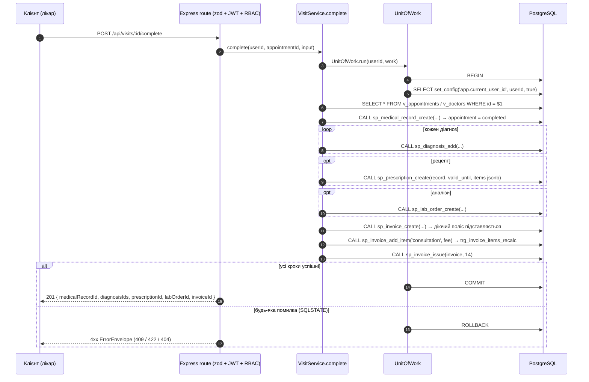

**Доказ rollback** — `apps/api/tests/scenarios.test.ts:134`: останній крок (`sp_invoice_issue`) підміняється викликом з неіснуючим
рахунком, база кидає `P0002`, API відповідає 404. Після цього кількість медичних записів, діагнозів, рецептів, направлень і рахунків
пацієнта не змінилася (усі 0), прийом лишився `scheduled`, а повторний виклик завершує прийом нормально.
Так само `scenarios.test.ts:65` (реєстрація з невалідним слотом → пацієнт і поліс не створені) і `:159` (невалідний код МКХ-10 посередині).

```
$ pnpm --filter @clinic/api test
 ✓ tests/scenarios.test.ts > VisitService.complete … > rolls back every step when the last step (invoice issue) fails
 Test Files  5 passed (5)
      Tests  34 passed (34)
```

## 6. ER-діаграма (26 таблиць + audit_log)

Згенеровано з каталогу (`information_schema.columns` + `pg_constraint`). Зв'язки з `users` через audit-поля
(`created_by`, `updated_by`, `deleted_by`, `changed_by`, …) не показані, щоб діаграма лишалась читабельною.

```mermaid
erDiagram
    beds ||--o{ admissions : "bed_id"
    doctors ||--o{ admissions : "doctor_id"
    patients ||--o{ admissions : "patient_id"
    doctors ||--o{ appointments : "doctor_id"
    patients ||--o{ appointments : "patient_id"
    wards ||--o{ beds : "ward_id"
    doctors |o--o{ departments : "head_doctor_id"
    icd10_codes ||--o{ diagnoses : "icd10_code"
    medical_records ||--o{ diagnoses : "medical_record_id"
    doctors ||--o{ doctor_schedules : "doctor_id"
    departments ||--o{ doctors : "department_id"
    specializations ||--o{ doctors : "specialization_id"
    users ||--o{ doctors : "user_id"
    invoices ||--o{ invoice_items : "invoice_id"
    admissions |o--o{ invoices : "admission_id"
    appointments |o--o{ invoices : "appointment_id"
    patients ||--o{ invoices : "patient_id"
    lab_orders ||--o{ lab_order_items : "lab_order_id"
    lab_test_types ||--o{ lab_order_items : "test_type_id"
    doctors ||--o{ lab_orders : "doctor_id"
    medical_records |o--o{ lab_orders : "medical_record_id"
    patients ||--o{ lab_orders : "patient_id"
    lab_order_items ||--o{ lab_results : "lab_order_id"
    admissions |o--o{ medical_records : "admission_id"
    appointments |o--o{ medical_records : "appointment_id"
    doctors ||--o{ medical_records : "doctor_id"
    patients ||--o{ medical_records : "patient_id"
    insurance_companies ||--o{ patient_insurances : "company_id"
    patients ||--o{ patient_insurances : "patient_id"
    users |o--o{ patients : "user_id"
    invoices ||--o{ payments : "invoice_id"
    medications ||--o{ prescription_items : "medication_id"
    prescriptions ||--o{ prescription_items : "prescription_id"
    medical_records ||--o{ prescriptions : "medical_record_id"
    roles ||--o{ users : "role_id"
    departments ||--o{ wards : "department_id"
    admissions {
        int4 id PK
        int4 patient_id FK
        int4 bed_id FK
        int4 doctor_id FK
        timestamptz admitted_at
        timestamptz discharged_at
        text reason
        text discharge_summary
        admission_status status
        timestamptz created_at
        int4 created_by FK
        timestamptz updated_at
        int4 updated_by FK
    }
    appointments {
        int4 id PK
        int4 patient_id FK
        int4 doctor_id FK
        timestamptz starts_at
        timestamptz ends_at
        appointment_status status
        text reason
        text cancel_reason
        timestamptz created_at
        int4 created_by FK
        timestamptz updated_at
        int4 updated_by FK
    }
    audit_log {
        int4 id PK
        text table_name
        int4 record_id
        audit_operation operation
        text changed_fields
        jsonb old_data
        jsonb new_data
        timestamptz changed_at
        int4 changed_by FK
    }
    beds {
        int4 id PK
        int4 ward_id FK
        text bed_number
        bed_status status
        timestamptz created_at
        int4 created_by FK
        timestamptz updated_at
        int4 updated_by FK
        timestamptz deleted_at
        int4 deleted_by FK
    }
    departments {
        int4 id PK
        text name
        text description
        text phone
        int4 head_doctor_id FK
        timestamptz created_at
        int4 created_by FK
        timestamptz updated_at
        int4 updated_by FK
        timestamptz deleted_at
        int4 deleted_by FK
    }
    diagnoses {
        int4 id PK
        int4 medical_record_id FK
        text icd10_code FK
        diagnosis_kind kind
        text notes
        timestamptz created_at
        int4 created_by FK
        timestamptz updated_at
        int4 updated_by FK
    }
    doctor_schedules {
        int4 id PK
        int4 doctor_id FK
        int2 weekday
        time start_time
        time end_time
        int4 slot_minutes
        text room
        timestamptz created_at
        int4 created_by FK
        timestamptz updated_at
        int4 updated_by FK
    }
    doctors {
        int4 id PK
        int4 user_id FK
        int4 department_id FK
        int4 specialization_id FK
        text license_number
        numeric consultation_fee
        text phone
        date hired_on
        timestamptz created_at
        int4 created_by FK
        timestamptz updated_at
        int4 updated_by FK
        timestamptz deleted_at
        int4 deleted_by FK
    }
    icd10_codes {
        text code PK
        text title
    }
    insurance_companies {
        int4 id PK
        text name
        text phone
        text email
        timestamptz created_at
        int4 created_by FK
        timestamptz updated_at
        int4 updated_by FK
        timestamptz deleted_at
        int4 deleted_by FK
    }
    invoice_items {
        int4 id PK
        int4 invoice_id FK
        invoice_item_type item_type
        text description
        numeric quantity
        numeric unit_price
        numeric amount
        timestamptz created_at
        int4 created_by FK
        timestamptz updated_at
        int4 updated_by FK
    }
    invoices {
        int4 id PK
        text number
        int4 patient_id FK
        int4 appointment_id FK
        int4 admission_id FK
        invoice_status status
        numeric subtotal
        numeric insurance_coverage_percent
        numeric insurance_amount
        numeric total_due
        numeric paid_amount
        timestamptz issued_at
        date due_date
        timestamptz created_at
        int4 created_by FK
        timestamptz updated_at
        int4 updated_by FK
    }
    lab_order_items {
        int4 id PK
        int4 lab_order_id FK
        int4 test_type_id FK
    }
    lab_orders {
        int4 id PK
        int4 patient_id FK
        int4 doctor_id FK
        int4 medical_record_id FK
        lab_priority priority
        lab_order_status status
        timestamptz ordered_at
        timestamptz completed_at
        timestamptz created_at
        int4 created_by FK
        timestamptz updated_at
        int4 updated_by FK
    }
    lab_results {
        int4 id PK
        int4 lab_order_id FK
        int4 test_type_id FK
        numeric value_numeric
        text value_text
        bool is_abnormal
        timestamptz recorded_at
        timestamptz created_at
        int4 created_by FK
        timestamptz updated_at
        int4 updated_by FK
    }
    lab_test_types {
        int4 id PK
        text code
        text name
        text unit
        numeric ref_min
        numeric ref_max
        numeric price
    }
    medical_records {
        int4 id PK
        int4 appointment_id FK
        int4 admission_id FK
        int4 patient_id FK
        int4 doctor_id FK
        text complaints
        text examination
        text conclusion
        text recommendations
        timestamptz created_at
        int4 created_by FK
        timestamptz updated_at
        int4 updated_by FK
    }
    medications {
        int4 id PK
        text name
        medication_form form
        text strength
        numeric unit_price
        timestamptz created_at
        int4 created_by FK
        timestamptz updated_at
        int4 updated_by FK
        timestamptz deleted_at
        int4 deleted_by FK
    }
    patient_insurances {
        int4 id PK
        int4 patient_id FK
        int4 company_id FK
        text policy_number
        numeric coverage_percent
        date valid_from
        date valid_to
        timestamptz created_at
        int4 created_by FK
        timestamptz updated_at
        int4 updated_by FK
    }
    patients {
        int4 id PK
        int4 user_id FK
        text last_name
        text first_name
        text middle_name
        date birth_date
        sex_type sex
        text phone
        text email
        text address
        blood_type blood_type
        text emergency_contact_name
        text emergency_contact_phone
        timestamptz created_at
        int4 created_by FK
        timestamptz updated_at
        int4 updated_by FK
        timestamptz deleted_at
        int4 deleted_by FK
    }
    payments {
        int4 id PK
        int4 invoice_id FK
        numeric amount
        payment_method method
        text reference
        timestamptz paid_at
        timestamptz created_at
        int4 created_by FK
        timestamptz updated_at
        int4 updated_by FK
    }
    prescription_items {
        int4 id PK
        int4 prescription_id FK
        int4 medication_id FK
        text dosage
        text frequency
        int4 duration_days
        int4 quantity
        text instructions
    }
    prescriptions {
        int4 id PK
        int4 medical_record_id FK
        timestamptz issued_at
        date valid_until
        timestamptz created_at
        int4 created_by FK
        timestamptz updated_at
        int4 updated_by FK
    }
    roles {
        int4 id PK
        user_role code
        text name
        text description
    }
    specializations {
        int4 id PK
        text name
        text description
    }
    users {
        int4 id PK
        text email
        text password_hash
        int4 role_id FK
        text full_name
        bool is_active
        timestamptz last_login_at
        timestamptz created_at
        int4 created_by FK
        timestamptz updated_at
        int4 updated_by FK
        timestamptz deleted_at
        int4 deleted_by FK
    }
    wards {
        int4 id PK
        int4 department_id FK
        text ward_number
        ward_type ward_type
        int4 capacity
        numeric daily_rate
        int4 floor
        timestamptz created_at
        int4 created_by FK
        timestamptz updated_at
        int4 updated_by FK
        timestamptz deleted_at
        int4 deleted_by FK
    }
```

## 7. Інтерфейс (знімки Playwright)

Знімки зроблено e2e-тестом `apps/e2e/tests/smoke.spec.ts` на реальному стеку (API + UI, без моків): реєстратор записує пацієнта →
лікар завершує прийом → касир приймає оплату → адміністратор бачить аудит і відновлює видаленого пацієнта.

| Екран | Знімок |
|---|---|
| Головна (реєстратор) | 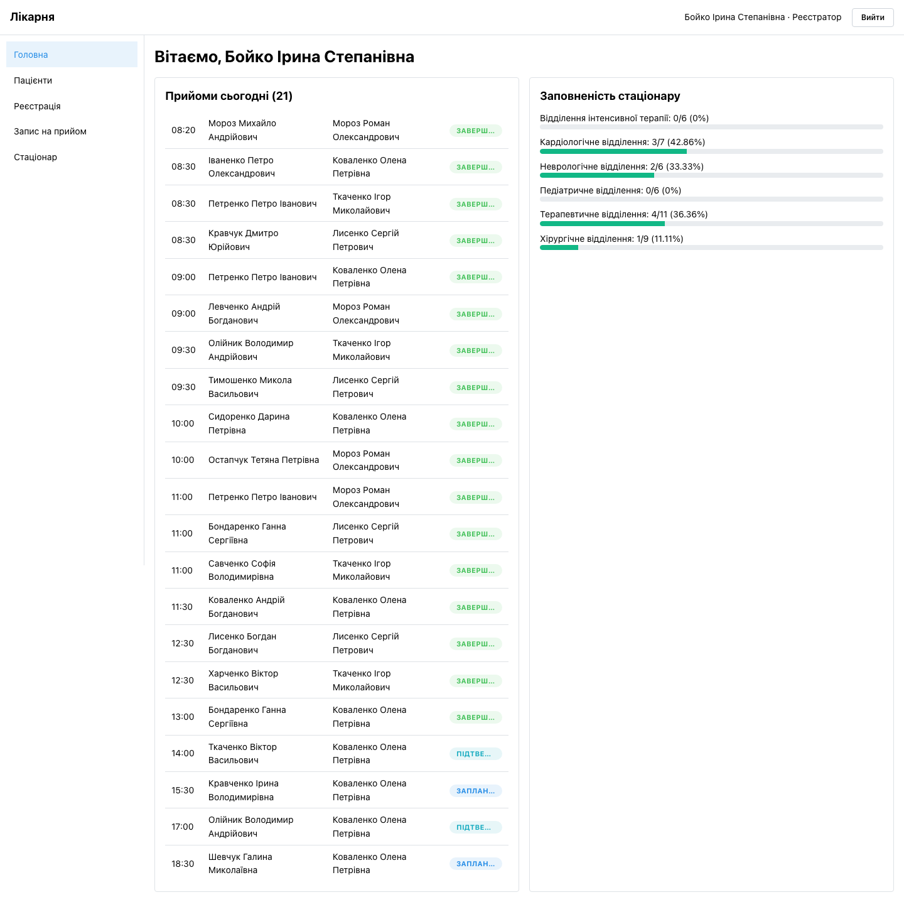 |
| Запис на прийом з вибором вільного слоту | 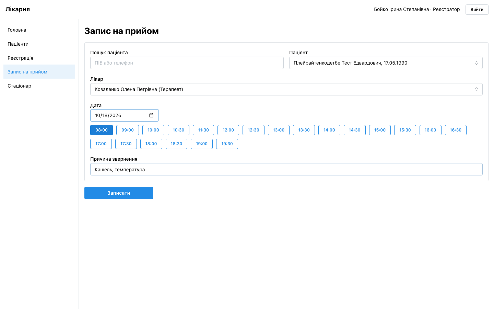 |
| Прийоми лікаря на сьогодні | 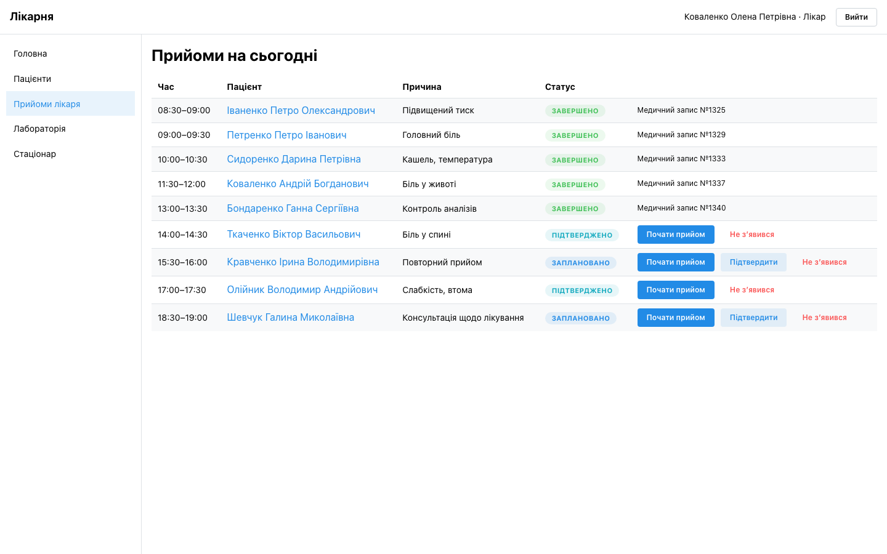 |
| Прийом: діагнози + рецепт + аналізи в одній формі | 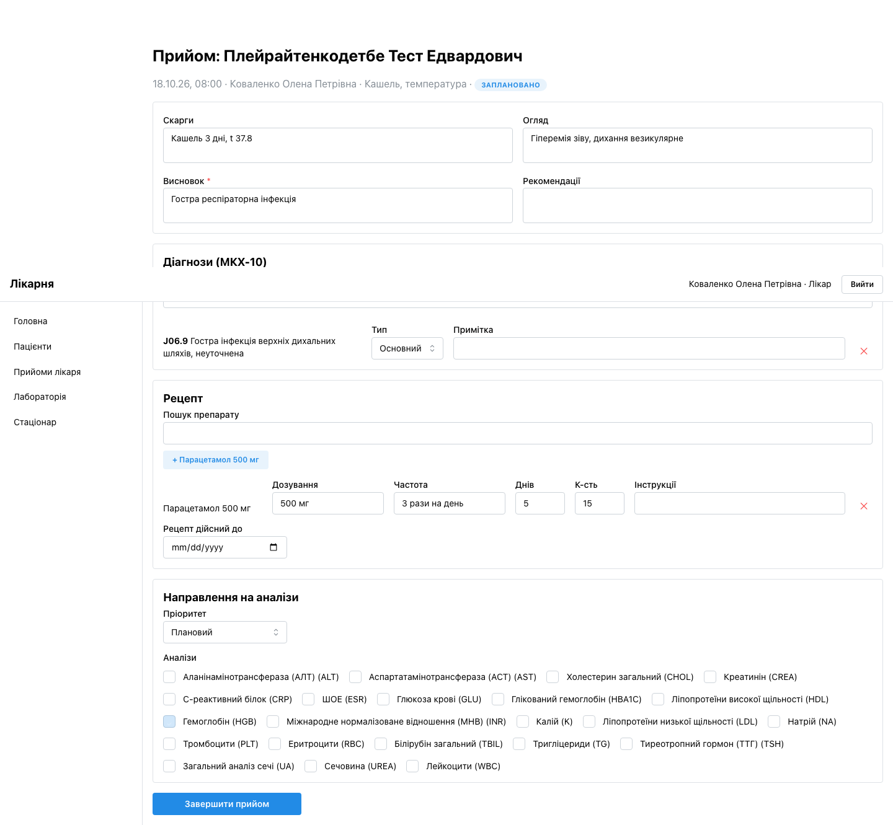 |
| Результат одного UoW | 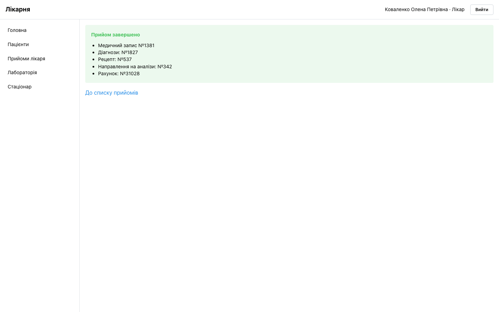 |
| Рахунок після часткової й повної оплати | 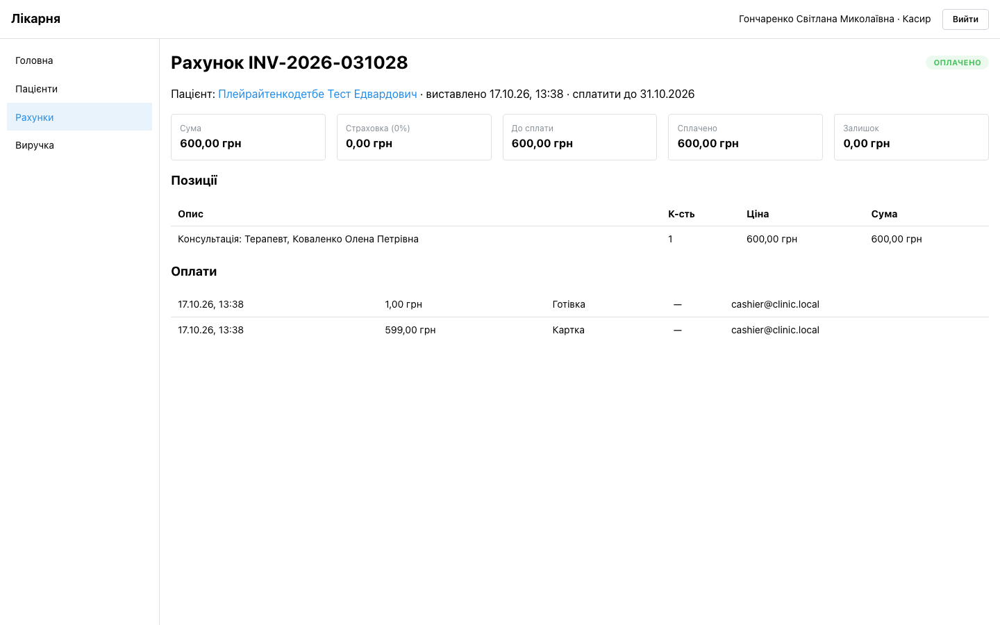 |
| Виручка по місяцях (`mv_monthly_revenue`) |  |
| Картка пацієнта («Останні зміни: хто / коли») | 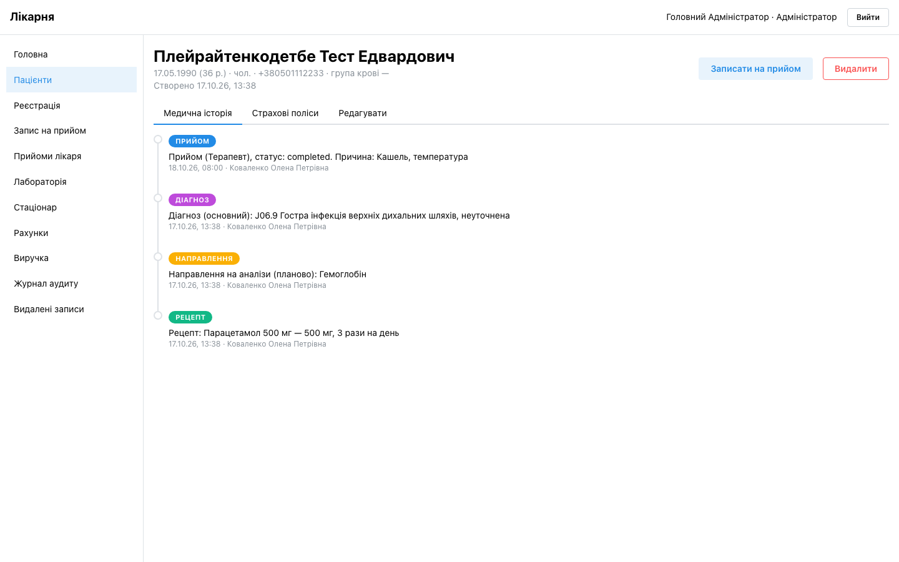 |
| Видалені записи + відновлення | 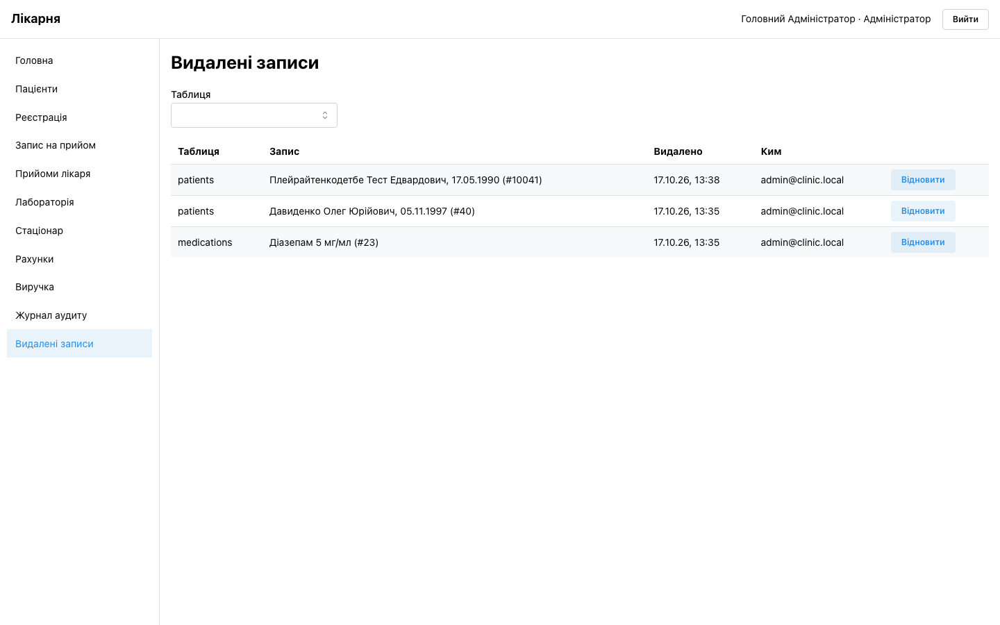 |
| Журнал аудиту з JSON-diff | 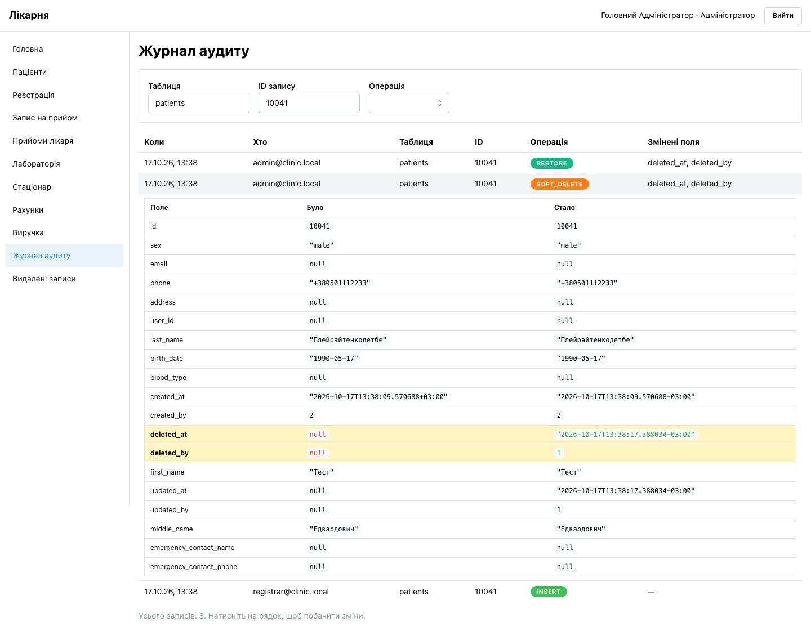 |
| Карта ліжок стаціонару | 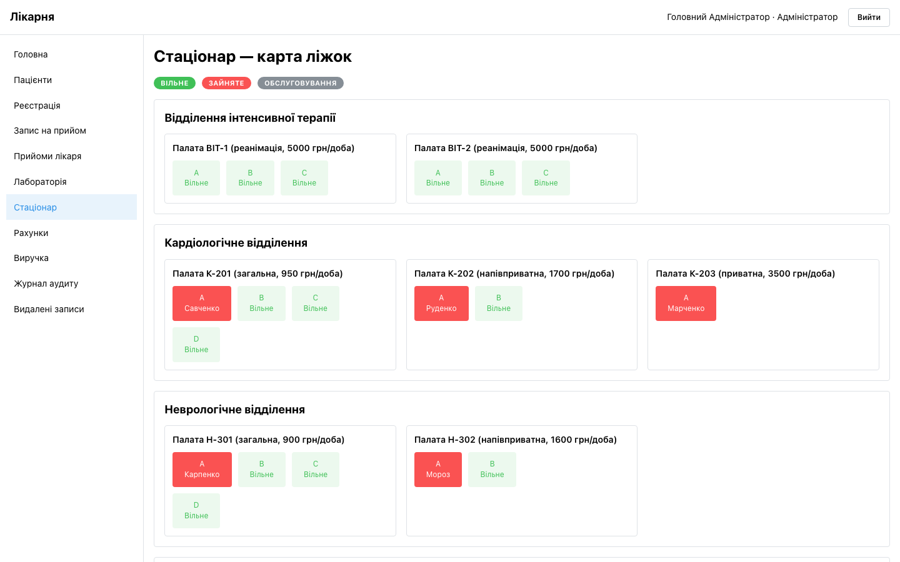 |
| Черга лабораторії | 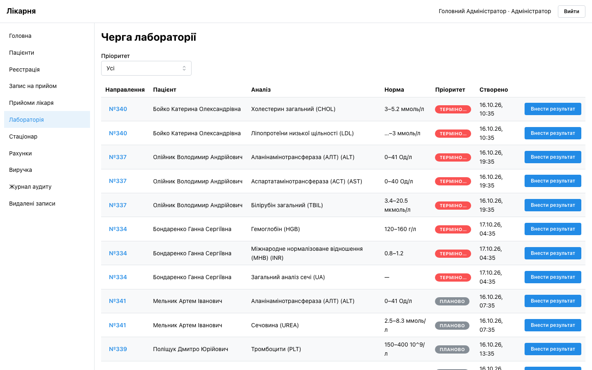 |

## 8. Тести та перевірки

| Пакет | Що перевіряє | Команда | Результат |
|---|---|---|---|
| `@clinic/db` | BR-1…BR-10 (позитив + негатив), audit-поля, soft delete, заборона DELETE, ліжка, суми рахунків, аналізи, слоти, MV | `pnpm --filter @clinic/db test` | 25 passed |
| `@clinic/api` | UoW-сценарії + rollback, `updated_by` = користувач JWT, soft delete + restore, RBAC, мапінг SQLSTATE → HTTP | `pnpm --filter @clinic/api test` | 34 passed |
| `@clinic/web` | login / booking / visit на MSW-моках, рендер усіх сторінок | `pnpm --filter @clinic/web test` | 16 passed |
| `@clinic/contracts` | таблиця маршрутів, JSON Schema, SQLSTATE | `pnpm --filter @clinic/contracts test` | 5 passed |
| `@clinic/e2e` | 4 наскрізні сценарії на реальному стеку | `pnpm e2e` | 4 passed |
| весь репозиторій | | `pnpm db:reset && pnpm typecheck && pnpm lint && pnpm test && pnpm build` | exit 0 |
