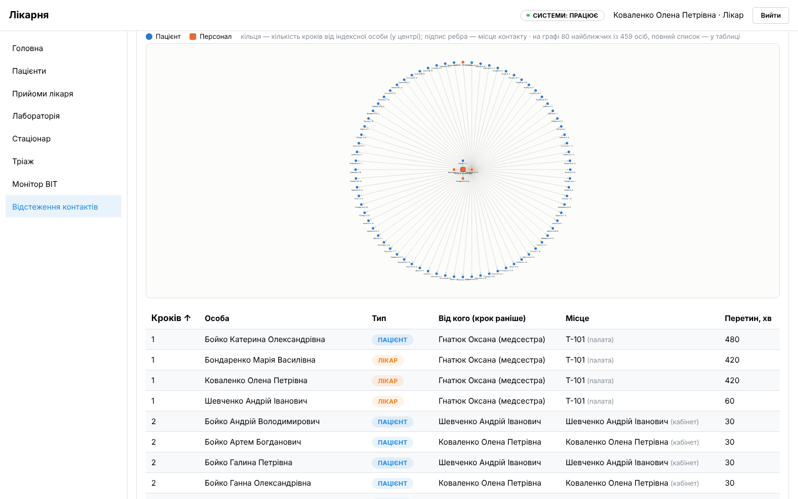
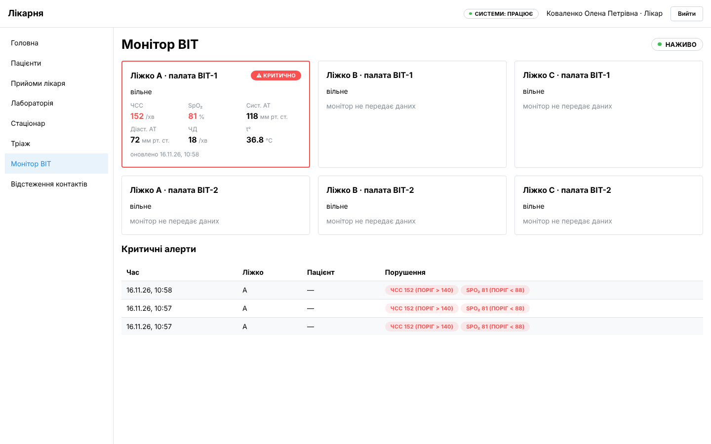
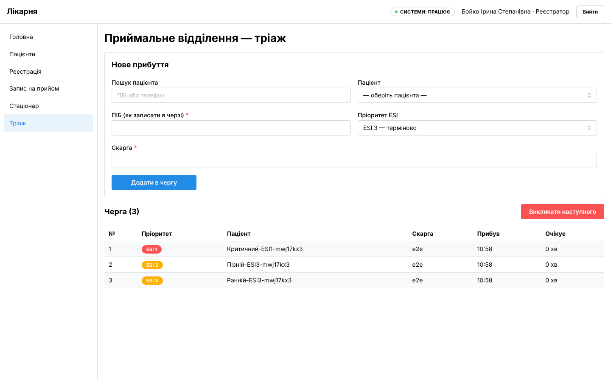

# Звіт до лабораторної роботи 2: NoSQL (Neo4j + Redis)

Вимоги й моделі: [`06-nosql-requirements.md`](06-nosql-requirements.md). Рішення й відхилення: [`05-decisions.md`](05-decisions.md)
(D-21…D-57). Стан Лаб 1 — коміт `b28a82b`.

PostgreSQL 16 лишається джерелом істини; Neo4j 5.26 Community — графова read-model для обходів; Redis 7.4 —
ефемерний оперативний стан. Запуск з нуля:

```bash
pnpm install
pnpm nosql:up               # db + neo4j + redis (docker-compose.yml)
pnpm db:reset               # міграції 001–012 + seed (Лаб 1 + персонал / зміни / класи ліків)
pnpm graph:sync --full      # повний ETL PG → Neo4j; далі `pnpm graph:sync --follow` — воркер outbox
pnpm simulate               # симулятор показників ВІТ → Redis Stream
pnpm dev                    # API :4000, UI :5173
pnpm --filter @clinic/redis basics            # базові запити Redis (п. 6)
pnpm --filter @clinic/graph gen -- --scale 1  # бенч-дані clinic_bench_x1 (також 5, 10)
pnpm --filter @clinic/bench equivalence -- --scale x1
cd packages/bench && ./run-all.sh             # усі бенчмарки (≈ 5 год), звіти → packages/bench/report/
```

## 1. Відповідність завданню

| # | Пункт завдання | Де реалізовано (`file:line`) | Як перевірити |
|---|---|---|---|
| 1 | Огляд видів NoSQL | `docs/06-nosql-requirements.md` §1 (7 типів: модель, приклади, сильні / слабкі сторони, де доречно в лікарні) | — |
| 2 | Аргументація винесення | `docs/06-nosql-requirements.md` §2: ядро Лаб 1 лишається в PG (BR-1…BR-10, UoW); розширюємо вимоги задачами, незручними для SQL (багатокрокові обходи → граф, ефемерний стан → key-value); чому не документна / wide-column / time-series | — |
| 3 | Реалізація в NoSQL — граф (Neo4j) | модель і схема: `packages/graph/neo4j/schema.ts:11`; трасування BFS у Cypher: `packages/graph/neo4j/queries.ts:87`; найкоротший ланцюг: `queries.ts:127`; взаємодії ліків через класи: `queries.ts:180`; повний ETL у знімку `REPEATABLE READ`: `packages/graph/sync/etl.ts:135`; outbox-воркер (ідемпотентний MERGE): `packages/graph/sync/worker.ts:113`, `:173`; свіжість `asOf`/`lagMs`: `worker.ts:207`; API: `apps/api/src/services/GraphService.ts`, `apps/api/src/lab2-handlers.ts:70`; UI: `apps/web/src/pages/Tracing.tsx` | `pnpm --filter @clinic/graph test` (golden + outbox + lag); сторінка «Відстеження контактів» (§9) |
| 3 | Розширені вимоги F-35…F-45, BR-11…BR-18 | `docs/06` §3; таблиці Лаб 2: `packages/db/migrations/009_lab2_tables.sql` (кімнати, персонал, зміни з `EXCLUDE` :88, класи й взаємодії, outbox :313, тригер :342, claim `SKIP LOCKED` :421); контракт: `packages/contracts/src/routes.ts` (12 нових маршрутів) | `pnpm --filter @clinic/db test` (`tests/lab2.test.ts`), `pnpm --filter @clinic/api test` (`tests/lab2.test.ts`) |
| 4 | Те саме в SQL | `v_presence` — UNION ALL над 8+ таблицями (admissions ⋈ beds ⋈ rooms / wards, staff_shifts, appointments ⋈ doctors ⋈ staff): `009_lab2_tables.sql:208`; GiST «місце + період» на кожному джерелі: `009:157`…; рекурсивний CTE з `CYCLE`: `packages/db/migrations/010_graph_functions.sql:102`; BFS на PL/pgSQL: `010:210`; шлях: `010:229`; взаємодії: `010:274`; плаский агрегат: `010:299`; `v_graph_counts`: `009:273` | `pnpm --filter @clinic/graph test` (`tests/sql/golden.test.ts`: CTE, BFS = еталон) |
| 5 | Тестування швидкодії, методика | harness: `packages/bench/src/runner.ts`, `src/stats.ts`, `src/env.ts`; сценарії S1–S8: `packages/bench/scenarios/graph/latency.ts`, `custom.ts`; R1–R4: `packages/bench/scenarios/redis/`; гейт еквівалентності: `packages/bench/equivalence/cli.ts`; генератор даних: `packages/graph/gen/`; гейт щільності: `packages/graph/validate.ts` | §2–§8 цього звіту; `packages/bench/run-all.sh` |
| 5 | NoSQL ↔ кілька SQL-таблиць | одне ребро `PRESENT` = рядок `v_presence` = 3–4 таблиці; вузол `:Office` = `doctors`; `TAKES` = `prescription_items ⋈ prescriptions ⋈ medical_records` (`009:` `v_takes`); таблиця відповідності — `docs/06` §4 | `SELECT * FROM v_graph_counts` = кількості в Neo4j (`pnpm graph:sync --full` друкує порівняння) |
| 6 | NoSQL іншого типу — Redis, базові запити | довідник команд (група → команда → роль у домені → складність → `file:line`): `packages/redis/REDIS_API.md`; демо всіх груп: `packages/redis/src/basics.ts`; використання: кеш слотів `packages/redis/src/slots.ts:15`, відкликання JWT `revocation.ts:22`, лічильники ліжок `beds.ts:26` (`MULTI` + `HINCRBY`), черга тріажу `triage.ts:72` (`ZPOPMIN`), ВІТ — Lua (`XADD MAXLEN ~`, `HSET`, поріг BR-17, `PUBLISH`, `LPUSH/LTRIM`) `icu-script.ts:32`, група споживачів `icu.ts:222` | `pnpm --filter @clinic/redis basics`; `pnpm --filter @clinic/redis test` |

## 2. Дані: сценарій, обсяги, валідація щільності

**Сценарій** (генератор `packages/graph/gen/`, детермінований: mulberry32, seed 2026 + масштаб; `COPY` з вимкненими
тригерами → перевірки цілісності, `VACUUM ANALYZE`). Багатопрофільна лікарня на 400 ліжок: 16 палат × 6 кімнат × 4 ліжка
+ 2 ВІТ × 8 одномісних; 8 відділень; 1 рік; заповненість 80 %; середня тривалість 5 днів (лог-нормальна, медіана 3,5);
15 % повторних госпіталізацій; 60 лікарів, 300 медсестер (ротація 2Д-2В-2Н-2 вихідні, 10 % «плаваючих»); лікарі —
палата 08–16 + 4 год прийому в кабінеті, чергування; прийоми — 80 % слотів, 85 / 8 / 7 % завершено / скасовано / неявка.
×5, ×10 — мережа 5 / 10 таких лікарень (3 % медсестер і 5 % консультацій — між лікарнями). Виведення кожного числа —
`packages/graph/gen/README.md`.

| Масштаб | Рядків усього | БД PG | Госпіталізації | Зміни | Прийоми | Позиції рецептів | Ребра PRESENT | Час генерації |
|---|---:|---:|---:|---:|---:|---:|---:|---:|
| ×1 | 812 070 | 175 МБ | 23 760 | 101 481 | 149 743 | 218 559 | 403 635 | 19 с |
| ×5 | 4 048 616 | 792 МБ | 118 475 | 507 367 | 748 413 | 1 090 046 | 2 017 579 | 97 с |
| ×10 | 8 092 218 | 1 555 МБ | 235 285 | 1 014 853 | 1 498 618 | 2 179 520 | 4 032 993 | 205 с |

×1: 65,1 госпіталізації / добу, заповненість 80,8 %. Змін ≈ 101k, а не ≈ 85k з плану: будні палатні зміни лікарів
додаються до ротації медсестер і чергувань (D-36…D-43).

**Чому саме такі обсяги.** Обсяг виведено зі сценарію реальної лікарні, а не обрано «щоб було багато»: граф контактів
однієї лікарні за рік — сотні тисяч ребер, і саме на такому обсязі лікарня зустріне задачу. ×5 / ×10 відповідають на
питання масштабування (мережа лікарень) і дають 4 млн ребер PRESENT. Обидва рушії на ×10 **вміщуються в RAM**
(PG 1,56 ГБ БД ≈ shared_buffers 1 ГБ + кеш ОС; Neo4j — page cache 1,5 ГБ): так ми порівнюємо моделі даних і алгоритми
доступу, а не швидкість диска; ціну холодного кешу міряє окремий сценарій S8. Більші обсяги перетворили б порівняння на
тест підсистеми вводу-виводу й обмежень контейнера, що не є предметом роботи.

**Гейт щільності** (`pnpm --filter @clinic/graph validate -- --scale N`; вікно 14 днів, 200 індексних пацієнтів).
Контакти мають бути реалістичними: якби в кожного було 2 сусіди, обхід був би тривіальний для обох рушіїв; якби
1000 — граф насичувався б на 2-му кроці, і глибина нічого б не значила.

| Масштаб | d1 p5 / p50 (вимога p5 ≥ 5, p50 30–120) | d2 p50 (150–1000) | d3 p50 (≤ 50 % активних) | насичення d5 |
|---|---|---:|---|---:|
| ×1 | 29 / 48 | 486 | 1 696 (27,4 %) | 100 % |
| ×5 | 32 / 50 | 675 | 4 029 (13,1 %) | 96,6 % |
| ×10 | 33 / 50 | 747 | 5 039 (8,2 %) | 87,2 % |

## 3. Методика

**Harness** (`packages/bench/src/runner.ts`): один процес Node керує всіма рушіями (однаковий клієнт, цикл подій,
вартість декодування); сценарій описує лише, *що* виконати на кожному рушії. Закритий цикл: N асинхронних клієнтів
(1 / 8 / 32) ділять один лічильник ітерацій; ітерація `i` бере параметри `params[i % n]` — однакова послідовність для
обох рушіїв. Параметри — один JSON на масштаб (`packages/bench/params/x1.json` …) із записаним способом відбору;
SHA-256 файлу — у кожному результаті.

| Крок | Специфікація | Профіль звіту `report` | Чому |
|---|---|---|---|
| Прогрів | 200 ітерацій або 30 с | 100 ітерацій або 10 с, перед **кожним** виміряним прогоном | кеші, план, JIT; повторюється, бо між прогонами працював інший рушій |
| Вимір | ≥ 1000 ітерацій або 60 с | 500 ітерацій або 30 с, але ≥ 5 | швидкі запити все одно дають 500 замірів; повільні обмежені часом |
| Повтори | 3, порядок рушіїв чергується | 3, чергується | повільний дрейф (autovacuum, GC) рівномірно на всі рушії |
| Конкурентність | 1 / 8 / 32 | S1–S3: 1 / 8 (×5, ×10: 1); S4, S5, R1–R4: 1 / 8 / 32 | див. нижче |
| Таймаут | 30 с (PG `statement_timeout`, Neo4j tx timeout) | 30 с | перевищення записується як `timeout` (= +∞ у квантилях), не відкидається |
| Статистика | p50 / p95 / p99 / max, ops/s | те саме, медіана 3 повторів + розкид p50 | nearest-rank: кожне число — реально виміряна латентність |

**Чому профіль `report`, а не специфікація.** Специфікація для ×1 / ×5 / ×10 потребує ≈ 17 год машинного часу, майже
весь — 60-секундні обмеження на багатосекундних обходах і 30-секундні таймаути CTE. Правила (прогрів, повтори з
чергуванням, однакові параметри, таймаути) не змінено, зменшено лише ліміти; розкид p50 між повторами в таблицях
показує, що 500 замірів досить для стабільної медіани. Конкурентність 32 для обходів не міряється: на хості з 4 vCPU
32 одночасні багатосекундні обходи вимірюють лише чергу на CPU (c = 8 уже вдвічі більше за кількість ядер);
для коротких запитів (S4, S5, Redis) 32 показує поведінку під перевантаженням. ×5 / ×10 відповідають на одне
питання — як латентність обходу росте з даними, — тож там лише S1–S3 при c = 1, ETL (S7) і холодний старт (S8, ×10).

**Налаштування рушіїв** (записуються в кожен файл результатів, `environment`): PG `shared_buffers=1GB`,
`effective_cache_size=2GB`, `work_mem=32MB`, `random_page_cost=1.1`, `jit=off`; Neo4j heap 1 ГБ, page cache 1500 МБ;
Redis AOF `everysec`, `maxmemory 400mb noeviction`. Ліміти контейнерів — `docker-compose.yml` (PG і Neo4j по 2 CPU / 3 ГБ,
Redis 1 CPU / 512 МБ).

**Чесність SQL-сторони.** PG не «соломʼяне опудало»: B-tree на кожному FK і фільтрі, GiST «місце + період» на кожному
джерелі присутності (`009:157`…), `ANALYZE` після завантаження, дві реалізації — «підручниковий» рекурсивний CTE з
`CYCLE` і BFS на PL/pgSQL, що дедуплікує фронт (як і Neo4j). Перетин інтервалів обчислюється під час запиту в обох
рушіях (D-24) — матеріалізованих ребер «контакт» немає ні там, ні там. Плани — `EXPLAIN (ANALYZE, BUFFERS)` у звітах
сценаріїв.

## 4. Результати: Neo4j vs PostgreSQL

Повні таблиці (p50 / розкид / p95 / p99 / max / ops/s / n / таймаути), графіки й плани `EXPLAIN (ANALYZE, BUFFERS)` /
`PROFILE` — у звітах генератора: [`x1-traversal`](../packages/bench/report/x1-traversal/README.md),
[`x1-flat`](../packages/bench/report/x1-flat/README.md), [`x1-sync`](../packages/bench/report/x1-sync/README.md),
[`x5-traversal`](../packages/bench/report/x5-traversal/README.md). Нижче — медіана p50 трьох повторів, мс, 1 клієнт
(«PG BFS / Neo4j» > 1 означає, що Neo4j швидший). Сирі дані — `packages/bench/results/*.json`.

**S1 — трасування, вікно 14 днів**

| Глибина | ×1 PG CTE | ×1 PG BFS | ×1 Neo4j | ×1 BFS / Neo4j | ×5 PG CTE | ×5 PG BFS | ×5 Neo4j | ×5 BFS / Neo4j |
|---|---:|---:|---:|---:|---:|---:|---:|---:|
| 1 | 40,6 | 4,3 | 9,3 | 0,47 | 210 | 4,5 | 12,3 | 0,37 |
| 2 | 130 | 134 | 109 | 1,23 | 328 | 455 | 179 | 2,54 |
| 3 | 13 424 | 272 | 288 | 0,94 | 15 410 | 802 | 751 | 1,07 |
| 4 | — | 646 | 624 | 1,04 | — | 2 003 | 2 123 | 0,94 |
| 5 | — | 1 139 | 855 | 1,33 | — | 4 620 | 3 653 | 1,26 |

При 8 клієнтах (×1): глибина 3 — CTE усі 20 запитів у таймауті 30 с, BFS 579 мс, Neo4j 523 мс; глибина 5 — 2 218 vs 1 844 мс.

**S2 — глибина 3, різні вікна** (ті самі 200 осіб)

| Вікно | ×1 PG BFS | ×1 Neo4j | ×1 BFS / Neo4j | ×5 PG BFS | ×5 Neo4j | ×5 BFS / Neo4j |
|---|---:|---:|---:|---:|---:|---:|
| 3 дні | 64 | 119 | 0,53 | 192 | 137 | 1,40 |
| 14 днів | 270 | 286 | 0,95 | 708 | 659 | 1,07 |
| 60 днів | 4 763 | 2 224 | 2,14 | 6 216 | 3 385 | 1,84 |

**S3 — найкоротший ланцюг (×1)**: відстань 2 — PG 138 / Neo4j 113 мс (1,22×); відстань 4 — 743 / 654 (1,14×);
не пов'язані (обхід до 6 кроків) — 1 206 / 824 (1,46×). При 8 клієнтах відстань 2 — 276 / 159 (1,74×).

**S4 — взаємодії ліків (×1)**: PG швидший за всіх розмірів — 1 препарат 0,97 / 1,77 мс, 5 — 1,08 / 2,22,
15 — 1,23 / 3,61 (PG у 2,9×), пацієнт + новий — 1,23 / 1,85; при 32 клієнтах PG 3 043–4 132 ops/s проти 1 094–2 292.

**S5 — плаский агрегат (×1)**: рік — PG 17 мс / Neo4j 111 мс (6,5×), квартал — 5,3 / 78 (14,7×); при 32 клієнтах
PG 200 / 746 ops/s проти 31 / 51.

**S6 — ціна синхронізації (×1)**: outbox-тригер додає +356 мкс p50 до вставки зміни (260 → 616 мкс, +137 %).
Відставання графа (подія → застосовано в Neo4j):

| Записів/с | досягнуто | p50, мс | p95, мс | max, мс |
|---:|---:|---:|---:|---:|
| 10 | 10,1 | 42 | 282 | 682 |
| 50 | 50,1 | 51 | 84 | 98 |
| 200 | 200 | 87 | 136 | 168 |

**S7 — повний ETL ×1**: 688 778 вузлів і ребер за 46,3 с (з них 16,5 с — очистка й схема); 17–28 тис. рядків/с.

**Не виміряно** (обмеження часу середовища, §8): ×10, S3 на ×5, ETL ×5 / ×10, холодний старт S8 на ×10
(пробний прогін на ×1: перший запит після рестарту PG 0,9 с, Neo4j 4,7 с).

## 5. Результати: Redis vs PostgreSQL

Звіт: [`x1-redis`](../packages/bench/report/x1-redis/README.md). Медіана p50 трьох повторів, мс.

| Сценарій | c | PostgreSQL | Redis | PG / Redis | ops/s PG → Redis |
|---|---:|---:|---:|---:|---|
| R1 вільні слоти, влучання в кеш | 1 | 0,80 | 0,07 | 11× | 1 188 → 11 500 |
| R1 вільні слоти, влучання в кеш | 32 | 6,66 | 0,27 | 25× | 4 408 → 77 106 |
| R1 промах + заповнення кешу | 1 | 0,67 | 1,06 | 0,6× | 1 403 → 902 |
| R2 лічильники ліжок (18 палат) | 1 | 0,92 | 0,17 | 5,4× | 1 038 → 4 700 |
| R2 лічильники ліжок | 32 | 6,20 | 2,68 | 2,3× | 5 243 → 11 408 |
| R3 тріаж: ZPOPMIN vs SKIP LOCKED | 1 | 0,63 | 0,13 | 4,8× | 1 533 → 6 597 |
| R3 тріаж | 32 | 4,06 | 0,82 | 5,0× | 7 285 → 36 023 |
| R4 інжест показника ВІТ (Lua vs процедура) | 1 | 0,70 | 0,11 | 6,4× | 1 355 → 7 633 |
| R4 інжест | 32 | 3,89 | 0,98 | 4,0× | 7 342 → 29 381 |

Промах кешу (R1) повільніший за прямий запит до PG — це ціна cache-aside: читання PG + запис у Redis. Тому кеш
виправданий лише за частки влучань, вищої за ≈ 40 %; для слотів лікаря на день (TTL 60 с, багато переглядів на один
запис) це виконується. Черга тріажу в обох рушіях видає кожен запис рівно один раз у порядку пріоритету (перевіряється
в самому сценарії R3 і в тестах на 32 споживачах).

## 6. Еквівалентність відповідей

Жодне число про граф не публікується, доки PG і Neo4j не дають однакових відповідей
(`packages/bench/equivalence/`).

1. **Еталон, пораховано вручну** (`packages/graph/fixtures/golden/`, написано **до** коду рушіїв): 10 трасувань
   (межі вікна, «впритул», відкрите перебування, скасовані прийоми, нехронологічний ланцюг D-25), 9 шляхів,
   8 перевірок взаємодій, кількості вузлів / ребер. Результат: **108 / 108** — PG CTE, PG BFS і Neo4j = `expected.json`.
2. **×1 seed** (`result-x1.json`): усі множини `(особа, кроки)` і довжини шляхів однакові; кожен шлях Neo4j повторно
   перевірено в PG (кожна пара сусідніх кроків — справжній контакт у вікні).

| група | перевірок | збіг | розбіжність | пропущено |
|---|---:|---:|---:|---:|
| кількості вузлів / ребер | 12 | 12 | 0 | 0 |
| трасування d1 / d2 / d3 / d4 / d5 | 80 / 80 / 45 / 40 / 40 | 80 / 80 / 44 / 40 / 40 | 0 | 1 (CTE > 30 с) |
| вікна 3 / 14 / 60 д | 60 | 60 | 0 | 0 |
| шляхи d2 / d4 / непов’язані | 500 | 500 | 0 | 0 |
| взаємодії m1 / m5 / m15 / пацієнт | 200 | 200 | 0 | 0 |
| агрегат по відділеннях | 2 | 2 | 0 | 0 |
| **усього** | **1059** | **1058** | **0** | **1** |

## 7. Захист методики («а чому…»)

- **Чому тестуємо саме обходи?** Це задача, заради якої граф винесено (п. 2). Плаский агрегат (S5) і маленький
  довідник (S4) включено навмисно — щоб показати, де граф **не** виграє.
- **Чому так мало / так багато даних?** Обсяг — зі сценарію реальної лікарні (§2), а не довільний; щільність контактів
  перевірено гейтом до будь-якого бенчмарку. ×10 = мережа з 10 лікарень — верхня межа, де обидва рушії ще в RAM.
- **Чому однаковий набір параметрів?** Інакше різниця могла б бути від різних запитів. Хеш файлу — в результатах.
- **Чому прогрів і повтори з чергуванням?** Без прогріву перший рушій платить за холодні кеші; без чергування —
  повільний дрейф машини списується на рушій, що йшов другим. Холодний старт виміряно окремо (S8).
- **Чому медіана і p95/p99, а не середнє?** Латентність має довгий хвіст (GC Neo4j, autovacuum); середнє приховує
  хвіст, p99 — показує. Таймаут не відкидається, а стає «timeout» у відповідному квантилі.
- **Чому PG має дві реалізації?** CTE — як написав би типовий SQL-розробник, BFS — найкраще, що можна зробити в PG
  (дедуплікація фронту). Порівнювати лише з CTE було б нечесно щодо PG.
- **Чому не тестується запис у граф напряму?** Neo4j тут — read-model; усі записи йдуть у PG (джерело істини), і їхня
  ціна для графа — це outbox (S6) і ETL (S7).
- **Чому не тестуються інші бази (Memgraph, MongoDB)?** Завдання — обґрунтований вибір по одному рушію кожного типу
  (п. 1–2), а не огляд продуктів.
- **Чому конкурентність 32 не для всіх сценаріїв?** Див. §3: на 4 vCPU це вимір черги, а не рушія.

## 8. Загрози валідності

- **Середовище.** Прогони цього звіту виконано в хмарному контейнері без Docker: ті самі версії рушіїв (PostgreSQL 16,
  Neo4j 5.26.33, Redis 7.4.12 — бінарні файли з офіційних образів) з тими самими налаштуваннями пам'яті, але **без
  лімітів CPU / RAM контейнерів**; усі три рушії й клієнт ділять 4 vCPU (D-29). Абсолютні числа залежать від машини;
  висновки спираються на співвідношення й тенденції.
- **D-25 (нехронологічність).** Трасування рахує контакт, якщо інтервали перетинаються, без вимоги «B після A». Це
  надмірна (консервативна) оцінка ланцюга зараження; однакова в обох рушіях, тож на порівняння не впливає.
- **D-31 (переведення).** Переведення змінює ліжко всієї госпіталізації (модель Лаб 1) — історія кімнат втрачається.
- **D-44 (Neo4j без `ANY SHORTEST`).** Neo4j 5.26 не повторює ребро в межах шляху, а ланцюг контактів інколи мусить
  пройти через ту саму присутність двічі; тому трасування в Cypher — BFS по рівнях. Це той самий алгоритм, що й PG BFS:
  порівнюються рушії, а не алгоритми; Neo4j 2025.x (`REPEATABLE ELEMENTS`) міг би дозволити інший план.
- **Синтетичні дані.** Генератор відтворює структуру лікарні, але не реальні аномалії (епідемічні спалахи, вихідні
  без планових госпіталізацій).
- **Один клієнт.** Harness і рушії на одній машині — мережеві затримки не враховано (однаково для всіх рушіїв).
- **Профіль `report`.** Менші ліміти, ніж у специфікації (§3); розкид p50 між повторами наведено в кожній таблиці.
- **Неповний прогін масштабів.** Середовище перезапускалося під час довгого прогону, тому виміряно ×1 повністю й ×5 для
  S1–S2; ×10, S3 / S7 на ×5 і холодний старт S8 не виміряно. Дані ×10 згенеровано й перевірено (§2), а
  `packages/bench/run-all.sh` довиміряє решту з того самого місця (кроки, що вже є, пропускаються).

## 9. Застосунок: інтеграція

12 нових маршрутів контракту (`packages/contracts/src/routes.ts`, адитивно): `traceContacts`, `exposurePath`,
`checkInteractions`, `triageList` / `triageAdd` / `triageCallNext`, `bedCounts`, `icuBeds`, `icuAlerts`, `icuStream` (SSE),
`logout`, `health`. Реалізація: `apps/api/src/lab2-handlers.ts`, `apps/api/src/services/GraphService.ts`,
`apps/api/src/sse.ts`, `apps/api/src/nosql.ts`.

| Ситуація | Поведінка (D-28) |
|---|---|
| Neo4j недоступний | трасування й шлях → 503 `GRAPH_UNAVAILABLE`; взаємодії ліків → PG `fn_drug_interactions`, `engine: 'postgres'` |
| Redis недоступний | слоти й лічильники ліжок — з PG; відкликання JWT — fail-open + пам'ять процесу; тріаж → 503 `QUEUE_UNAVAILABLE` |
| Відставання графа | кожна відповідь графа містить `asOf` і `lagMs` (BR-11); `/api/health` показує стан трьох рушіїв |
| Взаємодія `major` | прийом не завершується без `interactionsAcknowledged: true` → 422 (BR-13, `VisitService.ts:23`) |
| Вихід | `jti` відкликається з TTL залишку життя токена; повторне використання → 401 (BR-16, `auth.ts:53`) |

Знімки (e2e на реальному стеку, `apps/e2e/tests/lab2.spec.ts`):

| Сторінка | Знімок |
|---|---|
| Відстеження контактів: граф (кільця = кроки) + таблиця, свіжість графа |  |
| Монітор ВІТ: показники наживо (SSE), критичний алерт BR-17 |  |
| Тріаж: черга за ESI і часом прибуття |  |

## 10. Тести та перевірки

Фінальний прогін на `lab2-nosql` (після `pnpm db:reset`; e2e — з `pnpm graph:sync --full`):

```
pnpm typecheck   Tasks: 8 successful
pnpm lint        Tasks: 8 successful
pnpm test        graph 94 · api 47 · db 41 · redis 34 · web 24 · bench 16 · contracts 10 — усі пройшли
pnpm build       Tasks: 2 successful
check:sql-access OK — 29 files
pnpm e2e         7 passed (3 Лаб 2 + 4 Лаб 1)
еквівалентність  golden 108/108; ×1 — 1058 збігів, 0 розбіжностей, 1 пропуск (CTE > 30 с)
```

| Пакет | Що перевіряє |
|---|---|
| `@clinic/db` | правила Лаб 1 (25), кімнати, BR-15, outbox у тій самій транзакції, `SKIP LOCKED`, Redis-сторона PG |
| `@clinic/graph` | golden для PG (CTE, BFS) і Neo4j, генератор, outbox-еквівалентність, ідемпотентний повтор, відставання ≤ 5 с |
| `@clinic/redis` | кеш і TTL, відкликання + fail-open, лічильники = `v_beds`, тріаж на 32 споживачах, межі BR-17 у Lua, pub/sub ≤ 2 с, група споживачів |
| `@clinic/api` | усі маршрути Лаб 2, деградація (Neo4j / Redis недоступні), BR-13, BR-16, SSE |
| `@clinic/web` | сторінки трасування / ВІТ / тріажу, блокування форми прийому при `major`, парсер SSE |
| `@clinic/bench` | статистика, harness, звіт, злиття результатів, живі рушії |
| e2e | граф на сторінці трасування, живий алерт ВІТ, порядок тріажу, сценарій Лаб 1 |

## 11. Висновки

1. **Граф виграє там, де глибина й ширина обходу великі, — але не «на порядки» над добре написаним SQL.** Проти
   «підручникового» рекурсивного CTE Neo4j швидший у 1,2–47 разів (на глибині 3 CTE — 13–15 с, а при 8 клієнтах
   жоден запит не вкладається в 30 с). Проти BFS на PL/pgSQL із дедуплікацією фронту й GiST-індексами — паритет на глибинах 3–4 і
   перевага Neo4j 1,2–2,5× на глибині 2, 5, у довгому вікні (60 днів, 1,8–2,1×) і для непов'язаних пар. Тобто
   головна різниця — в алгоритмі обходу, який у Neo4j «безкоштовний», а в SQL його треба написати вручну.
2. **Мілкі запити й плаский агрегат — за PostgreSQL**: глибина 1 (PG у 2,1–2,7×) і коротке вікно 3 дні на ×1 (PG у 1,9×; на ×5 уже Neo4j 1,4×), взаємодія ліків
   (довідник у кеші, PG у 1,5–3×), звіт по відділеннях (PG у 6,5–15×). Ці сценарії навмисно в наборі.
3. **Масштаб ×1 → ×5**: латентність обох рушіїв росте приблизно лінійно з обсягом (глибина 3: BFS 272 → 802 мс,
   Neo4j 288 → 751 мс); відношення між ними майже не змінюється, тобто перевага графа з обсягом не зростає на тих
   глибинах, де граф насичується (d5 ×5 — 97 % активних осіб).
4. **Ціна read-model прийнятна**: +0,36 мс на запис у PG, відставання p95 ≤ 282 мс (вимога BR-11 — 5 с), повне
   перезавантаження ×1 — 46 с.
5. **Redis — правильний інструмент для ефемерного стану**: 2–25× менша латентність і 2–17× більша пропускна здатність для кешу,
   черги, лічильників і потоку показників; але кеш має ціну промаху, а черга живе лише в Redis (AOF `everysec`).
6. **Підсумок для лікарні.** PostgreSQL лишається джерелом істини й обслуговує все, крім задач з п. 2 розділу 2 docs/06.
   Neo4j виправданий для інфекційного контролю, коли обходи глибокі й вікна довгі, і як зручна мова запитів
   (BFS у Cypher — десятки рядків замість процедури PL/pgSQL); при поточному обсязі одна лікарня могла б обійтися
   BFS у PostgreSQL. Redis виправданий для оперативного стану однозначно.
