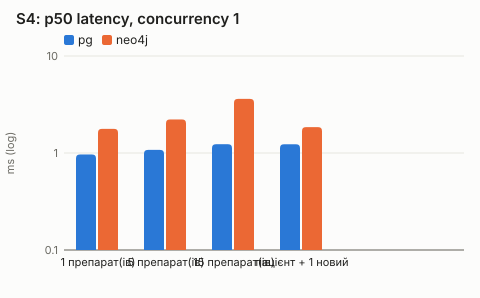
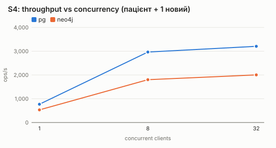
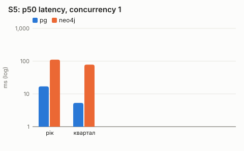
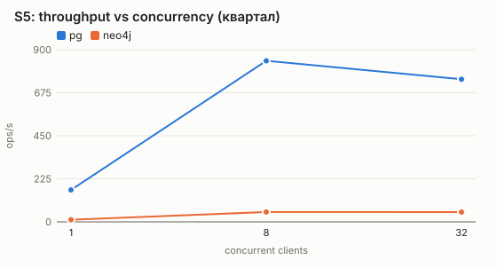

# Benchmark 2026-11-16T11-25-42-686Z (x1)

- Запуск: 2026-11-16T11:25:42.686Z → 2026-11-16T11:34:47.187Z
- Коміт: `5d404a290a864fc57f10985211094da118ae3d11` (є незакомічені зміни)
- Параметри: `—`, SHA-256 `44136fa355b3678a1146ad16f7e8649e94fb4fc21fe77e8310c060f61caaff8a`

<details><summary>Середовище (клієнт, ліміти контейнерів, налаштування рушіїв)</summary>

```json
{
  "client": {
    "node": "v22.23.4",
    "platform": "linux 6.18.44-fc-v470",
    "arch": "x64",
    "cpuModel": "Intel(R) Xeon(R) Processor @ 2.10GHz",
    "cpuCount": 4,
    "totalMemBytes": 16869146624
  },
  "containers": {
    "note": "docker not available; engines run without container limits"
  },
  "postgres": {
    "version": "PostgreSQL 16.15 (Ubuntu 16.15-0ubuntu0.24.04.1) on x86_64-pc-linux-gnu, compiled by gcc (Ubuntu 13.3.0-6ubuntu2~24.04.1) 13.3.0, 64-bit",
    "database": "clinic_bench_x1",
    "databaseSize": "191 MB",
    "settings": {
      "effective_cache_size": "262144 8kB",
      "jit": "off",
      "maintenance_work_mem": "65536 kB",
      "max_connections": "200",
      "max_parallel_workers_per_gather": "2",
      "random_page_cost": "1.1",
      "server_version": "16.15 (Ubuntu 16.15-0ubuntu0.24.04.1)",
      "shared_buffers": "131072 8kB",
      "statement_timeout": "30000 ms",
      "TimeZone": "Europe/Kyiv",
      "work_mem": "32768 kB"
    }
  },
  "neo4j": {
    "components": [
      {
        "name": "Neo4j Kernel",
        "versions": [
          "5.26.33"
        ],
        "edition": "community"
      }
    ],
    "settings": {
      "db.transaction.timeout": "1m",
      "dbms.cypher.planner": "DEFAULT",
      "server.cypher.parallel.worker_limit": "0",
      "server.memory.heap.initial_size": "1.00GiB",
      "server.memory.heap.max_size": "1.00GiB",
      "server.memory.pagecache.size": "1.46GiB"
    },
    "counts": {
      "nodes": 65230,
      "rels": 623548
    }
  }
}
```

</details>

## S4 — Перевірка взаємодії ліків: 1 / 5 / 15 препаратів

- **Чому:** Взаємодія через класи — граф глибиною 2 (препарат → клас → клас), але з крихітним довідником (600 препаратів, 80 класів, 550 взаємодій), що повністю в кеші обох рушіїв. Це навмисно сценарій, де графова модель не повинна вигравати: показує, що «граф» сам по собі не означає швидше. Набори препаратів вибрано пропорційно реальній частоті призначень.
- **Очікування:** PG рівний або швидший (кілька index lookup і join малих таблиць; накладні витрати Bolt і планувальника Cypher порівнянні з самим запитом). Різниця росте з 15 препаратами (105 пар) мало.
- **Спростовано, якщо:** Neo4j стабільно швидший у ≥ 2 рази на всіх розмірах набору.
- Методика: прогрів 100 ітерацій / 10 с; вимір 500 ітерацій / 30 с (мінімум 5); 3 повтори з чергуванням рушіїв; таймаут 30 с.





### S4 · 1 препарат(ів)

Параметри: `{"sets":50,"size":1}`

| c | engine | p50, ms | p50 spread | p95, ms | p99, ms | max, ms | ops/s | n | timeouts |
|---|---|---|---|---|---|---|---|---|---|
| 1 | pg | 0.965 | 0.885–0.994 | 1.38 | 1.69 | 5.64 | 969.8 | 1500 | 0 |
| 1 | neo4j | 1.77 | 1.27–1.99 | 2.92 | 4.68 | 19.6 | 526.6 | 1500 | 0 |
| 8 | pg | 1.78 | 1.64–1.81 | 3.60 | 4.84 | 7.82 | 4,157.8 | 1500 | 0 |
| 8 | neo4j | 4.14 | 3.39–4.66 | 9.51 | 13.0 | 16.9 | 1,673.8 | 1500 | 0 |
| 32 | pg | 8.05 | 6.46–8.61 | 13.1 | 15.1 | 29.3 | 4,132.5 | 1500 | 0 |
| 32 | neo4j | 14.6 | 11.2–18.0 | 28.6 | 32.2 | 61.1 | 2,062.1 | 1500 | 0 |

p50 ratio — c=1: pg / neo4j = 0.54×; c=8: pg / neo4j = 0.43×; c=32: pg / neo4j = 0.55×

<details><summary>План: pg</summary>

```
Append  (cost=0.44..5.70 rows=2 width=52) (actual time=0.031..0.033 rows=0 loops=1)
  CTE new_m
    ->  HashAggregate  (cost=0.02..0.03 rows=1 width=4) (actual time=0.013..0.014 rows=1 loops=1)
          Group Key: u.id
          Batches: 1  Memory Usage: 24kB
          ->  Function Scan on unnest u  (cost=0.00..0.01 rows=1 width=4) (actual time=0.007..0.007 rows=1 loops=1)
  CTE all_m
    ->  Unique  (cost=0.04..0.05 rows=2 width=4) (actual time=0.025..0.026 rows=1 loops=1)
          ->  Sort  (cost=0.04..0.05 rows=2 width=4) (actual time=0.025..0.025 rows=1 loops=1)
                Sort Key: new_m.id
                Sort Method: quicksort  Memory: 25kB
                ->  Append  (cost=0.00..0.03 rows=2 width=4) (actual time=0.014..0.016 rows=1 loops=1)
                      ->  CTE Scan on new_m  (cost=0.00..0.02 rows=1 width=4) (actual time=0.013..0.014 rows=1 loops=1)
                      ->  Result  (cost=0.00..0.00 rows=0 width=0) (actual time=0.001..0.001 rows=0 loops=1)
                            One-Time Filter: false
  CTE pairs
    ->  Nested Loop  (cost=0.04..0.22 rows=1 width=8) (actual time=0.028..0.029 rows=0 loops=1)
          Join Filter: ((a.id < b.id) AND ((hashed SubPlan 3) OR (hashed SubPlan 4)))
          Rows Removed by Join Filter: 1
          ->  CTE Scan on all_m a  (cost=0.00..0.04 rows=2 width=4) (actual time=0.026..0.026 rows=1 loops=1)
          ->  CTE Scan on all_m b  (cost=0.00..0.04 rows=2 width=4) (actual time=0.000..0.001 rows=1 loops=1)
          SubPlan 3
            ->  CTE Scan on new_m new_m_1  (cost=0.00..0.02 rows=1 width=4) (never executed)
          SubPlan 4
            ->  CTE Scan on new_m new_m_2  (cost=0.00..0.02 rows=1 width=4) (never executed)
  ->  Nested Loop  (cost=0.15..2.40 rows=1 width=52) (actual time=0.030..0.030 rows=0 loops=1)
        ->  CTE Scan on pairs p  (cost=0.00..0.02 rows=1 width=8) (actual time=0.029..0.029 rows=0 loops=1)
        ->  Index Scan using ix_medication_interactions_b on medication_interactions mi  (cost=0.15..2.37 rows=1 width=12) (never executed)
              Index Cond: (medication_b = p.b)
              Filter: (p.a = medication_a)
  ->  Nested Loop  (cost=0.70..3.00 rows=1 width=52) (actual time=0.000..0.001 rows=0 loops=1)
        ->  Nested Loop  (cost=0.55..2.83 rows=1 width=16) (actual time=0.000..0.001 rows=0 loops=1)
              ->  Nested Loop  (cost=0.28..1.42 rows=1 width=12) (actual time=0.000..0.000 rows=0 loops=1)
                    ->  CTE Scan on pairs p_1  (cost=0.00..0.02 rows=1 width=8) (actual time=0.000..0.000 rows=0 loops=1)
                    ->  Index Only Scan using ux_medication_classes on medication_classes ca  (cost=0.28..1.39 rows=1 width=8) (never executed)
                          Index Cond: (medication_id = p_1.a)
                          Heap Fetches: 0
              ->  Index Only Scan using ux_medication_classes on medication_classes cb  (cost=0.28..1.39 rows=1 width=8) (never executed)
                    Index Cond: (medication_id = p_1.b)
                    Heap Fetches: 0
        ->  Index Scan using ux_drug_class_interactions on drug_class_interactions ci  (cost=0.15..0.18 rows=1 width=12) (never executed)
              Index Cond: ((class_a = LEAST(ca.class_id, cb.class_id)) AND (class_b = GREATEST(ca.class_id, cb.class_id)))
Planning Time: 0.742 ms
Execution Time: 0.131 ms
```

</details>

<details><summary>План: neo4j</summary>

```
total dbHits=3, records=0
ProduceResults@neo4j  rows=0  dbHits=0
  Sort@neo4j  rows=0  dbHits=0
    Projection@neo4j  rows=0  dbHits=0
      Apply@neo4j  rows=0  dbHits=0
        Apply@neo4j  rows=0  dbHits=0
          Unwind@neo4j  rows=1  dbHits=0
            Unwind@neo4j  rows=1  dbHits=0
              Projection@neo4j  rows=1  dbHits=0
                EagerAggregation@neo4j  rows=1  dbHits=0
                  Optional@neo4j  rows=1  dbHits=0
                    CacheProperties@neo4j  rows=0  dbHits=0
                      Filter@neo4j  rows=0  dbHits=0
                        Expand(All)@neo4j  rows=0  dbHits=0
                          NodeUniqueIndexSeek@neo4j  rows=0  dbHits=1
          CartesianProduct@neo4j  rows=0  dbHits=0
            Filter@neo4j  rows=0  dbHits=0
              NodeUniqueIndexSeek@neo4j  rows=1  dbHits=2
            NodeUniqueIndexSeek@neo4j  rows=0  dbHits=0
        Distinct@neo4j  rows=0  dbHits=0
          Union@neo4j  rows=0  dbHits=0
            Projection@neo4j  rows=0  dbHits=0
              Distinct@neo4j  rows=0  dbHits=0
                Expand(Into)@neo4j  rows=0  dbHits=0
                  Argument@neo4j  rows=0  dbHits=0
            Projection@neo4j  rows=0  dbHits=0
              Distinct@neo4j  rows=0  dbHits=0
                Expand(Into)@neo4j  rows=0  dbHits=0
                  Filter@neo4j  rows=0  dbHits=0
                    Expand(All)@neo4j  rows=0  dbHits=0
                      Filter@neo4j  rows=0  dbHits=0
                        Expand(All)@neo4j  rows=0  dbHits=0
                          Argument@neo4j  rows=0  dbHits=0
```

</details>

### S4 · 5 препарат(ів)

Параметри: `{"sets":50,"size":5}`

| c | engine | p50, ms | p50 spread | p95, ms | p99, ms | max, ms | ops/s | n | timeouts |
|---|---|---|---|---|---|---|---|---|---|
| 1 | pg | 1.08 | 1.000–1.30 | 1.44 | 2.01 | 4.90 | 903.2 | 1500 | 0 |
| 1 | neo4j | 2.22 | 1.85–2.50 | 2.70 | 4.80 | 17.6 | 440.1 | 1500 | 0 |
| 8 | pg | 1.99 | 1.86–2.25 | 4.58 | 6.06 | 8.45 | 3,464.4 | 1500 | 0 |
| 8 | neo4j | 4.36 | 4.08–5.33 | 8.00 | 10.2 | 29.6 | 1,664.4 | 1500 | 0 |
| 32 | pg | 7.26 | 7.22–7.72 | 12.9 | 15.9 | 21.5 | 4,021.2 | 1500 | 0 |
| 32 | neo4j | 13.0 | 12.9–13.1 | 21.8 | 26.6 | 55.4 | 2,291.7 | 1500 | 0 |

p50 ratio — c=1: pg / neo4j = 0.49×; c=8: pg / neo4j = 0.46×; c=32: pg / neo4j = 0.56×

<details><summary>План: pg</summary>

```
Append  (cost=1.86..25.19 rows=2 width=52) (actual time=0.142..0.186 rows=1 loops=1)
  Buffers: shared hit=70
  CTE new_m
    ->  HashAggregate  (cost=0.07..0.12 rows=5 width=4) (actual time=0.018..0.019 rows=5 loops=1)
          Group Key: u.id
          Batches: 1  Memory Usage: 24kB
          ->  Function Scan on unnest u  (cost=0.00..0.05 rows=5 width=4) (actual time=0.010..0.010 rows=5 loops=1)
  CTE all_m
    ->  HashAggregate  (cost=0.15..0.21 rows=6 width=4) (actual time=0.027..0.029 rows=5 loops=1)
          Group Key: new_m.id
          Batches: 1  Memory Usage: 24kB
          ->  Append  (cost=0.00..0.13 rows=6 width=4) (actual time=0.019..0.025 rows=5 loops=1)
                ->  CTE Scan on new_m  (cost=0.00..0.10 rows=5 width=4) (actual time=0.019..0.022 rows=5 loops=1)
                ->  Result  (cost=0.00..0.00 rows=0 width=0) (actual time=0.001..0.001 rows=0 loops=1)
                      One-Time Filter: false
  CTE pairs
    ->  Nested Loop  (cost=0.23..1.40 rows=9 width=8) (actual time=0.039..0.050 rows=10 loops=1)
          Join Filter: ((a.id < b.id) AND ((hashed SubPlan 3) OR (hashed SubPlan 4)))
          Rows Removed by Join Filter: 15
          ->  CTE Scan on all_m a  (cost=0.00..0.12 rows=6 width=4) (actual time=0.028..0.028 rows=5 loops=1)
          ->  CTE Scan on all_m b  (cost=0.00..0.12 rows=6 width=4) (actual time=0.000..0.001 rows=5 loops=5)
          SubPlan 3
            ->  CTE Scan on new_m new_m_1  (cost=0.00..0.10 rows=5 width=4) (actual time=0.000..0.001 rows=5 loops=1)
          SubPlan 4
            ->  CTE Scan on new_m new_m_2  (cost=0.00..0.10 rows=5 width=4) (never executed)
  ->  Nested Loop  (cost=0.15..7.28 rows=1 width=52) (actual time=0.108..0.108 rows=0 loops=1)
        Buffers: shared hit=17
        ->  CTE Scan on pairs p  (cost=0.00..0.18 rows=9 width=8) (actual time=0.041..0.054 rows=10 loops=1)
        ->  Index Scan using ix_medication_interactions_b on medication_interactions mi  (cost=0.15..0.78 rows=1 width=12) (actual time=0.005..0.005 rows=0 loops=10)
              Index Cond: (medication_b = p.b)
              Filter: (p.a = medication_a)
              Rows Removed by Filter: 1
              Buffers: shared hit=17
  ->  Nested Loop  (cost=0.70..16.19 rows=1 width=52) (actual time=0.033..0.074 rows=1 loops=1)
        Buffers: shared hit=53
        ->  CTE Scan on pairs p_1  (cost=0.00..0.18 rows=9 width=8) (actual time=0.000..0.001 rows=10 loops=1)
        ->  Nested Loop  (cost=0.70..1.77 rows=1 width=20) (actual time=0.007..0.007 rows=0 loops=10)
              Join Filter: ((ci.class_a = LEAST(ca.class_id, cb.class_id)) AND (ci.class_b = GREATEST(ca.class_id, cb.class_id)))
              Buffers: shared hit=53
              ->  Index Only Scan using ux_medication_classes on medication_classes cb  (cost=0.28..0.78 rows=1 width=8) (actual time=0.002..0.002 rows=1 loops=10)
                    Index Cond: (medication_id = p_1.b)
                    Heap Fetches: 0
                    Buffers: shared hit=21
              ->  Nested Loop  (cost=0.43..0.97 rows=1 width=20) (actual time=0.004..0.004 rows=0 loops=10)
                    Buffers: shared hit=32
                    ->  Index Only Scan using ux_medication_classes on medication_classes ca  (cost=0.28..0.78 rows=1 width=8) (actual time=0.001..0.002 rows=1 loops=10)
                          Index Cond: (medication_id = p_1.a)
                          Heap Fetches: 0
                          Buffers: shared hit=21
                    ->  Index Scan using ux_drug_class_interactions on drug_class_interactions ci  (cost=0.15..0.18 rows=1 width=12) (actual time=0.002..0.002 rows=0 loops=10)
                          Index Cond: ((class_a = LEAST(ca.class_id, cb.class_id)) AND (class_b = GREATEST(ca.class_id, cb.class_id)))
                          Buffers: shared hit=11
Planning Time: 1.161 ms
Execution Time: 0.311 ms
```

</details>

<details><summary>План: neo4j</summary>

```
total dbHits=429, records=1
ProduceResults@neo4j  rows=1  dbHits=0
  Sort@neo4j  rows=1  dbHits=0
    Projection@neo4j  rows=1  dbHits=0
      Apply@neo4j  rows=1  dbHits=0
        Apply@neo4j  rows=10  dbHits=0
          Unwind@neo4j  rows=25  dbHits=0
            Unwind@neo4j  rows=5  dbHits=0
              Projection@neo4j  rows=1  dbHits=0
                EagerAggregation@neo4j  rows=1  dbHits=0
                  Optional@neo4j  rows=1  dbHits=0
                    CacheProperties@neo4j  rows=0  dbHits=0
                      Filter@neo4j  rows=0  dbHits=0
                        Expand(All)@neo4j  rows=0  dbHits=0
                          NodeUniqueIndexSeek@neo4j  rows=0  dbHits=1
          CartesianProduct@neo4j  rows=10  dbHits=0
            Filter@neo4j  rows=10  dbHits=0
              NodeUniqueIndexSeek@neo4j  rows=25  dbHits=50
            NodeUniqueIndexSeek@neo4j  rows=10  dbHits=20
        Distinct@neo4j  rows=1  dbHits=0
          Union@neo4j  rows=1  dbHits=0
            Projection@neo4j  rows=0  dbHits=0
              Distinct@neo4j  rows=0  dbHits=0
                Expand(Into)@neo4j  rows=0  dbHits=66
                  Argument@neo4j  rows=10  dbHits=0
            Projection@neo4j  rows=1  dbHits=0
              Distinct@neo4j  rows=1  dbHits=3
                Expand(Into)@neo4j  rows=1  dbHits=169
                  Filter@neo4j  rows=10  dbHits=10
                    Expand(All)@neo4j  rows=10  dbHits=50
                      Filter@neo4j  rows=10  dbHits=10
                        Expand(All)@neo4j  rows=10  dbHits=50
                          Argument@neo4j  rows=10  dbHits=0
```

</details>

### S4 · 15 препарат(ів)

Параметри: `{"sets":50,"size":15}`

| c | engine | p50, ms | p50 spread | p95, ms | p99, ms | max, ms | ops/s | n | timeouts |
|---|---|---|---|---|---|---|---|---|---|
| 1 | pg | 1.23 | 1.15–1.31 | 1.64 | 2.18 | 4.64 | 781.6 | 1500 | 0 |
| 1 | neo4j | 3.61 | 3.48–3.99 | 5.19 | 7.97 | 23.8 | 261.8 | 1500 | 0 |
| 8 | pg | 2.28 | 2.18–2.42 | 4.44 | 5.33 | 12.2 | 3,298.8 | 1500 | 0 |
| 8 | neo4j | 7.24 | 7.18–9.32 | 13.7 | 18.6 | 28.3 | 1,013.4 | 1500 | 0 |
| 32 | pg | 10.4 | 8.60–11.0 | 17.4 | 21.4 | 33.1 | 3,043.3 | 1500 | 0 |
| 32 | neo4j | 26.4 | 24.8–29.7 | 53.8 | 64.1 | 81.7 | 1,094.1 | 1500 | 0 |

p50 ratio — c=1: pg / neo4j = 0.34×; c=8: pg / neo4j = 0.31×; c=32: pg / neo4j = 0.39×

<details><summary>План: pg</summary>

```
Append  (cost=11.36..61.59 rows=2 width=52) (actual time=0.502..0.585 rows=4 loops=1)
  Buffers: shared hit=15
  CTE new_m
    ->  HashAggregate  (cost=0.19..0.34 rows=15 width=4) (actual time=0.016..0.018 rows=15 loops=1)
          Group Key: u.id
          Batches: 1  Memory Usage: 24kB
          ->  Function Scan on unnest u  (cost=0.00..0.15 rows=15 width=4) (actual time=0.008..0.009 rows=15 loops=1)
  CTE all_m
    ->  HashAggregate  (cost=0.42..0.58 rows=16 width=4) (actual time=0.027..0.029 rows=15 loops=1)
          Group Key: new_m.id
          Batches: 1  Memory Usage: 24kB
          ->  Append  (cost=0.00..0.38 rows=16 width=4) (actual time=0.017..0.025 rows=15 loops=1)
                ->  CTE Scan on new_m  (cost=0.00..0.30 rows=15 width=4) (actual time=0.017..0.021 rows=15 loops=1)
                ->  Result  (cost=0.00..0.00 rows=0 width=0) (actual time=0.002..0.002 rows=0 loops=1)
                      One-Time Filter: false
  CTE pairs
    ->  Nested Loop  (cost=0.67..8.20 rows=64 width=8) (actual time=0.039..0.088 rows=105 loops=1)
          Join Filter: ((a.id < b.id) AND ((hashed SubPlan 3) OR (hashed SubPlan 4)))
          Rows Removed by Join Filter: 120
          ->  CTE Scan on all_m a  (cost=0.00..0.32 rows=16 width=4) (actual time=0.027..0.028 rows=15 loops=1)
          ->  CTE Scan on all_m b  (cost=0.00..0.32 rows=16 width=4) (actual time=0.000..0.001 rows=15 loops=15)
          SubPlan 3
            ->  CTE Scan on new_m new_m_1  (cost=0.00..0.30 rows=15 width=4) (actual time=0.000..0.001 rows=15 loops=1)
          SubPlan 4
            ->  CTE Scan on new_m new_m_2  (cost=0.00..0.30 rows=15 width=4) (never executed)
  ->  Hash Join  (cost=2.24..11.38 rows=1 width=52) (actual time=0.210..0.211 rows=0 loops=1)
        Hash Cond: ((mi.medication_a = p.a) AND (mi.medication_b = p.b))
        Buffers: shared hit=3
        ->  Seq Scan on medication_interactions mi  (cost=0.00..6.50 rows=350 width=12) (actual time=0.008..0.036 rows=350 loops=1)
              Buffers: shared hit=3
        ->  Hash  (cost=1.28..1.28 rows=64 width=8) (actual time=0.123..0.124 rows=105 loops=1)
              Buckets: 1024  Batches: 1  Memory Usage: 13kB
              ->  CTE Scan on pairs p  (cost=0.00..1.28 rows=64 width=8) (actual time=0.040..0.109 rows=105 loops=1)
  ->  Hash Join  (cost=25.26..41.09 rows=1 width=52) (actual time=0.292..0.370 rows=4 loops=1)
        Hash Cond: ((LEAST(ca.class_id, cb.class_id) = ci.class_a) AND (GREATEST(ca.class_id, cb.class_id) = ci.class_b))
        Buffers: shared hit=12
        ->  Hash Join  (cost=18.26..33.62 rows=85 width=16) (actual time=0.182..0.279 rows=119 loops=1)
              Hash Cond: (cb.medication_id = p_1.b)
              Buffers: shared hit=10
              ->  Seq Scan on medication_classes cb  (cost=0.00..11.92 rows=692 width=8) (actual time=0.006..0.044 rows=692 loops=1)
                    Buffers: shared hit=5
              ->  Hash  (cost=17.34..17.34 rows=74 width=12) (actual time=0.167..0.168 rows=113 loops=1)
                    Buckets: 1024  Batches: 1  Memory Usage: 13kB
                    Buffers: shared hit=5
                    ->  Hash Join  (cost=2.08..17.34 rows=74 width=12) (actual time=0.027..0.136 rows=113 loops=1)
                          Hash Cond: (ca.medication_id = p_1.a)
                          Buffers: shared hit=5
                          ->  Seq Scan on medication_classes ca  (cost=0.00..11.92 rows=692 width=8) (actual time=0.001..0.050 rows=692 loops=1)
                                Buffers: shared hit=5
                          ->  Hash  (cost=1.28..1.28 rows=64 width=8) (actual time=0.017..0.017 rows=105 loops=1)
                                Buckets: 1024  Batches: 1  Memory Usage: 13kB
                                ->  CTE Scan on pairs p_1  (cost=0.00..1.28 rows=64 width=8) (actual time=0.000..0.007 rows=105 loops=1)
        ->  Hash  (cost=4.00..4.00 rows=200 width=12) (actual time=0.067..0.067 rows=200 loops=1)
              Buckets: 1024  Batches: 1  Memory Usage: 17kB
              Buffers: shared hit=2
              ->  Seq Scan on drug_class_interactions ci  (cost=0.00..4.00 rows=200 width=12) (actual time=0.003..0.029 rows=200 loops=1)
                    Buffers: shared hit=2
Planning Time: 0.767 ms
Execution Time: 0.669 ms
```

</details>

<details><summary>План: neo4j</summary>

```
total dbHits=4416, records=4
ProduceResults@neo4j  rows=4  dbHits=0
  Sort@neo4j  rows=4  dbHits=0
    Projection@neo4j  rows=4  dbHits=0
      Apply@neo4j  rows=4  dbHits=0
        Apply@neo4j  rows=105  dbHits=0
          Unwind@neo4j  rows=225  dbHits=0
            Unwind@neo4j  rows=15  dbHits=0
              Projection@neo4j  rows=1  dbHits=0
                EagerAggregation@neo4j  rows=1  dbHits=0
                  Optional@neo4j  rows=1  dbHits=0
                    CacheProperties@neo4j  rows=0  dbHits=0
                      Filter@neo4j  rows=0  dbHits=0
                        Expand(All)@neo4j  rows=0  dbHits=0
                          NodeUniqueIndexSeek@neo4j  rows=0  dbHits=1
          CartesianProduct@neo4j  rows=105  dbHits=0
            Filter@neo4j  rows=105  dbHits=0
              NodeUniqueIndexSeek@neo4j  rows=225  dbHits=450
            NodeUniqueIndexSeek@neo4j  rows=105  dbHits=210
        Distinct@neo4j  rows=4  dbHits=0
          Union@neo4j  rows=4  dbHits=0
            Projection@neo4j  rows=0  dbHits=0
              Distinct@neo4j  rows=0  dbHits=0
                Expand(Into)@neo4j  rows=0  dbHits=557
                  Argument@neo4j  rows=105  dbHits=0
            Projection@neo4j  rows=4  dbHits=0
              Distinct@neo4j  rows=4  dbHits=12
                Expand(Into)@neo4j  rows=4  dbHits=1947
                  Filter@neo4j  rows=119  dbHits=119
                    Expand(All)@neo4j  rows=119  dbHits=527
                      Filter@neo4j  rows=111  dbHits=111
                        Expand(All)@neo4j  rows=111  dbHits=482
                          Argument@neo4j  rows=105  dbHits=0
```

</details>

### S4 · пацієнт + 1 новий

Параметри: `{"sets":50}`

| c | engine | p50, ms | p50 spread | p95, ms | p99, ms | max, ms | ops/s | n | timeouts |
|---|---|---|---|---|---|---|---|---|---|
| 1 | pg | 1.23 | 1.22–1.31 | 1.70 | 1.97 | 7.39 | 769.4 | 1500 | 0 |
| 1 | neo4j | 1.85 | 1.80–1.99 | 2.56 | 4.31 | 11.0 | 531.4 | 1500 | 0 |
| 8 | pg | 2.52 | 2.32–2.60 | 4.98 | 6.47 | 7.67 | 2,965.6 | 1500 | 0 |
| 8 | neo4j | 3.76 | 2.82–4.54 | 7.83 | 10.5 | 12.6 | 1,802.8 | 1500 | 0 |
| 32 | pg | 8.97 | 8.72–9.51 | 17.3 | 20.9 | 46.9 | 3,205.7 | 1500 | 0 |
| 32 | neo4j | 15.4 | 13.0–17.6 | 21.9 | 29.4 | 42.3 | 2,003.9 | 1500 | 0 |

p50 ratio — c=1: pg / neo4j = 0.67×; c=8: pg / neo4j = 0.67×; c=32: pg / neo4j = 0.58×

<details><summary>План: pg</summary>

```
Append  (cost=13.36..18.62 rows=2 width=52) (actual time=0.258..0.262 rows=0 loops=1)
  Buffers: shared hit=67
  CTE new_m
    ->  HashAggregate  (cost=0.02..0.03 rows=1 width=4) (actual time=0.017..0.018 rows=1 loops=1)
          Group Key: u.id
          Batches: 1  Memory Usage: 24kB
          ->  Function Scan on unnest u  (cost=0.00..0.01 rows=1 width=4) (actual time=0.011..0.011 rows=1 loops=1)
  CTE all_m
    ->  Unique  (cost=12.96..12.97 rows=2 width=4) (actual time=0.171..0.175 rows=5 loops=1)
          Buffers: shared hit=38
          ->  Sort  (cost=12.96..12.97 rows=2 width=4) (actual time=0.170..0.172 rows=5 loops=1)
                Sort Key: new_m.id
                Sort Method: quicksort  Memory: 25kB
                Buffers: shared hit=38
                ->  Append  (cost=0.00..12.95 rows=2 width=4) (actual time=0.018..0.163 rows=5 loops=1)
                      Buffers: shared hit=38
                      ->  CTE Scan on new_m  (cost=0.00..0.02 rows=1 width=4) (actual time=0.018..0.019 rows=1 loops=1)
                      ->  Unique  (cost=12.92..12.92 rows=1 width=4) (actual time=0.140..0.143 rows=4 loops=1)
                            Buffers: shared hit=38
                            ->  Sort  (cost=12.92..12.92 rows=1 width=4) (actual time=0.140..0.141 rows=4 loops=1)
                                  Sort Key: pi.medication_id
                                  Sort Method: quicksort  Memory: 25kB
                                  Buffers: shared hit=38
                                  ->  Nested Loop  (cost=1.13..12.91 rows=1 width=4) (actual time=0.095..0.131 rows=4 loops=1)
                                        Buffers: shared hit=38
                                        ->  Nested Loop  (cost=0.71..12.35 rows=1 width=12) (actual time=0.050..0.097 rows=2 loops=1)
                                              Buffers: shared hit=30
                                              ->  Index Scan using ix_medical_records_patient on medical_records mr  (cost=0.42..4.78 rows=3 width=4) (actual time=0.019..0.036 rows=7 loops=1)
                                                    Index Cond: (patient_id = 11330)
                                                    Buffers: shared hit=10
                                              ->  Index Scan using ix_prescriptions_record on prescriptions rx  (cost=0.29..2.51 rows=1 width=16) (actual time=0.008..0.008 rows=0 loops=7)
                                                    Index Cond: (medical_record_id = mr.id)
                                                    Filter: (issued_at <= '2026-05-14 20:00:00+03'::timestamp with time zone)
                                                    Rows Removed by Filter: 1
                                                    Buffers: shared hit=20
                                        ->  Index Scan using ix_prescription_items_prescription on prescription_items pi  (cost=0.42..0.55 rows=1 width=12) (actual time=0.014..0.015 rows=2 loops=2)
                                              Index Cond: (prescription_id = rx.id)
                                              Filter: ('2026-05-14 20:00:00+03'::timestamp with time zone < (rx.issued_at + make_interval(0, 0, 0, duration_days, 0, 0, '0'::double precision)))
                                              Rows Removed by Filter: 2
                                              Buffers: shared hit=8
  CTE pairs
    ->  Nested Loop  (cost=0.04..0.22 rows=1 width=8) (actual time=0.181..0.193 rows=4 loops=1)
          Join Filter: ((a.id < b.id) AND ((hashed SubPlan 3) OR (hashed SubPlan 4)))
          Rows Removed by Join Filter: 21
          Buffers: shared hit=38
          ->  CTE Scan on all_m a  (cost=0.00..0.04 rows=2 width=4) (actual time=0.171..0.172 rows=5 loops=1)
                Buffers: shared hit=38
          ->  CTE Scan on all_m b  (cost=0.00..0.04 rows=2 width=4) (actual time=0.000..0.001 rows=5 loops=5)
          SubPlan 3
            ->  CTE Scan on new_m new_m_1  (cost=0.00..0.02 rows=1 width=4) (actual time=0.000..0.000 rows=1 loops=1)
          SubPlan 4
            ->  CTE Scan on new_m new_m_2  (cost=0.00..0.02 rows=1 width=4) (actual time=0.000..0.000 rows=1 loops=1)
  ->  Nested Loop  (cost=0.15..2.40 rows=1 width=52) (actual time=0.209..0.209 rows=0 loops=1)
        Buffers: shared hit=43
        ->  CTE Scan on pairs p  (cost=0.00..0.02 rows=1 width=8) (actual time=0.183..0.196 rows=4 loops=1)
              Buffers: shared hit=38
        ->  Index Scan using ix_medication_interactions_b on medication_interactions mi  (cost=0.15..2.37 rows=1 width=12) (actual time=0.003..0.003 rows=0 loops=4)
              Index Cond: (medication_b = p.b)
              Filter: (p.a = medication_a)
              Rows Removed by Filter: 0
              Buffers: shared hit=5
  ->  Nested Loop  (cost=0.70..3.00 rows=1 width=52) (actual time=0.048..0.049 rows=0 loops=1)
        Buffers: shared hit=24
        ->  Nested Loop  (cost=0.55..2.83 rows=1 width=16) (actual time=0.021..0.034 rows=6 loops=1)
              Buffers: shared hit=18
              ->  Nested Loop  (cost=0.28..1.42 rows=1 width=12) (actual time=0.013..0.019 rows=4 loops=1)
                    Buffers: shared hit=9
                    ->  CTE Scan on pairs p_1  (cost=0.00..0.02 rows=1 width=8) (actual time=0.000..0.001 rows=4 loops=1)
                    ->  Index Only Scan using ux_medication_classes on medication_classes ca  (cost=0.28..1.39 rows=1 width=8) (actual time=0.004..0.004 rows=1 loops=4)
                          Index Cond: (medication_id = p_1.a)
                          Heap Fetches: 0
                          Buffers: shared hit=9
              ->  Index Only Scan using ux_medication_classes on medication_classes cb  (cost=0.28..1.39 rows=1 width=8) (actual time=0.003..0.003 rows=2 loops=4)
                    Index Cond: (medication_id = p_1.b)
                    Heap Fetches: 0
                    Buffers: shared hit=9
        ->  Index Scan using ux_drug_class_interactions on drug_class_interactions ci  (cost=0.15..0.18 rows=1 width=12) (actual time=0.002..0.002 rows=0 loops=6)
              Index Cond: ((class_a = LEAST(ca.class_id, cb.class_id)) AND (class_b = GREATEST(ca.class_id, cb.class_id)))
              Buffers: shared hit=6
Planning:
  Buffers: shared hit=28
Planning Time: 1.284 ms
Execution Time: 0.378 ms
```

</details>

<details><summary>План: neo4j</summary>

```
total dbHits=309, records=0
ProduceResults@neo4j  rows=0  dbHits=0
  Sort@neo4j  rows=0  dbHits=0
    Projection@neo4j  rows=0  dbHits=0
      Apply@neo4j  rows=0  dbHits=0
        Apply@neo4j  rows=4  dbHits=0
          Unwind@neo4j  rows=25  dbHits=0
            Unwind@neo4j  rows=5  dbHits=0
              Projection@neo4j  rows=1  dbHits=0
                EagerAggregation@neo4j  rows=1  dbHits=0
                  Optional@neo4j  rows=4  dbHits=0
                    CacheProperties@neo4j  rows=4  dbHits=4
                      Filter@neo4j  rows=4  dbHits=34
                        Expand(All)@neo4j  rows=17  dbHits=28
                          NodeUniqueIndexSeek@neo4j  rows=1  dbHits=2
          CartesianProduct@neo4j  rows=4  dbHits=0
            Filter@neo4j  rows=4  dbHits=0
              NodeUniqueIndexSeek@neo4j  rows=25  dbHits=50
            NodeUniqueIndexSeek@neo4j  rows=4  dbHits=8
        Distinct@neo4j  rows=0  dbHits=0
          Union@neo4j  rows=0  dbHits=0
            Projection@neo4j  rows=0  dbHits=0
              Distinct@neo4j  rows=0  dbHits=0
                Expand(Into)@neo4j  rows=0  dbHits=20
                  Argument@neo4j  rows=4  dbHits=0
            Projection@neo4j  rows=0  dbHits=0
              Distinct@neo4j  rows=0  dbHits=0
                Expand(Into)@neo4j  rows=0  dbHits=106
                  Filter@neo4j  rows=6  dbHits=6
                    Expand(All)@neo4j  rows=6  dbHits=24
                      Filter@neo4j  rows=6  dbHits=6
                        Expand(All)@neo4j  rows=6  dbHits=21
                          Argument@neo4j  rows=4  dbHits=0
```

</details>

## S5 — Плаский агрегат: госпіталізації по відділеннях по місяцях

- **Чому:** Типовий звіт без обходу: скан + групування. Включений, щоб показати, де графова модель програє: Neo4j мусить пройти всі ребра PRESENT (src = admission) і перетворити час, PG — індекс за датою і hash aggregate. Без цього сценарію порівняння було б упереджене на користь графа.
- **Очікування:** PG швидший щонайменше в 10 разів на рік даних; різниця росте з масштабом.
- **Спростовано, якщо:** Neo4j у межах 2× від PG.
- Методика: прогрів 100 ітерацій / 10 с; вимір 500 ітерацій / 30 с (мінімум 5); 3 повтори з чергуванням рушіїв; таймаут 30 с.





### S5 · рік

Параметри: `{"from":"2025-11-01","to":"2026-11-01"}`

| c | engine | p50, ms | p50 spread | p95, ms | p99, ms | max, ms | ops/s | n | timeouts |
|---|---|---|---|---|---|---|---|---|---|
| 1 | pg | 17.0 | 16.8–17.2 | 28.9 | 30.6 | 40.9 | 53.5 | 1500 | 0 |
| 1 | neo4j | 111 | 111–129 | 173 | 192 | 343 | 8.4 | 713 | 0 |
| 8 | pg | 37.1 | 36.8–37.1 | 66.0 | 80.5 | 94.9 | 193.8 | 1500 | 0 |
| 8 | neo4j | 224 | 223–225 | 328 | 373 | 490 | 34.5 | 1500 | 0 |
| 32 | pg | 145 | 144–152 | 252 | 292 | 330 | 199.8 | 1500 | 0 |
| 32 | neo4j | 1027 | 1002–1039 | 1416 | 1576 | 1824 | 30.5 | 1500 | 0 |

p50 ratio — c=1: pg / neo4j = 0.15×; c=8: pg / neo4j = 0.17×; c=32: pg / neo4j = 0.14×

<details><summary>План: pg</summary>

```
GroupAggregate  (cost=2612.59..3265.99 rows=23760 width=12) (actual time=20.498..23.365 rows=96 loops=1)
  Group Key: w.department_id, ((date_trunc('month'::text, a.admitted_at))::date)
  Buffers: shared hit=267
  ->  Sort  (cost=2612.59..2671.99 rows=23760 width=8) (actual time=20.444..21.550 rows=23760 loops=1)
        Sort Key: w.department_id, ((date_trunc('month'::text, a.admitted_at))::date)
        Sort Method: quicksort  Memory: 1511kB
        Buffers: shared hit=267
        ->  Hash Join  (cost=14.40..885.69 rows=23760 width=8) (actual time=0.159..15.113 rows=23760 loops=1)
              Hash Cond: (b.ward_id = w.id)
              Buffers: shared hit=261
              ->  Hash Join  (cost=13.00..688.43 rows=23760 width=12) (actual time=0.130..7.872 rows=23760 loops=1)
                    Hash Cond: (a.bed_id = b.id)
                    Buffers: shared hit=260
                    ->  Seq Scan on admissions a  (cost=0.00..612.40 rows=23760 width=12) (actual time=0.004..4.211 rows=23760 loops=1)
                          Filter: ((admitted_at >= '2025-11-01'::date) AND (admitted_at < '2026-11-01'::date))
                          Buffers: shared hit=256
                    ->  Hash  (cost=8.00..8.00 rows=400 width=8) (actual time=0.110..0.111 rows=400 loops=1)
                          Buckets: 1024  Batches: 1  Memory Usage: 24kB
                          Buffers: shared hit=4
                          ->  Seq Scan on beds b  (cost=0.00..8.00 rows=400 width=8) (actual time=0.005..0.062 rows=400 loops=1)
                                Buffers: shared hit=4
              ->  Hash  (cost=1.18..1.18 rows=18 width=8) (actual time=0.014..0.014 rows=18 loops=1)
                    Buckets: 1024  Batches: 1  Memory Usage: 9kB
                    Buffers: shared hit=1
                    ->  Seq Scan on wards w  (cost=0.00..1.18 rows=18 width=8) (actual time=0.004..0.006 rows=18 loops=1)
                          Buffers: shared hit=1
Planning:
  Buffers: shared hit=796
Planning Time: 1.948 ms
Execution Time: 23.574 ms
```

</details>

<details><summary>План: neo4j</summary>

```
total dbHits=321853, records=96
ProduceResults@neo4j  rows=96  dbHits=0
  PartialSort@neo4j  rows=96  dbHits=0
    OrderedAggregation@neo4j  rows=96  dbHits=0
      Projection@neo4j  rows=23760  dbHits=23760
        Filter@neo4j  rows=23760  dbHits=172761
          Expand(All)@neo4j  rows=125241  dbHits=125295
            Sort@neo4j  rows=18  dbHits=0
              Projection@neo4j  rows=18  dbHits=18
                NodeByLabelScan@neo4j  rows=18  dbHits=19
```

</details>

### S5 · квартал

Параметри: `{"from":"2026-01-01","to":"2026-04-01"}`

| c | engine | p50, ms | p50 spread | p95, ms | p99, ms | max, ms | ops/s | n | timeouts |
|---|---|---|---|---|---|---|---|---|---|
| 1 | pg | 5.31 | 4.99–5.31 | 8.14 | 8.83 | 12.8 | 167.2 | 1500 | 0 |
| 1 | neo4j | 78.3 | 77.9–79.7 | 131 | 139 | 151 | 11.2 | 1013 | 0 |
| 8 | pg | 8.65 | 8.41–9.82 | 16.7 | 21.0 | 40.9 | 841.9 | 1500 | 0 |
| 8 | neo4j | 144 | 140–144 | 247 | 304 | 352 | 51.6 | 1500 | 0 |
| 32 | pg | 40.5 | 37.5–40.7 | 72.0 | 88.2 | 127 | 745.5 | 1500 | 0 |
| 32 | neo4j | 604 | 577–613 | 896 | 1034 | 1154 | 51.1 | 1500 | 0 |

p50 ratio — c=1: pg / neo4j = 0.07×; c=8: pg / neo4j = 0.06×; c=32: pg / neo4j = 0.07×

<details><summary>План: pg</summary>

```
GroupAggregate  (cost=630.01..788.47 rows=5762 width=12) (actual time=5.026..5.615 rows=24 loops=1)
  Group Key: w.department_id, ((date_trunc('month'::text, a.admitted_at))::date)
  Buffers: shared hit=88
  ->  Sort  (cost=630.01..644.42 rows=5762 width=8) (actual time=4.982..5.225 rows=5720 loops=1)
        Sort Key: w.department_id, ((date_trunc('month'::text, a.admitted_at))::date)
        Sort Method: quicksort  Memory: 371kB
        Buffers: shared hit=88
        ->  Hash Join  (cost=14.69..270.11 rows=5762 width=8) (actual time=0.165..3.886 rows=5720 loops=1)
              Hash Cond: (b.ward_id = w.id)
              Buffers: shared hit=82
              ->  Hash Join  (cost=13.29..221.21 rows=5762 width=12) (actual time=0.134..2.062 rows=5720 loops=1)
                    Hash Cond: (a.bed_id = b.id)
                    Buffers: shared hit=81
                    ->  Index Scan using ix_admissions_admitted_at on admissions a  (cost=0.29..192.93 rows=5762 width=12) (actual time=0.032..0.931 rows=5720 loops=1)
                          Index Cond: ((admitted_at >= '2026-01-01'::date) AND (admitted_at < '2026-04-01'::date))
                          Buffers: shared hit=77
                    ->  Hash  (cost=8.00..8.00 rows=400 width=8) (actual time=0.090..0.091 rows=400 loops=1)
                          Buckets: 1024  Batches: 1  Memory Usage: 24kB
                          Buffers: shared hit=4
                          ->  Seq Scan on beds b  (cost=0.00..8.00 rows=400 width=8) (actual time=0.006..0.043 rows=400 loops=1)
                                Buffers: shared hit=4
              ->  Hash  (cost=1.18..1.18 rows=18 width=8) (actual time=0.014..0.014 rows=18 loops=1)
                    Buckets: 1024  Batches: 1  Memory Usage: 9kB
                    Buffers: shared hit=1
                    ->  Seq Scan on wards w  (cost=0.00..1.18 rows=18 width=8) (actual time=0.004..0.006 rows=18 loops=1)
                          Buffers: shared hit=1
Planning:
  Buffers: shared hit=790
Planning Time: 1.918 ms
Execution Time: 5.776 ms
```

</details>

<details><summary>План: neo4j</summary>

```
total dbHits=285773, records=24
ProduceResults@neo4j  rows=24  dbHits=0
  PartialSort@neo4j  rows=24  dbHits=0
    OrderedAggregation@neo4j  rows=24  dbHits=0
      Projection@neo4j  rows=5720  dbHits=5720
        Filter@neo4j  rows=5720  dbHits=154721
          Expand(All)@neo4j  rows=125241  dbHits=125295
            Sort@neo4j  rows=18  dbHits=0
              Projection@neo4j  rows=18  dbHits=18
                NodeByLabelScan@neo4j  rows=18  dbHits=19
```

</details>

