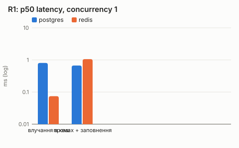
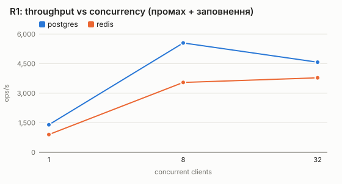
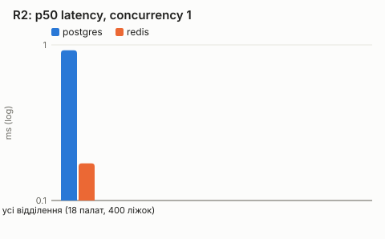
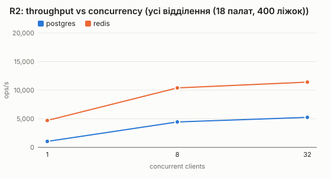
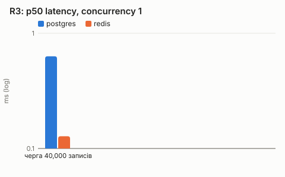
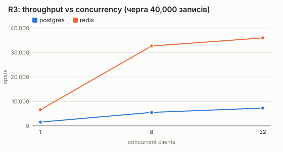
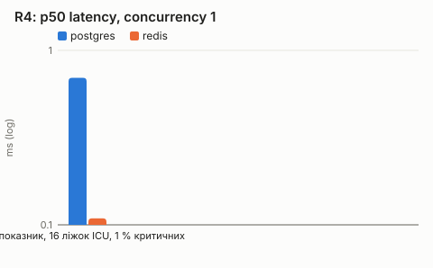
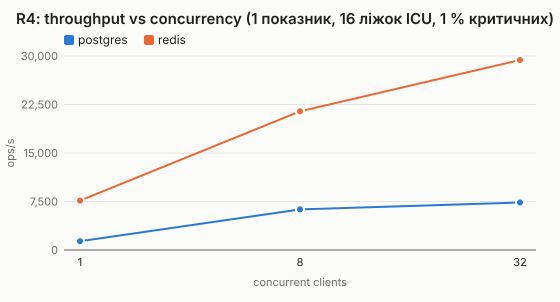

# Benchmark 2026-11-16T11-36-20-078Z (x1)

- Запуск: 2026-11-16T11:36:20.078Z → 2026-11-16T11:38:54.176Z
- Коміт: `5d404a290a864fc57f10985211094da118ae3d11` (є незакомічені зміни)
- Параметри: `—`, SHA-256 `44136fa355b3678a1146ad16f7e8649e94fb4fc21fe77e8310c060f61caaff8a`

<details><summary>Середовище (клієнт, ліміти контейнерів, налаштування рушіїв)</summary>

```json
{
  "client": {
    "node": "v22.23.4",
    "platform": "linux 6.18.44-fc-v470",
    "arch": "x64",
    "cpuModel": "Intel(R) Xeon(R) Processor @ 2.10GHz",
    "cpuCount": 4,
    "totalMemBytes": 16869146624
  },
  "containers": {
    "note": "docker not available; engines run without container limits"
  },
  "postgres": {
    "version": "PostgreSQL 16.15 (Ubuntu 16.15-0ubuntu0.24.04.1) on x86_64-pc-linux-gnu, compiled by gcc (Ubuntu 13.3.0-6ubuntu2~24.04.1) 13.3.0, 64-bit",
    "database": "clinic_bench_x1",
    "databaseSize": "201 MB",
    "settings": {
      "effective_cache_size": "262144 8kB",
      "jit": "off",
      "maintenance_work_mem": "65536 kB",
      "max_connections": "200",
      "max_parallel_workers_per_gather": "2",
      "random_page_cost": "1.1",
      "server_version": "16.15 (Ubuntu 16.15-0ubuntu0.24.04.1)",
      "shared_buffers": "131072 8kB",
      "statement_timeout": "30000 ms",
      "TimeZone": "Europe/Kyiv",
      "work_mem": "32768 kB"
    }
  },
  "redis": {
    "version": "7.4.12",
    "config": {
      "maxmemory": "419430400",
      "maxmemory-policy": "noeviction",
      "appendonly": "yes",
      "appendfsync": "everysec",
      "save": "3600 1 300 100 60 10000",
      "io-threads": "1"
    }
  }
}
```

</details>

## R1 — Вільні слоти лікаря: кеш Redis vs fn_doctor_free_slots

- **Чому:** Розклад читають набагато частіше, ніж записують (кожне відкриття форми запису), а fn_doctor_free_slots щоразу генерує сітку слотів і перевіряє перетин з прийомами. Кеш має сенс лише якщо влучання суттєво дешевше за запит, а промах не надто дорожчий. Тому два варіанти: влучання (GET + JSON.parse) і промах (DEL → GET → PG → SET EX 60), обидва проти чистого PG. Вхідні дані виводяться детерміновано з бази (ORDER BY id) — обидва рушії отримують однаковий i-й запит.
- **Очікування:** Влучання в 3–10× швидше за PG (один GET проти генерації сітки й anti-join); промах повільніший за PG на 2–3 мережеві обміни з Redis.
- **Спростовано, якщо:** p50 влучання ≥ p50 PG (кеш не виграє навіть у найкращому випадку) або промах дорожчий за PG більш ніж на 1 мс.
- Методика: прогрів 100 ітерацій / 10 с; вимір 500 ітерацій / 30 с (мінімум 5); 3 повтори з чергуванням рушіїв; таймаут 30 с.





### R1 · влучання в кеш

Параметри: `{"pairs":64,"ttlSeconds":3600}`

| c | engine | p50, ms | p50 spread | p95, ms | p99, ms | max, ms | ops/s | n | timeouts |
|---|---|---|---|---|---|---|---|---|---|
| 1 | postgres | 0.805 | 0.686–1.07 | 1.18 | 1.49 | 4.58 | 1,188.3 | 1500 | 0 |
| 1 | redis | 0.074 | 0.057–0.093 | 0.133 | 0.356 | 3.25 | 11,499.7 | 1500 | 0 |
| 8 | postgres | 1.82 | 1.80–1.91 | 3.44 | 4.83 | 6.92 | 4,131.2 | 1500 | 0 |
| 8 | redis | 0.149 | 0.127–0.161 | 0.255 | 3.90 | 6.70 | 39,011.8 | 1500 | 0 |
| 32 | postgres | 6.66 | 6.06–7.01 | 13.8 | 18.1 | 22.0 | 4,407.7 | 1500 | 0 |
| 32 | redis | 0.274 | 0.268–0.483 | 1.45 | 1.45 | 2.11 | 77,105.9 | 1500 | 0 |

p50 ratio — c=1: postgres / redis = 10.83×; c=8: postgres / redis = 12.25×; c=32: postgres / redis = 24.31×

<details><summary>План: postgres</summary>

```
Sort  (cost=529.18..530.01 rows=331 width=16) (actual time=0.089..0.091 rows=12 loops=1)
  Sort Key: ((gs.gs)::timestamp with time zone)
  Sort Method: quicksort  Memory: 25kB
  Buffers: shared hit=15
  ->  Nested Loop Anti Join  (cost=0.45..515.33 rows=331 width=16) (actual time=0.060..0.085 rows=12 loops=1)
        Buffers: shared hit=15
        ->  Nested Loop  (cost=0.16..26.51 rows=333 width=12) (actual time=0.030..0.039 rows=12 loops=1)
              Buffers: shared hit=3
              ->  Nested Loop  (cost=0.15..5.66 rows=1 width=20) (actual time=0.021..0.027 rows=1 loops=1)
                    Buffers: shared hit=3
                    ->  Index Scan using ux_doctor_schedules_day on doctor_schedules s  (cost=0.15..3.90 rows=1 width=24) (actual time=0.016..0.018 rows=1 loops=1)
                          Index Cond: (doctor_id = 1)
                          Filter: ((weekday)::numeric = '2'::numeric)
                          Rows Removed by Filter: 4
                          Buffers: shared hit=2
                    ->  Seq Scan on doctors d  (cost=0.00..1.75 rows=1 width=4) (actual time=0.004..0.008 rows=1 loops=1)
                          Filter: ((deleted_at IS NULL) AND (id = 1))
                          Rows Removed by Filter: 59
                          Buffers: shared hit=1
              ->  Function Scan on generate_series gs  (cost=0.02..17.52 rows=333 width=8) (actual time=0.008..0.010 rows=12 loops=1)
                    Filter: ((gs)::timestamp with time zone > now())
        ->  Index Scan using ex_appointments_doctor_overlap on appointments a  (cost=0.29..24.91 rows=21 width=16) (actual time=0.003..0.003 rows=0 loops=12)
              Index Cond: ((doctor_id = 1) AND (tstzrange(starts_at, ends_at) && tstzrange((gs.gs)::timestamp with time zone, ((gs.gs)::timestamp with time zone + make_interval(0, 0, 0, 0, 0, s.slot_minutes, '0'::double precision)))))
              Buffers: shared hit=12
Planning Time: 0.437 ms
Execution Time: 0.160 ms
```

</details>

### R1 · промах + заповнення

Параметри: `{"pairs":64,"ttlSeconds":60}`

| c | engine | p50, ms | p50 spread | p95, ms | p99, ms | max, ms | ops/s | n | timeouts |
|---|---|---|---|---|---|---|---|---|---|
| 1 | postgres | 0.670 | 0.621–0.712 | 0.942 | 1.04 | 18.1 | 1,402.5 | 1500 | 0 |
| 1 | redis | 1.06 | 1.05–1.13 | 1.49 | 1.78 | 4.70 | 901.8 | 1500 | 0 |
| 8 | postgres | 1.27 | 1.17–1.41 | 2.63 | 3.55 | 5.36 | 5,551.8 | 1500 | 0 |
| 8 | redis | 2.09 | 1.91–2.48 | 3.86 | 5.01 | 6.73 | 3,548.1 | 1500 | 0 |
| 32 | postgres | 7.09 | 6.06–7.81 | 11.1 | 15.0 | 24.6 | 4,573.3 | 1500 | 0 |
| 32 | redis | 8.38 | 7.05–9.12 | 11.1 | 14.6 | 16.5 | 3,780.9 | 1500 | 0 |

p50 ratio — c=1: postgres / redis = 0.63×; c=8: postgres / redis = 0.61×; c=32: postgres / redis = 0.85×

<details><summary>План: postgres</summary>

```
Sort  (cost=529.18..530.01 rows=331 width=16) (actual time=0.075..0.076 rows=12 loops=1)
  Sort Key: ((gs.gs)::timestamp with time zone)
  Sort Method: quicksort  Memory: 25kB
  Buffers: shared hit=15
  ->  Nested Loop Anti Join  (cost=0.45..515.33 rows=331 width=16) (actual time=0.049..0.071 rows=12 loops=1)
        Buffers: shared hit=15
        ->  Nested Loop  (cost=0.16..26.51 rows=333 width=12) (actual time=0.023..0.032 rows=12 loops=1)
              Buffers: shared hit=3
              ->  Nested Loop  (cost=0.15..5.66 rows=1 width=20) (actual time=0.016..0.022 rows=1 loops=1)
                    Buffers: shared hit=3
                    ->  Index Scan using ux_doctor_schedules_day on doctor_schedules s  (cost=0.15..3.90 rows=1 width=24) (actual time=0.012..0.013 rows=1 loops=1)
                          Index Cond: (doctor_id = 1)
                          Filter: ((weekday)::numeric = '2'::numeric)
                          Rows Removed by Filter: 4
                          Buffers: shared hit=2
                    ->  Seq Scan on doctors d  (cost=0.00..1.75 rows=1 width=4) (actual time=0.003..0.007 rows=1 loops=1)
                          Filter: ((deleted_at IS NULL) AND (id = 1))
                          Rows Removed by Filter: 59
                          Buffers: shared hit=1
              ->  Function Scan on generate_series gs  (cost=0.02..17.52 rows=333 width=8) (actual time=0.007..0.008 rows=12 loops=1)
                    Filter: ((gs)::timestamp with time zone > now())
        ->  Index Scan using ex_appointments_doctor_overlap on appointments a  (cost=0.29..24.91 rows=21 width=16) (actual time=0.002..0.002 rows=0 loops=12)
              Index Cond: ((doctor_id = 1) AND (tstzrange(starts_at, ends_at) && tstzrange((gs.gs)::timestamp with time zone, ((gs.gs)::timestamp with time zone + make_interval(0, 0, 0, 0, 0, s.slot_minutes, '0'::double precision)))))
              Buffers: shared hit=12
Planning Time: 0.365 ms
Execution Time: 0.113 ms
```

</details>

## R2 — Лічильники ліжок: HGETALL по відділеннях vs агрегат v_beds

- **Чому:** Дашборд заповненості опитується постійно з багатьох робочих місць. У PG це агрегат над v_beds (beds ⋈ wards ⋈ departments ⋈ активні admissions ⋈ patients), в Redis — готові лічильники (SMEMBERS + конвеєр HGETALL, один мережевий обмін). Вимірюємо саме читання; ціну підтримки лічильників (HINCRBY після commit + звірка) показує тест packages/redis/tests. Вхідні дані виводяться детерміновано з бази (ORDER BY id) — обидва рушії отримують однаковий i-й запит.
- **Очікування:** Redis у 5–20× швидший і майже не залежить від кількості ліжок; PG росте лінійно з розміром таблиці ліжок.
- **Спростовано, якщо:** p50 Redis ≥ p50 PG при ×1 або результати розходяться (сценарій перевіряє рівність перед виміром).
- Методика: прогрів 100 ітерацій / 10 с; вимір 500 ітерацій / 30 с (мінімум 5); 3 повтори з чергуванням рушіїв; таймаут 30 с.





### R2 · усі відділення (18 палат, 400 ліжок)

Параметри: `{"beds":400,"wards":18}`

| c | engine | p50, ms | p50 spread | p95, ms | p99, ms | max, ms | ops/s | n | timeouts |
|---|---|---|---|---|---|---|---|---|---|
| 1 | postgres | 0.924 | 0.825–0.924 | 1.27 | 1.47 | 4.04 | 1,037.9 | 1500 | 0 |
| 1 | redis | 0.173 | 0.169–0.300 | 0.396 | 0.863 | 4.69 | 4,699.6 | 1500 | 0 |
| 8 | postgres | 1.69 | 1.59–1.92 | 3.37 | 4.50 | 7.76 | 4,441.6 | 1500 | 0 |
| 8 | redis | 0.713 | 0.581–0.878 | 1.27 | 1.87 | 3.93 | 10,400.2 | 1500 | 0 |
| 32 | postgres | 6.20 | 6.14–6.76 | 10.0 | 13.4 | 19.3 | 5,243.0 | 1500 | 0 |
| 32 | redis | 2.68 | 2.19–2.97 | 4.14 | 4.52 | 4.54 | 11,407.6 | 1500 | 0 |

p50 ratio — c=1: postgres / redis = 5.33×; c=8: postgres / redis = 2.38×; c=32: postgres / redis = 2.31×

<details><summary>План: postgres</summary>

```
Sort  (cost=38.02..38.07 rows=18 width=12) (actual time=0.441..0.444 rows=18 loops=1)
  Sort Key: w.id
  Sort Method: quicksort  Memory: 25kB
  Buffers: shared hit=78
  ->  HashAggregate  (cost=37.38..37.65 rows=18 width=12) (actual time=0.430..0.435 rows=18 loops=1)
        Group Key: w.id
        Batches: 1  Memory Usage: 24kB
        Buffers: shared hit=78
        ->  Hash Join  (cost=15.73..32.38 rows=400 width=8) (actual time=0.134..0.372 rows=400 loops=1)
              Hash Cond: (w.department_id = dep.id)
              Buffers: shared hit=78
              ->  Hash Join  (cost=14.55..29.59 rows=400 width=12) (actual time=0.120..0.307 rows=400 loops=1)
                    Hash Cond: (b.ward_id = w.id)
                    Buffers: shared hit=77
                    ->  Hash Right Join  (cost=13.15..26.89 rows=400 width=8) (actual time=0.107..0.240 rows=400 loops=1)
                          Hash Cond: (a.bed_id = b.id)
                          Buffers: shared hit=76
                          ->  Index Scan using ux_admissions_patient_active on admissions a  (cost=0.15..13.06 rows=314 width=8) (actual time=0.012..0.080 rows=314 loops=1)
                                Buffers: shared hit=72
                          ->  Hash  (cost=8.00..8.00 rows=400 width=12) (actual time=0.088..0.089 rows=400 loops=1)
                                Buckets: 1024  Batches: 1  Memory Usage: 26kB
                                Buffers: shared hit=4
                                ->  Seq Scan on beds b  (cost=0.00..8.00 rows=400 width=12) (actual time=0.002..0.045 rows=400 loops=1)
                                      Filter: (deleted_at IS NULL)
                                      Buffers: shared hit=4
                    ->  Hash  (cost=1.18..1.18 rows=18 width=8) (actual time=0.010..0.010 rows=18 loops=1)
                          Buckets: 1024  Batches: 1  Memory Usage: 9kB
                          Buffers: shared hit=1
                          ->  Seq Scan on wards w  (cost=0.00..1.18 rows=18 width=8) (actual time=0.003..0.006 rows=18 loops=1)
                                Filter: (deleted_at IS NULL)
                                Buffers: shared hit=1
              ->  Hash  (cost=1.08..1.08 rows=8 width=4) (actual time=0.011..0.011 rows=8 loops=1)
                    Buckets: 1024  Batches: 1  Memory Usage: 9kB
                    Buffers: shared hit=1
                    ->  Seq Scan on departments dep  (cost=0.00..1.08 rows=8 width=4) (actual time=0.005..0.007 rows=8 loops=1)
                          Buffers: shared hit=1
Planning:
  Buffers: shared hit=18
Planning Time: 0.507 ms
Execution Time: 0.487 ms
```

</details>

## R3 — Черга тріажу: ZPOPMIN vs FOR UPDATE SKIP LOCKED

- **Чому:** BR-14 вимагає, щоб кожного пацієнта викликали рівно один раз у порядку ESI → час прибуття, навіть коли «наступного» натискають одночасно кілька постів. У PG це UPDATE … WHERE id = (SELECT … FOR UPDATE SKIP LOCKED) з частковим індексом (запис у WAL, блокування рядка, мертвий кортеж), у Redis — атомарний ZPOPMIN O(log N). Конкурентність 1/8/32 показує, як кожен рушій поводиться під конкуренцією за «голову» черги. Обидві черги заздалегідь заповнені однаковими 40 000 записів.
- **Очікування:** Redis у 3–10× швидший на c = 1 і масштабується краще (однопотоковий цикл подій без блокувань рядків); PG під 32 споживачами упирається в fsync/WAL і пропуск заблокованих рядків. Обидва — без дублікатів і з правильним порядком.
- **Спростовано, якщо:** будь-який дублікат або порушення порядку (сценарій падає), або p50 PG ≤ p50 Redis на c = 1.
- Методика: прогрів 100 ітерацій / 10 с; вимір 500 ітерацій / 30 с (мінімум 5); 3 повтори з чергуванням рушіїв; таймаут 30 с.





### R3 · черга 40,000 записів

Параметри: `{"prefill":40000,"esi":"1 + (i·7919) mod 5","arrival":"t0 + i ms"}`

| c | engine | p50, ms | p50 spread | p95, ms | p99, ms | max, ms | ops/s | n | timeouts |
|---|---|---|---|---|---|---|---|---|---|
| 1 | postgres | 0.631 | 0.611–0.731 | 0.943 | 1.38 | 3.74 | 1,532.7 | 1500 | 0 |
| 1 | redis | 0.128 | 0.115–0.134 | 0.197 | 0.375 | 2.82 | 6,597.1 | 1500 | 0 |
| 8 | postgres | 1.31 | 1.17–1.37 | 2.37 | 3.56 | 5.00 | 5,501.9 | 1500 | 0 |
| 8 | redis | 0.236 | 0.228–0.358 | 0.370 | 0.495 | 0.766 | 32,694.2 | 1500 | 0 |
| 32 | postgres | 4.06 | 3.89–4.28 | 7.45 | 8.77 | 11.8 | 7,285.0 | 1500 | 0 |
| 32 | redis | 0.819 | 0.776–0.834 | 1.74 | 1.74 | 6.46 | 36,022.7 | 1500 | 0 |

p50 ratio — c=1: postgres / redis = 4.94×; c=8: postgres / redis = 5.57×; c=32: postgres / redis = 4.96×

<details><summary>План: postgres</summary>

```
Function Scan on fn_triage_pop  (cost=0.25..10.25 rows=1000 width=94) (actual time=0.596..0.597 rows=1 loops=1)
  Buffers: shared hit=63
Planning Time: 0.049 ms
Execution Time: 0.619 ms
```

</details>

## R4 — Інжест показників ICU: Lua-скрипт Redis vs CALL sp_icu_vitals_insert

- **Чому:** Монітори шлють показник щосекунди з кожного ліжка; запис має бути дешевим, а критичний алерт — миттєвим (≤ 2 с, F-44). Порівнюємо однакову роботу: зберегти показник + перевірити BR-17 + за порушення записати алерт і сповістити (Redis: XADD MAXLEN~ + HSET latest + PUBLISH + LPUSH одним Lua; PG: INSERT + fn_icu_violations + INSERT icu_alerts + pg_notify у транзакції з fsync при commit). Вхідні дані виводяться детерміновано з бази (ORDER BY id) — обидва рушії отримують однаковий i-й запит.
- **Очікування:** Redis у 3–10× швидший на c = 1 (пам'ять + AOF everysec проти синхронного fsync WAL на кожен commit) і дає більшу пропускну здатність під 32 клієнтами; ціна — до 1 с даних при аварії (AOF everysec) і обрізаний потік (MAXLEN).
- **Спростовано, якщо:** p50 PG ≤ p50 Redis на c = 1, або PG масштабується під 32 клієнтами краще за Redis (group commit WAL).
- Методика: прогрів 100 ітерацій / 10 с; вимір 500 ітерацій / 30 с (мінімум 5); 3 повтори з чергуванням рушіїв; таймаут 30 с.





### R4 · 1 показник, 16 ліжок ICU, 1 % критичних

Параметри: `{"icuBeds":16,"criticalEvery":100}`

| c | engine | p50, ms | p50 spread | p95, ms | p99, ms | max, ms | ops/s | n | timeouts |
|---|---|---|---|---|---|---|---|---|---|
| 1 | postgres | 0.696 | 0.632–0.731 | 1.05 | 1.50 | 5.96 | 1,355.4 | 1500 | 0 |
| 1 | redis | 0.109 | 0.086–0.118 | 0.186 | 0.412 | 3.95 | 7,633.1 | 1500 | 0 |
| 8 | postgres | 1.11 | 1.09–1.28 | 2.26 | 3.28 | 4.88 | 6,283.8 | 1500 | 0 |
| 8 | redis | 0.335 | 0.325–0.413 | 0.556 | 0.763 | 1.86 | 21,441.1 | 1500 | 0 |
| 32 | postgres | 3.89 | 3.68–4.25 | 8.05 | 10.00 | 16.4 | 7,341.7 | 1500 | 0 |
| 32 | redis | 0.983 | 0.808–1.17 | 1.43 | 1.46 | 1.71 | 29,381.4 | 1500 | 0 |

p50 ratio — c=1: postgres / redis = 6.39×; c=8: postgres / redis = 3.33×; c=32: postgres / redis = 3.95×

<details><summary>План: postgres</summary>

```
duration: 0.022 ms  plan:
Query Text: SELECT 1 FROM ONLY "public"."beds" x WHERE "id" OPERATOR(pg_catalog.=) $1 FOR KEY SHARE OF x
Query Parameters: $1 = '385'
LockRows  (cost=0.15..2.38 rows=1 width=10) (actual time=0.021..0.021 rows=1 loops=1)
  Buffers: shared hit=4
  ->  Index Scan using beds_pkey on beds x  (cost=0.15..2.37 rows=1 width=10) (actual time=0.014..0.014 rows=1 loops=1)
        Index Cond: (id = $1)
        Buffers: shared hit=2

duration: 0.255 ms  plan:
Query Text: INSERT INTO icu_vitals_pg (bed_id, at, hr, spo2, sbp, dbp, rr, temp)
  VALUES (p_bed_id, p_at, p_hr, p_spo2, p_sbp, p_dbp, p_rr, p_temp)
  RETURNING id
Insert on icu_vitals_pg  (cost=0.00..0.03 rows=1 width=44) (actual time=0.069..0.070 rows=1 loops=1)
  Buffers: shared hit=9
  ->  Result  (cost=0.00..0.03 rows=1 width=44) (actual time=0.016..0.016 rows=1 loops=1)
        Buffers: shared hit=1

duration: 0.036 ms  plan:
Query Text: 
  SELECT coalesce(jsonb_agg(jsonb_build_object('sign', v.sign, 'value', v.value, 'rule', v.rule) ORDER BY v.ord), '[]'::jsonb)
  FROM (VALUES
    (1, 'hr', p_hr, '< 40', p_hr < 40),
    (2, 'hr', p_hr, '> 140', p_hr > 140),
    (3, 'spo2', p_spo2, '< 88', p_spo2 < 88),
    (4, 'sbp', p_sbp, '< 80', p_sbp < 80),
    (5, 'sbp', p_sbp, '> 200', p_sbp > 200),
    (6, 'rr', p_rr, '< 8', p_rr < 8),
    (7, 'rr', p_rr, '> 30', p_rr > 30),
    (8, 'temp', p_temp, '> 39.5', p_temp > 39.5)
  ) AS v (ord, sign, value, rule, hit)
  WHERE v.hit

Query Parameters: $1 = '35', $2 = '95', $3 = '115', $4 = '70', $5 = '14', $6 = '36.6'
Aggregate  (cost=0.17..0.18 rows=1 width=32) (actual time=0.034..0.035 rows=1 loops=1)
  ->  Sort  (cost=0.14..0.15 rows=4 width=100) (actual time=0.017..0.018 rows=1 loops=1)
        Sort Key: "*VALUES*".column1
        Sort Method: quicksort  Memory: 25kB
        ->  Values Scan on "*VALUES*"  (cost=0.00..0.10 rows=4 width=100) (actual time=0.005..0.009 rows=1 loops=1)
              Filter: column5
              Rows Removed by Filter: 7

duration: 0.018 ms  plan:
Query Text: SELECT 1 FROM ONLY "public"."beds" x WHERE "id" OPERATOR(pg_catalog.=) $1 FOR KEY SHARE OF x
Query Parameters: $1 = '385'
LockRows  (cost=0.15..2.38 rows=1 width=10) (actual time=0.014..0.014 rows=1 loops=1)
  Buffers: shared hit=4
  ->  Index Scan using beds_pkey on beds x  (cost=0.15..2.37 rows=1 width=10) (actual time=0.012..0.012 rows=1 loops=1)
        Index Cond: (id = 385)
        Buffers: shared hit=2

duration: 0.052 ms  plan:
Query Text: SELECT 1 FROM ONLY "public"."patients" x WHERE "id" OPERATOR(pg_catalog.=) $1 FOR KEY SHARE OF x
Query Parameters: $1 = '19524'
LockRows  (cost=0.29..2.52 rows=1 width=10) (actual time=0.049..0.050 rows=1 loops=1)
  Buffers: shared hit=5
  ->  Index Scan using patients_pkey on patients x  (cost=0.29..2.51 rows=1 width=10) (actual time=0.031..0.031 rows=1 loops=1)
        Index Cond: (id = 19524)
        Buffers: shared hit=3

duration: 1.618 ms  plan:
Query Text: INSERT INTO icu_alerts (stream_id, bed_id, patient_id, violations, vitals, at)
  VALUES (p_stream_id, p_bed_id,
          coalesce(p_patient_id, (SELECT a.patient_id FROM admissions a WHERE a.bed_id = p_bed_id AND a.status = 'active')),
          p_violations, p_vitals, p_at)
  ON CONFLICT (stream_id) DO NOTHING
  RETURNING id
Insert on icu_alerts  (cost=2.36..2.37 rows=1 width=128) (actual time=0.474..0.475 rows=1 loops=1)
  Conflict Resolution: NOTHING
  Conflict Arbiter Indexes: ux_icu_alerts_stream
  Tuples Inserted: 1
  Conflicting Tuples: 0
  Buffers: shared hit=71
  InitPlan 1 (returns $0)
    ->  Index Scan using ex_admissions_bed_active on admissions a  (cost=0.14..2.36 rows=1 width=4) (actual time=0.292..0.293 rows=1 loops=1)
          Index Cond: (bed_id = 385)
          Buffers: shared hit=30
  ->  Result  (cost=0.00..0.01 rows=1 width=128) (actual time=0.319..0.320 rows=1 loops=1)
        Buffers: shared hit=39

duration: 0.017 ms  plan:
Query Text: SELECT pg_notify('icu_alerts', jsonb_build_object('id', v_alert, 'bedId', p_bed_id, 'violations', p_violations)::text)
Result  (cost=0.00..0.02 rows=1 width=4) (actual time=0.015..0.016 rows=1 loops=1)
```

</details>

