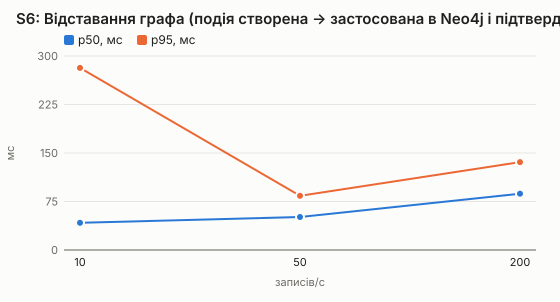

# Benchmark 2026-11-16T11-34-50-050Z (x1)

- Запуск: 2026-11-16T11:34:50.050Z → 2026-11-16T11:36:18.716Z
- Коміт: `5d404a290a864fc57f10985211094da118ae3d11` (є незакомічені зміни)
- Параметри: `—`, SHA-256 `44136fa355b3678a1146ad16f7e8649e94fb4fc21fe77e8310c060f61caaff8a`

<details><summary>Середовище (клієнт, ліміти контейнерів, налаштування рушіїв)</summary>

```json
{
  "client": {
    "node": "v22.23.4",
    "platform": "linux 6.18.44-fc-v470",
    "arch": "x64",
    "cpuModel": "Intel(R) Xeon(R) Processor @ 2.10GHz",
    "cpuCount": 4,
    "totalMemBytes": 16869146624
  },
  "containers": {
    "note": "docker not available; engines run without container limits"
  },
  "postgres": {
    "version": "PostgreSQL 16.15 (Ubuntu 16.15-0ubuntu0.24.04.1) on x86_64-pc-linux-gnu, compiled by gcc (Ubuntu 13.3.0-6ubuntu2~24.04.1) 13.3.0, 64-bit",
    "database": "clinic_bench_x1",
    "databaseSize": "191 MB",
    "settings": {
      "effective_cache_size": "262144 8kB",
      "jit": "off",
      "maintenance_work_mem": "65536 kB",
      "max_connections": "200",
      "max_parallel_workers_per_gather": "2",
      "random_page_cost": "1.1",
      "server_version": "16.15 (Ubuntu 16.15-0ubuntu0.24.04.1)",
      "shared_buffers": "131072 8kB",
      "statement_timeout": "30000 ms",
      "TimeZone": "Europe/Kyiv",
      "work_mem": "32768 kB"
    }
  },
  "neo4j": {
    "components": [
      {
        "name": "Neo4j Kernel",
        "versions": [
          "5.26.33"
        ],
        "edition": "community"
      }
    ],
    "settings": {
      "db.transaction.timeout": "1m",
      "dbms.cypher.planner": "DEFAULT",
      "server.cypher.parallel.worker_limit": "0",
      "server.memory.heap.initial_size": "1.00GiB",
      "server.memory.heap.max_size": "1.00GiB",
      "server.memory.pagecache.size": "1.46GiB"
    },
    "counts": {
      "nodes": 65230,
      "rels": 623548
    }
  }
}
```

</details>

## S6 — Ціна синхронізації: накладні витрати outbox на запис і відставання графа при 10 / 50 / 200 записів/с

- **Чому:** Граф — read-model, і за нього платить кожен запис у PG (тригер будує payload з v_presence і вставляє рядок outbox у тій самій транзакції). Без цієї ціни порівняння читання було б нечесним. Записом обрано вставку зміни персоналу: вона дає ребро PRESENT, тобто проходить повний шлях тригер → outbox → воркер → Neo4j. Темпи 10 / 50 / 200 записів/с — від реального навантаження лікарні (~1 запис/с для присутностей) до 200× запасу.
- **Очікування:** Накладні витрати тригера — десятки відсотків від часу маленької вставки (але < 1 мс абсолютно); p95 відставання ≤ 5 с (BR-11) на всіх темпах, з ростом при 200/с через пакетування.
- **Спростовано, якщо:** p95 відставання > 5 с при 50 записах/с або тригер подвоює час запису.
- Методика: прогрів 100 ітерацій / 10 с; вимір 500 ітерацій / 30 с (мінімум 5); 3 повтори з чергуванням рушіїв; таймаут 30 с.

**Вставка зміни персоналу (2000 × 3 повтори в транзакції з ROLLBACK, по одній, 1 клієнт)**

| режим | n | p50, мкс | p95, мкс | p99, мкс |
|---|---|---|---|---|
| без outbox-тригера | 6,000 | 260 | 526 | 671.30 |
| з outbox-тригером | 6,000 | 615.60 | 980.20 | 1,363.60 |
| накладні витрати p50 | — | +355.6 мкс (136.8 %) | — | — |

**Відставання графа (подія створена → застосована в Neo4j і підтверджена), 10 с на кожен темп**

| записів/с | досягнуто/с | подій | p50, мс | p95, мс | max, мс |
|---|---|---|---|---|---|
| 10 | 10.10 | 100 | 42 | 281.60 | 681.60 |
| 50 | 50.10 | 500 | 51.10 | 83.80 | 97.60 |
| 200 | 200 | 2,000 | 87 | 135.90 | 168.10 |



## S7 — Повний ETL PostgreSQL → Neo4j

- **Чому:** Початкове завантаження і відновлення графа після збою — одноразова, але реальна ціна read-model. Час по сутностях показує, що домінує (ребра PRESENT), і як ETL масштабується з даними ×1 / ×5 / ×10. UNWIND пакетами по 10 000 — компроміс між кількістю round-trip і розміром транзакції в heap 1 ГБ.
- **Очікування:** Час росте приблизно лінійно з кількістю ребер; ×10 — хвилини, не години.
- **Спростовано, якщо:** Надлінійне зростання (ознака відсутнього індексу при MERGE) або ×10 > 30 хв.
- Методика: прогрів 100 ітерацій / 10 с; вимір 500 ітерацій / 30 с (мінімум 5); 3 повтори з чергуванням рушіїв; таймаут 30 с.

**Повний ETL (x1), підтверджено подій outbox: 0**

| сутність | рядків | с | рядків/с |
|---|---|---|---|
| Patient | 64,000 | 3 | 21,208 |
| Staff | 360 | 0.10 | 2,777 |
| Ward | 18 | 0.10 | 253 |
| Room | 112 | 0.10 | 1,110 |
| Office | 60 | 0.10 | 597 |
| Medication | 600 | 0.10 | 6,248 |
| DrugClass | 80 | 0.10 | 1,011 |
| IN | 112 | 0.20 | 675 |
| PRESENT patient→room | 23,760 | 1.40 | 16,515 |
| PRESENT patient→ward | 23,760 | 1.30 | 17,868 |
| PRESENT patient→office | 127,317 | 5.90 | 21,687 |
| PRESENT staff→room | 0 | 0 | 0 |
| PRESENT staff→ward | 101,481 | 3.80 | 26,951 |
| PRESENT staff→office | 127,317 | 4.60 | 27,762 |
| TAKES | 218,559 | 8.60 | 25,383 |
| IN_CLASS | 692 | 0.10 | 5,026 |
| INTERACTS med | 350 | 0.10 | 2,958 |
| INTERACTS class | 200 | 0.10 | 1,965 |
| очистка + схема | — | 16.50 | — |
| усього | 688,778 | 46.30 | — |

