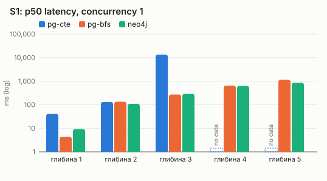
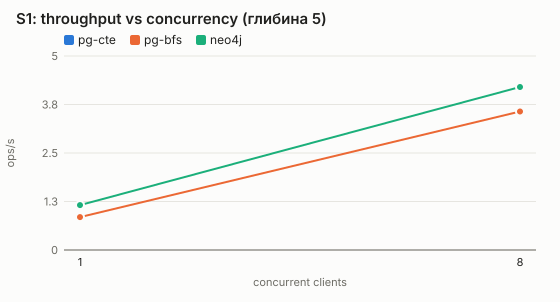
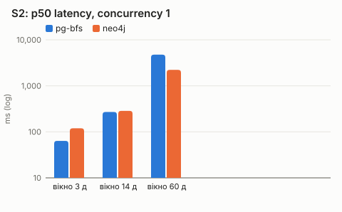
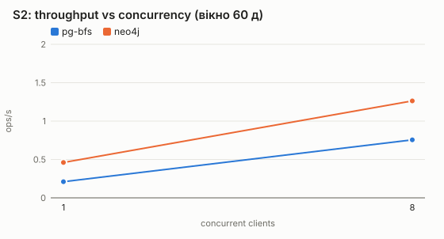
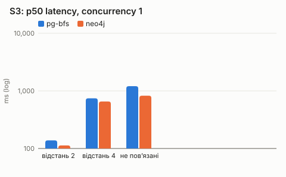
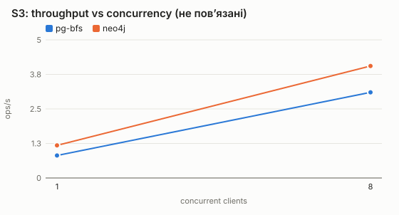

# Benchmark 2026-11-16T09-57-06-056Z (x1)

- Запуск: 2026-11-16T09:57:06.056Z → 2026-11-16T11:25:39.974Z
- Коміт: `5d404a290a864fc57f10985211094da118ae3d11` (є незакомічені зміни)
- Параметри: `—`, SHA-256 `44136fa355b3678a1146ad16f7e8649e94fb4fc21fe77e8310c060f61caaff8a`

<details><summary>Середовище (клієнт, ліміти контейнерів, налаштування рушіїв)</summary>

```json
{
  "client": {
    "node": "v22.23.4",
    "platform": "linux 6.18.44-fc-v470",
    "arch": "x64",
    "cpuModel": "Intel(R) Xeon(R) Processor @ 2.10GHz",
    "cpuCount": 4,
    "totalMemBytes": 16869146624
  },
  "containers": {
    "note": "docker not available; engines run without container limits"
  },
  "postgres": {
    "version": "PostgreSQL 16.15 (Ubuntu 16.15-0ubuntu0.24.04.1) on x86_64-pc-linux-gnu, compiled by gcc (Ubuntu 13.3.0-6ubuntu2~24.04.1) 13.3.0, 64-bit",
    "database": "clinic_bench_x1",
    "databaseSize": "193 MB",
    "settings": {
      "effective_cache_size": "262144 8kB",
      "jit": "off",
      "maintenance_work_mem": "65536 kB",
      "max_connections": "200",
      "max_parallel_workers_per_gather": "2",
      "random_page_cost": "1.1",
      "server_version": "16.15 (Ubuntu 16.15-0ubuntu0.24.04.1)",
      "shared_buffers": "131072 8kB",
      "statement_timeout": "30000 ms",
      "TimeZone": "Europe/Kyiv",
      "work_mem": "32768 kB"
    }
  },
  "neo4j": {
    "components": [
      {
        "name": "Neo4j Kernel",
        "versions": [
          "5.26.33"
        ],
        "edition": "community"
      }
    ],
    "settings": {
      "db.transaction.timeout": "1m",
      "dbms.cypher.planner": "DEFAULT",
      "server.cypher.parallel.worker_limit": "0",
      "server.memory.heap.initial_size": "1.00GiB",
      "server.memory.heap.max_size": "1.00GiB",
      "server.memory.pagecache.size": "1.46GiB"
    },
    "counts": {
      "nodes": 65230,
      "rels": 623548
    }
  }
}
```

</details>

## S1 — Відстеження контактів, глибина 1–5 (вікно 14 днів)

- **Чому:** Головне питання роботи: чи дає графова модель виграш на багатокрокових обходах. Глибина — єдиний параметр, від якого вартість SQL росте як розмір фронту в степені кроку; 200 індексних пацієнтів, активних у вікні, — ті самі, що в гейті щільності, тож розмір кроків відомий (d1 p50 ≈ 50, d2 ≈ 500 на ×1). Рекурсивний CTE міряється лише до глибини 3: на глибині 3 він уже виходить за таймаут 30 с, далі були б самі таймаути.
- **Очікування:** d1 — паритет або перемога PG (один GiST-пошук); з глибиною Neo4j виграє в pg-cte на порядки (CTE не дедуплікує осіб між кроками), а відносно pg-bfs (дедуплікація фронту) — у рази або паритет; з масштабом ×5/×10 перевага Neo4j не зменшується.
- **Спростовано, якщо:** pg-bfs не повільніший за Neo4j на глибині ≥ 3 на всіх масштабах — тоді винесення в граф не виправдане для цього навантаження.
- Методика: прогрів 100 ітерацій / 10 с; вимір 500 ітерацій / 30 с (мінімум 3); 3 повтори з чергуванням рушіїв; таймаут 30 с.





### S1 · глибина 1

Параметри: `{"depth":1,"window":"14 d","indexes":200}`

| c | engine | p50, ms | p50 spread | p95, ms | p99, ms | max, ms | ops/s | n | timeouts |
|---|---|---|---|---|---|---|---|---|---|
| 1 | pg-cte | 40.6 | 39.9–40.7 | 59.6 | 61.9 | 67.7 | 23.1 | 1500 | 0 |
| 1 | pg-bfs | 4.34 | 4.24–4.36 | 6.05 | 6.54 | 24.5 | 218.4 | 1500 | 0 |
| 1 | neo4j | 9.26 | 8.65–10.9 | 15.3 | 22.8 | 64.6 | 96.4 | 1500 | 0 |
| 8 | pg-cte | 81.4 | 78.6–85.2 | 119 | 134 | 153 | 93.5 | 1500 | 0 |
| 8 | pg-bfs | 10.1 | 9.49–10.7 | 17.3 | 23.1 | 26.1 | 753.4 | 1500 | 0 |
| 8 | neo4j | 15.9 | 15.6–16.8 | 28.4 | 37.4 | 49.1 | 472.0 | 1500 | 0 |

p50 ratio — c=1: pg-cte / neo4j = 4.39×; c=1: pg-bfs / neo4j = 0.47×; c=8: pg-cte / neo4j = 5.13×; c=8: pg-bfs / neo4j = 0.64×

<details><summary>План: pg-cte</summary>

```
Function Scan on fn_trace_contacts_cte  (cost=0.25..10.25 rows=1000 width=40) (actual time=39.180..39.184 rows=54 loops=1)
  Buffers: shared hit=2719
Planning Time: 0.014 ms
Execution Time: 39.198 ms
```

</details>

<details><summary>План: pg-bfs</summary>

```
Function Scan on fn_trace_contacts  (cost=0.25..10.25 rows=1000 width=40) (actual time=4.123..4.127 rows=54 loops=1)
  Buffers: shared hit=434, local hit=113 read=1 dirtied=3 written=2
Planning Time: 0.034 ms
Execution Time: 4.145 ms
```

</details>

<details><summary>План: neo4j</summary>

```
total dbHits=20331, records=54
ProduceResults@neo4j  rows=54  dbHits=0
  Projection@neo4j  rows=54  dbHits=751
    Projection@neo4j  rows=54  dbHits=0
      Unwind@neo4j  rows=54  dbHits=0
        Projection@neo4j  rows=1  dbHits=0
          Apply@neo4j  rows=1  dbHits=0
            Projection@neo4j  rows=1  dbHits=0
              NodeUniqueIndexSeek@neo4j  rows=1  dbHits=2
            EagerAggregation@neo4j  rows=1  dbHits=0
              Projection@neo4j  rows=54  dbHits=0
                EagerAggregation@neo4j  rows=54  dbHits=0
                  Sort@neo4j  rows=94  dbHits=0
                    Projection@neo4j  rows=94  dbHits=183
                      Filter@neo4j  rows=94  dbHits=0
                        Projection@neo4j  rows=310  dbHits=620
                          Filter@neo4j  rows=310  dbHits=11430
                            Expand(All)@neo4j  rows=7319  dbHits=7325
                              EagerAggregation@neo4j  rows=2  dbHits=0
                                Filter@neo4j  rows=2  dbHits=7
                                  Expand(All)@neo4j  rows=3  dbHits=13
                                    Unwind@neo4j  rows=1  dbHits=0
                                      Argument@neo4j  rows=1  dbHits=0
```

</details>

### S1 · глибина 2

Параметри: `{"depth":2,"window":"14 d","indexes":200}`

| c | engine | p50, ms | p50 spread | p95, ms | p99, ms | max, ms | ops/s | n | timeouts |
|---|---|---|---|---|---|---|---|---|---|
| 1 | pg-cte | 130 | 129–130 | 329 | 481 | 503 | 6.4 | 586 | 0 |
| 1 | pg-bfs | 134 | 133–137 | 181 | 207 | 230 | 7.3 | 646 | 0 |
| 1 | neo4j | 109 | 105–113 | 160 | 194 | 360 | 8.8 | 798 | 0 |
| 8 | pg-cte | 294 | 271–298 | 767 | 960 | 1432 | 22.9 | 1500 | 0 |
| 8 | pg-bfs | 296 | 272–304 | 436 | 455 | 604 | 25.0 | 1500 | 0 |
| 8 | neo4j | 175 | 159–181 | 290 | 349 | 484 | 43.2 | 1500 | 0 |

p50 ratio — c=1: pg-cte / neo4j = 1.20×; c=1: pg-bfs / neo4j = 1.23×; c=8: pg-cte / neo4j = 1.68×; c=8: pg-bfs / neo4j = 1.69×

<details><summary>План: pg-cte</summary>

```
Function Scan on fn_trace_contacts_cte  (cost=0.25..10.25 rows=1000 width=40) (actual time=167.013..167.048 rows=695 loops=1)
  Buffers: shared hit=2743
Planning Time: 0.020 ms
Execution Time: 167.106 ms
```

</details>

<details><summary>План: pg-bfs</summary>

```
Function Scan on fn_trace_contacts  (cost=0.25..10.25 rows=1000 width=40) (actual time=175.708..175.755 rows=695 loops=1)
  Buffers: shared hit=3661, local hit=115059 read=3 dirtied=277 written=278
Planning Time: 0.083 ms
Execution Time: 175.813 ms
```

</details>

<details><summary>План: neo4j</summary>

```
total dbHits=288333, records=695
ProduceResults@neo4j  rows=695  dbHits=0
  Projection@neo4j  rows=695  dbHits=9690
    Projection@neo4j  rows=695  dbHits=0
      Unwind@neo4j  rows=695  dbHits=0
        Projection@neo4j  rows=1  dbHits=0
          Apply@neo4j  rows=1  dbHits=0
            Projection@neo4j  rows=1  dbHits=0
              Apply@neo4j  rows=1  dbHits=0
                Projection@neo4j  rows=1  dbHits=0
                  NodeUniqueIndexSeek@neo4j  rows=1  dbHits=2
                EagerAggregation@neo4j  rows=1  dbHits=0
                  Projection@neo4j  rows=54  dbHits=0
                    EagerAggregation@neo4j  rows=54  dbHits=0
                      Sort@neo4j  rows=94  dbHits=0
                        Projection@neo4j  rows=94  dbHits=183
                          Filter@neo4j  rows=94  dbHits=0
                            Projection@neo4j  rows=310  dbHits=620
                              Filter@neo4j  rows=310  dbHits=11430
                                Expand(All)@neo4j  rows=7319  dbHits=7325
                                  EagerAggregation@neo4j  rows=2  dbHits=0
                                    Filter@neo4j  rows=2  dbHits=7
                                      Expand(All)@neo4j  rows=3  dbHits=13
                                        Unwind@neo4j  rows=1  dbHits=0
                                          Argument@neo4j  rows=1  dbHits=0
            EagerAggregation@neo4j  rows=1  dbHits=0
              Projection@neo4j  rows=641  dbHits=0
                EagerAggregation@neo4j  rows=641  dbHits=0
                  Sort@neo4j  rows=833  dbHits=0
                    Projection@neo4j  rows=833  dbHits=1631
                      Filter@neo4j  rows=833  dbHits=0
                        Projection@neo4j  rows=2196  dbHits=67466
                          Filter@neo4j  rows=2196  dbHits=84797
                            Expand(All)@neo4j  rows=68911  dbHits=68968
                              EagerAggregation@neo4j  rows=21  dbHits=0
                                Filter@neo4j  rows=618  dbHits=21874
                                  Expand(All)@neo4j  rows=14084  dbHits=14327
                                    Unwind@neo4j  rows=54  dbHits=0
                                      Argument@neo4j  rows=1  dbHits=0
```

</details>

### S1 · глибина 3

Параметри: `{"depth":3,"window":"14 d","indexes":200}`

| c | engine | p50, ms | p50 spread | p95, ms | p99, ms | max, ms | ops/s | n | timeouts |
|---|---|---|---|---|---|---|---|---|---|
| 1 | pg-cte | 13424 | 12285–13638 | 19918 | 19918 | 20432 | 0.1 | 9 | 0 |
| 1 | pg-bfs | 272 | 262–277 | 435 | 525 | 693 | 3.5 | 318 | 0 |
| 1 | neo4j | 288 | 284–288 | 466 | 520 | 606 | 3.3 | 299 | 0 |
| 8 | pg-cte | timeout | 28986–timeout | timeout | timeout | timeout | 0.2 | 37 | **20** |
| 8 | pg-bfs | 579 | 532–584 | 905 | 1072 | 1403 | 13.3 | 1245 | 0 |
| 8 | neo4j | 523 | 488–570 | 859 | 1043 | 1469 | 14.7 | 1331 | 0 |

p50 ratio — c=1: pg-cte / neo4j = 46.60×; c=1: pg-bfs / neo4j = 0.94×; c=8: pg-bfs / neo4j = 1.11×

<details><summary>План: pg-cte</summary>

```
Function Scan on fn_trace_contacts_cte  (cost=0.25..10.25 rows=1000 width=40) (actual time=20250.845..20250.973 rows=2885 loops=1)
  Buffers: shared hit=2798, temp read=124505 written=249511
Planning Time: 0.105 ms
Execution Time: 20251.097 ms
```

</details>

<details><summary>План: pg-bfs</summary>

```
Function Scan on fn_trace_contacts  (cost=0.25..10.25 rows=1000 width=40) (actual time=447.076..447.305 rows=2885 loops=1)
  Buffers: shared hit=3658 dirtied=1 written=1, local hit=351203 read=3 dirtied=311 written=312
Planning Time: 0.038 ms
Execution Time: 447.504 ms
```

</details>

<details><summary>План: neo4j</summary>

```
total dbHits=1423693, records=2885
ProduceResults@neo4j  rows=2885  dbHits=0
  Projection@neo4j  rows=2885  dbHits=40190
    Projection@neo4j  rows=2885  dbHits=0
      Unwind@neo4j  rows=2885  dbHits=0
        Projection@neo4j  rows=1  dbHits=0
          Apply@neo4j  rows=1  dbHits=0
            Projection@neo4j  rows=1  dbHits=0
              Apply@neo4j  rows=1  dbHits=0
                Projection@neo4j  rows=1  dbHits=0
                  Apply@neo4j  rows=1  dbHits=0
                    Projection@neo4j  rows=1  dbHits=0
                      NodeUniqueIndexSeek@neo4j  rows=1  dbHits=2
                    EagerAggregation@neo4j  rows=1  dbHits=0
                      Projection@neo4j  rows=54  dbHits=0
                        EagerAggregation@neo4j  rows=54  dbHits=0
                          Sort@neo4j  rows=94  dbHits=0
                            Projection@neo4j  rows=94  dbHits=183
                              Filter@neo4j  rows=94  dbHits=0
                                Projection@neo4j  rows=310  dbHits=620
                                  Filter@neo4j  rows=310  dbHits=11430
                                    Expand(All)@neo4j  rows=7319  dbHits=7325
                                      EagerAggregation@neo4j  rows=2  dbHits=0
                                        Filter@neo4j  rows=2  dbHits=7
                                          Expand(All)@neo4j  rows=3  dbHits=13
                                            Unwind@neo4j  rows=1  dbHits=0
                                              Argument@neo4j  rows=1  dbHits=0
                EagerAggregation@neo4j  rows=1  dbHits=0
                  Projection@neo4j  rows=641  dbHits=0
                    EagerAggregation@neo4j  rows=641  dbHits=0
                      Sort@neo4j  rows=833  dbHits=0
                        Projection@neo4j  rows=833  dbHits=1631
                          Filter@neo4j  rows=833  dbHits=0
                            Projection@neo4j  rows=2196  dbHits=67466
                              Filter@neo4j  rows=2196  dbHits=84797
                                Expand(All)@neo4j  rows=68911  dbHits=68968
                                  EagerAggregation@neo4j  rows=21  dbHits=0
                                    Filter@neo4j  rows=618  dbHits=21874
                                      Expand(All)@neo4j  rows=14084  dbHits=14327
                                        Unwind@neo4j  rows=54  dbHits=0
                                          Argument@neo4j  rows=1  dbHits=0
            EagerAggregation@neo4j  rows=1  dbHits=0
              Projection@neo4j  rows=2190  dbHits=0
                EagerAggregation@neo4j  rows=2190  dbHits=0
                  Sort@neo4j  rows=2963  dbHits=0
                    Projection@neo4j  rows=2963  dbHits=5765
                      Filter@neo4j  rows=2963  dbHits=0
                        Projection@neo4j  rows=7175  dbHits=332773
                          Filter@neo4j  rows=7175  dbHits=307606
                            Expand(All)@neo4j  rows=279671  dbHits=279927
                              EagerAggregation@neo4j  rows=100  dbHits=0
                                Filter@neo4j  rows=3406  dbHits=107393
                                  Expand(All)@neo4j  rows=67898  dbHits=71396
                                    Unwind@neo4j  rows=641  dbHits=0
                                      Argument@neo4j  rows=1  dbHits=0
```

</details>

### S1 · глибина 4

Параметри: `{"depth":4,"window":"14 d","indexes":200}`

| c | engine | p50, ms | p50 spread | p95, ms | p99, ms | max, ms | ops/s | n | timeouts |
|---|---|---|---|---|---|---|---|---|---|
| 1 | pg-bfs | 646 | 639–665 | 898 | 1057 | 1100 | 1.5 | 136 | 0 |
| 1 | neo4j | 624 | 617–630 | 806 | 898 | 1118 | 1.6 | 147 | 0 |
| 8 | pg-bfs | 1331 | 1316–1368 | 1868 | 2096 | 2227 | 5.8 | 538 | 0 |
| 8 | neo4j | 1200 | 1159–1264 | 1581 | 1696 | 1902 | 6.7 | 604 | 0 |

p50 ratio — c=1: pg-bfs / neo4j = 1.04×; c=8: pg-bfs / neo4j = 1.11×

<details><summary>План: pg-bfs</summary>

```
Function Scan on fn_trace_contacts  (cost=0.25..10.25 rows=1000 width=40) (actual time=815.436..815.767 rows=5503 loops=1)
  Buffers: shared hit=6621 dirtied=23, local hit=742482 read=3 dirtied=355 written=356
Planning Time: 0.058 ms
Execution Time: 816.600 ms
```

</details>

<details><summary>План: neo4j</summary>

```
total dbHits=2832348, records=5503
ProduceResults@neo4j  rows=5503  dbHits=0
  Projection@neo4j  rows=5503  dbHits=76701
    Projection@neo4j  rows=5503  dbHits=0
      Unwind@neo4j  rows=5503  dbHits=0
        Projection@neo4j  rows=1  dbHits=0
          Apply@neo4j  rows=1  dbHits=0
            Projection@neo4j  rows=1  dbHits=0
              Apply@neo4j  rows=1  dbHits=0
                Projection@neo4j  rows=1  dbHits=0
                  Apply@neo4j  rows=1  dbHits=0
                    Projection@neo4j  rows=1  dbHits=0
                      Apply@neo4j  rows=1  dbHits=0
                        Projection@neo4j  rows=1  dbHits=0
                          NodeUniqueIndexSeek@neo4j  rows=1  dbHits=2
                        EagerAggregation@neo4j  rows=1  dbHits=0
                          Projection@neo4j  rows=54  dbHits=0
                            EagerAggregation@neo4j  rows=54  dbHits=0
                              Sort@neo4j  rows=94  dbHits=0
                                Projection@neo4j  rows=94  dbHits=183
                                  Filter@neo4j  rows=94  dbHits=0
                                    Projection@neo4j  rows=310  dbHits=620
                                      Filter@neo4j  rows=310  dbHits=11430
                                        Expand(All)@neo4j  rows=7319  dbHits=7325
                                          EagerAggregation@neo4j  rows=2  dbHits=0
                                            Filter@neo4j  rows=2  dbHits=7
                                              Expand(All)@neo4j  rows=3  dbHits=13
                                                Unwind@neo4j  rows=1  dbHits=0
                                                  Argument@neo4j  rows=1  dbHits=0
                    EagerAggregation@neo4j  rows=1  dbHits=0
                      Projection@neo4j  rows=641  dbHits=0
                        EagerAggregation@neo4j  rows=641  dbHits=0
                          Sort@neo4j  rows=833  dbHits=0
                            Projection@neo4j  rows=833  dbHits=1631
                              Filter@neo4j  rows=833  dbHits=0
                                Projection@neo4j  rows=2196  dbHits=67466
                                  Filter@neo4j  rows=2196  dbHits=84797
                                    Expand(All)@neo4j  rows=68911  dbHits=68968
                                      EagerAggregation@neo4j  rows=21  dbHits=0
                                        Filter@neo4j  rows=618  dbHits=21874
                                          Expand(All)@neo4j  rows=14084  dbHits=14327
                                            Unwind@neo4j  rows=54  dbHits=0
                                              Argument@neo4j  rows=1  dbHits=0
                EagerAggregation@neo4j  rows=1  dbHits=0
                  Projection@neo4j  rows=2190  dbHits=0
                    EagerAggregation@neo4j  rows=2190  dbHits=0
                      Sort@neo4j  rows=2963  dbHits=0
                        Projection@neo4j  rows=2963  dbHits=5765
                          Filter@neo4j  rows=2963  dbHits=0
                            Projection@neo4j  rows=7175  dbHits=332773
                              Filter@neo4j  rows=7175  dbHits=307606
                                Expand(All)@neo4j  rows=279671  dbHits=279927
                                  EagerAggregation@neo4j  rows=100  dbHits=0
                                    Filter@neo4j  rows=3406  dbHits=107393
                                      Expand(All)@neo4j  rows=67898  dbHits=71396
                                        Unwind@neo4j  rows=641  dbHits=0
                                          Argument@neo4j  rows=1  dbHits=0
            EagerAggregation@neo4j  rows=1  dbHits=0
              Projection@neo4j  rows=2618  dbHits=0
                EagerAggregation@neo4j  rows=2618  dbHits=0
                  Sort@neo4j  rows=3907  dbHits=0
                    Projection@neo4j  rows=3907  dbHits=7672
                      Filter@neo4j  rows=3907  dbHits=0
                        Projection@neo4j  rows=5526  dbHits=406814
                          Filter@neo4j  rows=5526  dbHits=309842
                            Expand(All)@neo4j  rows=370011  dbHits=370403
                              EagerAggregation@neo4j  rows=149  dbHits=0
                                Filter@neo4j  rows=6392  dbHits=162564
                                  Expand(All)@neo4j  rows=102275  dbHits=114849
                                    Unwind@neo4j  rows=2190  dbHits=0
                                      Argument@neo4j  rows=1  dbHits=0
```

</details>

### S1 · глибина 5

Параметри: `{"depth":5,"window":"14 d","indexes":200}`

| c | engine | p50, ms | p50 spread | p95, ms | p99, ms | max, ms | ops/s | n | timeouts |
|---|---|---|---|---|---|---|---|---|---|
| 1 | pg-bfs | 1139 | 1122–1165 | 1539 | 1604 | 1630 | 0.8 | 78 | 0 |
| 1 | neo4j | 855 | 828–863 | 1008 | 1018 | 1088 | 1.2 | 105 | 0 |
| 8 | pg-bfs | 2218 | 2204–2295 | 2518 | 2596 | 2876 | 3.6 | 331 | 0 |
| 8 | neo4j | 1844 | 1830–1894 | 2405 | 2766 | 3162 | 4.2 | 394 | 0 |

p50 ratio — c=1: pg-bfs / neo4j = 1.33×; c=8: pg-bfs / neo4j = 1.20×

<details><summary>План: pg-bfs</summary>

```
Function Scan on fn_trace_contacts  (cost=0.25..10.25 rows=1000 width=40) (actual time=1301.549..1301.965 rows=6193 loops=1)
  Buffers: shared hit=6545 dirtied=3 written=1, local hit=1071953 read=3 dirtied=364 written=365
Planning Time: 0.069 ms
Execution Time: 1303.028 ms
```

</details>

<details><summary>План: neo4j</summary>

```
total dbHits=3499099, records=6193
ProduceResults@neo4j  rows=6193  dbHits=0
  Projection@neo4j  rows=6193  dbHits=86359
    Projection@neo4j  rows=6193  dbHits=0
      Unwind@neo4j  rows=6193  dbHits=0
        Projection@neo4j  rows=1  dbHits=0
          Apply@neo4j  rows=1  dbHits=0
            Projection@neo4j  rows=1  dbHits=0
              Apply@neo4j  rows=1  dbHits=0
                Projection@neo4j  rows=1  dbHits=0
                  Apply@neo4j  rows=1  dbHits=0
                    Projection@neo4j  rows=1  dbHits=0
                      Apply@neo4j  rows=1  dbHits=0
                        Projection@neo4j  rows=1  dbHits=0
                          Apply@neo4j  rows=1  dbHits=0
                            Projection@neo4j  rows=1  dbHits=0
                              NodeUniqueIndexSeek@neo4j  rows=1  dbHits=2
                            EagerAggregation@neo4j  rows=1  dbHits=0
                              Projection@neo4j  rows=54  dbHits=0
                                EagerAggregation@neo4j  rows=54  dbHits=0
                                  Sort@neo4j  rows=94  dbHits=0
                                    Projection@neo4j  rows=94  dbHits=183
                                      Filter@neo4j  rows=94  dbHits=0
                                        Projection@neo4j  rows=310  dbHits=620
                                          Filter@neo4j  rows=310  dbHits=11430
                                            Expand(All)@neo4j  rows=7319  dbHits=7325
                                              EagerAggregation@neo4j  rows=2  dbHits=0
                                                Filter@neo4j  rows=2  dbHits=7
                                                  Expand(All)@neo4j  rows=3  dbHits=13
                                                    Unwind@neo4j  rows=1  dbHits=0
                                                      Argument@neo4j  rows=1  dbHits=0
                        EagerAggregation@neo4j  rows=1  dbHits=0
                          Projection@neo4j  rows=641  dbHits=0
                            EagerAggregation@neo4j  rows=641  dbHits=0
                              Sort@neo4j  rows=833  dbHits=0
                                Projection@neo4j  rows=833  dbHits=1631
                                  Filter@neo4j  rows=833  dbHits=0
                                    Projection@neo4j  rows=2196  dbHits=67466
                                      Filter@neo4j  rows=2196  dbHits=84797
                                        Expand(All)@neo4j  rows=68911  dbHits=68968
                                          EagerAggregation@neo4j  rows=21  dbHits=0
                                            Filter@neo4j  rows=618  dbHits=21874
                                              Expand(All)@neo4j  rows=14084  dbHits=14327
                                                Unwind@neo4j  rows=54  dbHits=0
                                                  Argument@neo4j  rows=1  dbHits=0
                    EagerAggregation@neo4j  rows=1  dbHits=0
                      Projection@neo4j  rows=2190  dbHits=0
                        EagerAggregation@neo4j  rows=2190  dbHits=0
                          Sort@neo4j  rows=2963  dbHits=0
                            Projection@neo4j  rows=2963  dbHits=5765
                              Filter@neo4j  rows=2963  dbHits=0
                                Projection@neo4j  rows=7175  dbHits=332773
                                  Filter@neo4j  rows=7175  dbHits=307606
                                    Expand(All)@neo4j  rows=279671  dbHits=279927
                                      EagerAggregation@neo4j  rows=100  dbHits=0
                                        Filter@neo4j  rows=3406  dbHits=107393
                                          Expand(All)@neo4j  rows=67898  dbHits=71396
                                            Unwind@neo4j  rows=641  dbHits=0
                                              Argument@neo4j  rows=1  dbHits=0
                EagerAggregation@neo4j  rows=1  dbHits=0
                  Projection@neo4j  rows=2618  dbHits=0
                    EagerAggregation@neo4j  rows=2618  dbHits=0
                      Sort@neo4j  rows=3907  dbHits=0
                        Projection@neo4j  rows=3907  dbHits=7672
                          Filter@neo4j  rows=3907  dbHits=0
                            Projection@neo4j  rows=5526  dbHits=406814
                              Filter@neo4j  rows=5526  dbHits=309842
                                Expand(All)@neo4j  rows=370011  dbHits=370403
                                  EagerAggregation@neo4j  rows=149  dbHits=0
                                    Filter@neo4j  rows=6392  dbHits=162564
                                      Expand(All)@neo4j  rows=102275  dbHits=114849
                                        Unwind@neo4j  rows=2190  dbHits=0
                                          Argument@neo4j  rows=1  dbHits=0
            EagerAggregation@neo4j  rows=1  dbHits=0
              Projection@neo4j  rows=690  dbHits=0
                EagerAggregation@neo4j  rows=690  dbHits=0
                  Sort@neo4j  rows=698  dbHits=0
                    Projection@neo4j  rows=698  dbHits=1394
                      Filter@neo4j  rows=698  dbHits=0
                        Projection@neo4j  rows=699  dbHits=92751
                          Filter@neo4j  rows=699  dbHits=137555
                            Expand(All)@neo4j  rows=241702  dbHits=241994
                              EagerAggregation@neo4j  rows=110  dbHits=0
                                Filter@neo4j  rows=5158  dbHits=104294
                                  Expand(All)@neo4j  rows=64495  dbHits=79105
                                    Unwind@neo4j  rows=2618  dbHits=0
                                      Argument@neo4j  rows=1  dbHits=0
```

</details>

## S2 — Відстеження контактів глибини 3: вікно 3 / 14 / 60 днів

- **Чому:** Вікно — другий множник вартості: кількість присутностей, що перетинають вікно, росте лінійно з його довжиною, а розмір кроку — надлінійно. Особи однакові для всіх вікон (активні в 3-денному ⊂ 14 ⊂ 60), тож різниця — лише від вікна. PG фільтрує вікно GiST-індексом, Neo4j — після розгортання ребер (індексу на час у ребрі обходу не використати).
- **Очікування:** Обидва рушії сповільнюються з вікном; відносна перевага Neo4j зменшується на 60 днях, бо зростає частка ребер, що відкидаються фільтром часу після обходу.
- **Спростовано, якщо:** Час Neo4j не залежить від вікна (тоді вартість визначає не фільтр, а щось інше) або PG сповільнюється сильніше за Neo4j.
- Методика: прогрів 100 ітерацій / 10 с; вимір 500 ітерацій / 30 с (мінімум 3); 3 повтори з чергуванням рушіїв; таймаут 30 с.





### S2 · вікно 3 д

Параметри: `{"depth":3,"window":{"from":"2026-04-30T21:00:00.000Z","to":"2026-05-03T21:00:00.000Z"}}`

| c | engine | p50, ms | p50 spread | p95, ms | p99, ms | max, ms | ops/s | n | timeouts |
|---|---|---|---|---|---|---|---|---|---|
| 1 | pg-bfs | 63.6 | 59.2–63.8 | 106 | 133 | 156 | 14.0 | 1292 | 0 |
| 1 | neo4j | 119 | 115–121 | 168 | 188 | 216 | 8.1 | 736 | 0 |
| 8 | pg-bfs | 120 | 120–120 | 201 | 232 | 292 | 60.6 | 1500 | 0 |
| 8 | neo4j | 150 | 140–155 | 218 | 262 | 345 | 51.3 | 1500 | 0 |

p50 ratio — c=1: pg-bfs / neo4j = 0.53×; c=8: pg-bfs / neo4j = 0.80×

<details><summary>План: pg-bfs</summary>

```
Function Scan on fn_trace_contacts  (cost=0.25..10.25 rows=1000 width=40) (actual time=63.922..63.934 rows=209 loops=1)
  Buffers: shared hit=6117 dirtied=3 written=1, local hit=25102 read=3 dirtied=61 written=62
Planning Time: 0.049 ms
Execution Time: 64.515 ms
```

</details>

<details><summary>План: neo4j</summary>

```
total dbHits=198931, records=209
ProduceResults@neo4j  rows=209  dbHits=0
  Projection@neo4j  rows=209  dbHits=2897
    Projection@neo4j  rows=209  dbHits=0
      Unwind@neo4j  rows=209  dbHits=0
        Projection@neo4j  rows=1  dbHits=0
          Apply@neo4j  rows=1  dbHits=0
            Projection@neo4j  rows=1  dbHits=0
              Apply@neo4j  rows=1  dbHits=0
                Projection@neo4j  rows=1  dbHits=0
                  Apply@neo4j  rows=1  dbHits=0
                    Projection@neo4j  rows=1  dbHits=0
                      NodeUniqueIndexSeek@neo4j  rows=1  dbHits=2
                    EagerAggregation@neo4j  rows=1  dbHits=0
                      Projection@neo4j  rows=39  dbHits=0
                        EagerAggregation@neo4j  rows=39  dbHits=0
                          Sort@neo4j  rows=44  dbHits=0
                            Projection@neo4j  rows=44  dbHits=85
                              Filter@neo4j  rows=44  dbHits=0
                                Projection@neo4j  rows=83  dbHits=133
                                  Filter@neo4j  rows=83  dbHits=10639
                                    Expand(All)@neo4j  rows=7039  dbHits=7045
                                      EagerAggregation@neo4j  rows=2  dbHits=0
                                        Filter@neo4j  rows=2  dbHits=12
                                          Expand(All)@neo4j  rows=6  dbHits=13
                                            Unwind@neo4j  rows=1  dbHits=0
                                              Argument@neo4j  rows=1  dbHits=0
                EagerAggregation@neo4j  rows=1  dbHits=0
                  Projection@neo4j  rows=46  dbHits=0
                    EagerAggregation@neo4j  rows=46  dbHits=0
                      Sort@neo4j  rows=57  dbHits=0
                        Projection@neo4j  rows=57  dbHits=105
                          Filter@neo4j  rows=57  dbHits=0
                            Projection@neo4j  rows=105  dbHits=1662
                              Filter@neo4j  rows=105  dbHits=19325
                                Expand(All)@neo4j  rows=19283  dbHits=19309
                                  EagerAggregation@neo4j  rows=9  dbHits=0
                                    Filter@neo4j  rows=98  dbHits=10542
                                      Expand(All)@neo4j  rows=6931  dbHits=7121
                                        Unwind@neo4j  rows=39  dbHits=0
                                          Argument@neo4j  rows=1  dbHits=0
            EagerAggregation@neo4j  rows=1  dbHits=0
              Projection@neo4j  rows=124  dbHits=0
                EagerAggregation@neo4j  rows=124  dbHits=0
                  Sort@neo4j  rows=194  dbHits=0
                    Projection@neo4j  rows=194  dbHits=371
                      Filter@neo4j  rows=194  dbHits=0
                        Projection@neo4j  rows=256  dbHits=2849
                          Filter@neo4j  rows=256  dbHits=52227
                            Expand(All)@neo4j  rows=47962  dbHits=48024
                              EagerAggregation@neo4j  rows=22  dbHits=0
                                Filter@neo4j  rows=101  dbHits=9835
                                  Expand(All)@neo4j  rows=6476  dbHits=6735
                                    Unwind@neo4j  rows=46  dbHits=0
                                      Argument@neo4j  rows=1  dbHits=0
```

</details>

### S2 · вікно 14 д

Параметри: `{"depth":3,"window":{"from":"2026-04-30T21:00:00.000Z","to":"2026-05-14T21:00:00.000Z"}}`

| c | engine | p50, ms | p50 spread | p95, ms | p99, ms | max, ms | ops/s | n | timeouts |
|---|---|---|---|---|---|---|---|---|---|
| 1 | pg-bfs | 270 | 270–285 | 398 | 477 | 613 | 3.6 | 320 | 0 |
| 1 | neo4j | 285 | 276–287 | 433 | 562 | 727 | 3.3 | 305 | 0 |
| 8 | pg-bfs | 548 | 544–568 | 812 | 930 | 1610 | 14.0 | 1268 | 0 |
| 8 | neo4j | 508 | 495–542 | 816 | 1008 | 1097 | 15.0 | 1370 | 0 |

p50 ratio — c=1: pg-bfs / neo4j = 0.95×; c=8: pg-bfs / neo4j = 1.08×

<details><summary>План: pg-bfs</summary>

```
Function Scan on fn_trace_contacts  (cost=0.25..10.25 rows=1000 width=40) (actual time=378.366..378.538 rows=1806 loops=1)
  Buffers: shared hit=6490 dirtied=4 written=1, local hit=219969 read=3 dirtied=294 written=295
Planning Time: 0.068 ms
Execution Time: 379.400 ms
```

</details>

<details><summary>План: neo4j</summary>

```
total dbHits=868695, records=1806
ProduceResults@neo4j  rows=1806  dbHits=0
  Projection@neo4j  rows=1806  dbHits=25167
    Projection@neo4j  rows=1806  dbHits=0
      Unwind@neo4j  rows=1806  dbHits=0
        Projection@neo4j  rows=1  dbHits=0
          Apply@neo4j  rows=1  dbHits=0
            Projection@neo4j  rows=1  dbHits=0
              Apply@neo4j  rows=1  dbHits=0
                Projection@neo4j  rows=1  dbHits=0
                  Apply@neo4j  rows=1  dbHits=0
                    Projection@neo4j  rows=1  dbHits=0
                      NodeUniqueIndexSeek@neo4j  rows=1  dbHits=2
                    EagerAggregation@neo4j  rows=1  dbHits=0
                      Projection@neo4j  rows=39  dbHits=0
                        EagerAggregation@neo4j  rows=39  dbHits=0
                          Sort@neo4j  rows=44  dbHits=0
                            Projection@neo4j  rows=44  dbHits=85
                              Filter@neo4j  rows=44  dbHits=0
                                Projection@neo4j  rows=319  dbHits=605
                                  Filter@neo4j  rows=319  dbHits=11032
                                    Expand(All)@neo4j  rows=7039  dbHits=7045
                                      EagerAggregation@neo4j  rows=2  dbHits=0
                                        Filter@neo4j  rows=2  dbHits=12
                                          Expand(All)@neo4j  rows=6  dbHits=13
                                            Unwind@neo4j  rows=1  dbHits=0
                                              Argument@neo4j  rows=1  dbHits=0
                EagerAggregation@neo4j  rows=1  dbHits=0
                  Projection@neo4j  rows=264  dbHits=0
                    EagerAggregation@neo4j  rows=264  dbHits=0
                      Sort@neo4j  rows=417  dbHits=0
                        Projection@neo4j  rows=417  dbHits=789
                          Filter@neo4j  rows=417  dbHits=0
                            Projection@neo4j  rows=1155  dbHits=51463
                              Filter@neo4j  rows=1155  dbHits=44496
                                Expand(All)@neo4j  rows=35051  dbHits=35090
                                  EagerAggregation@neo4j  rows=14  dbHits=0
                                    Filter@neo4j  rows=320  dbHits=10903
                                      Expand(All)@neo4j  rows=6931  dbHits=7121
                                        Unwind@neo4j  rows=39  dbHits=0
                                          Argument@neo4j  rows=1  dbHits=0
            EagerAggregation@neo4j  rows=1  dbHits=0
              Projection@neo4j  rows=1503  dbHits=0
                EagerAggregation@neo4j  rows=1503  dbHits=0
                  Sort@neo4j  rows=2380  dbHits=0
                    Projection@neo4j  rows=2380  dbHits=4691
                      Filter@neo4j  rows=2380  dbHits=0
                        Projection@neo4j  rows=5600  dbHits=164200
                          Filter@neo4j  rows=5600  dbHits=228804
                            Expand(All)@neo4j  rows=187659  dbHits=187814
                              EagerAggregation@neo4j  rows=60  dbHits=0
                                Filter@neo4j  rows=1687  dbHits=53663
                                  Expand(All)@neo4j  rows=34215  dbHits=35700
                                    Unwind@neo4j  rows=264  dbHits=0
                                      Argument@neo4j  rows=1  dbHits=0
```

</details>

### S2 · вікно 60 д

Параметри: `{"depth":3,"window":{"from":"2026-04-30T21:00:00.000Z","to":"2026-06-29T21:00:00.000Z"}}`

| c | engine | p50, ms | p50 spread | p95, ms | p99, ms | max, ms | ops/s | n | timeouts |
|---|---|---|---|---|---|---|---|---|---|
| 1 | pg-bfs | 4763 | 4630–5047 | 7126 | 7126 | 8023 | 0.2 | 20 | 0 |
| 1 | neo4j | 2224 | 2016–2414 | 3125 | 3125 | 3187 | 0.5 | 42 | 0 |
| 8 | pg-bfs | 9570 | 9140–10680 | 15102 | 16717 | 18052 | 0.8 | 84 | 0 |
| 8 | neo4j | 6029 | 5749–6274 | 8862 | 9328 | 9685 | 1.3 | 128 | 0 |

p50 ratio — c=1: pg-bfs / neo4j = 2.14×; c=8: pg-bfs / neo4j = 1.59×

<details><summary>План: pg-bfs</summary>

```
Function Scan on fn_trace_contacts  (cost=0.25..10.25 rows=1000 width=40) (actual time=4334.731..4335.620 rows=11881 loops=1)
  Buffers: shared hit=15086 dirtied=21 written=1, local hit=1495595 read=94 dirtied=1222 written=1498
Planning Time: 0.067 ms
Execution Time: 4336.912 ms
```

</details>

<details><summary>План: neo4j</summary>

```
total dbHits=9595878, records=11881
ProduceResults@neo4j  rows=11881  dbHits=0
  Projection@neo4j  rows=11881  dbHits=165452
    Projection@neo4j  rows=11881  dbHits=0
      Unwind@neo4j  rows=11881  dbHits=0
        Projection@neo4j  rows=1  dbHits=0
          Apply@neo4j  rows=1  dbHits=0
            Projection@neo4j  rows=1  dbHits=0
              Apply@neo4j  rows=1  dbHits=0
                Projection@neo4j  rows=1  dbHits=0
                  Apply@neo4j  rows=1  dbHits=0
                    Projection@neo4j  rows=1  dbHits=0
                      NodeUniqueIndexSeek@neo4j  rows=1  dbHits=2
                    EagerAggregation@neo4j  rows=1  dbHits=0
                      Projection@neo4j  rows=41  dbHits=0
                        EagerAggregation@neo4j  rows=41  dbHits=0
                          Sort@neo4j  rows=46  dbHits=0
                            Projection@neo4j  rows=46  dbHits=89
                              Filter@neo4j  rows=46  dbHits=0
                                Projection@neo4j  rows=2597  dbHits=4407
                                  Filter@neo4j  rows=2597  dbHits=26452
                                    Expand(All)@neo4j  rows=15597  dbHits=15607
                                      EagerAggregation@neo4j  rows=4  dbHits=0
                                        Filter@neo4j  rows=4  dbHits=16
                                          Expand(All)@neo4j  rows=6  dbHits=13
                                            Unwind@neo4j  rows=1  dbHits=0
                                              Argument@neo4j  rows=1  dbHits=0
                EagerAggregation@neo4j  rows=1  dbHits=0
                  Projection@neo4j  rows=1878  dbHits=0
                    EagerAggregation@neo4j  rows=1878  dbHits=0
                      Sort@neo4j  rows=3188  dbHits=0
                        Projection@neo4j  rows=3188  dbHits=6312
                          Filter@neo4j  rows=3188  dbHits=0
                            Projection@neo4j  rows=12568  dbHits=1202048
                              Filter@neo4j  rows=12568  dbHits=132729
                                Expand(All)@neo4j  rows=87708  dbHits=87774
                                  EagerAggregation@neo4j  rows=26  dbHits=0
                                    Filter@neo4j  rows=1994  dbHits=20222
                                      Expand(All)@neo4j  rows=11885  dbHits=12079
                                        Unwind@neo4j  rows=41  dbHits=0
                                          Argument@neo4j  rows=1  dbHits=0
            EagerAggregation@neo4j  rows=1  dbHits=0
              Projection@neo4j  rows=9962  dbHits=0
                EagerAggregation@neo4j  rows=9962  dbHits=0
                  Sort@neo4j  rows=20646  dbHits=0
                    Projection@neo4j  rows=20646  dbHits=40463
                      Filter@neo4j  rows=20646  dbHits=0
                        Projection@neo4j  rows=48748  dbHits=6717255
                          Filter@neo4j  rows=48748  dbHits=529373
                            Expand(All)@neo4j  rows=402680  dbHits=403158
                              EagerAggregation@neo4j  rows=180  dbHits=0
                                Filter@neo4j  rows=15527  dbHits=141184
                                  Expand(All)@neo4j  rows=80016  dbHits=91243
                                    Unwind@neo4j  rows=1878  dbHits=0
                                      Argument@neo4j  rows=1  dbHits=0
```

</details>

## S3 — Найкоротший ланцюг експозиції: відстань 2 / 4 / не пов’язані

- **Чому:** Пошук шляху зупиняється, щойно знайдено ціль, тож вартість залежить від відстані; «не пов’язані» — найгірший випадок (обхід до maxDepth = 6). Пари підібрано заздалегідь PG BFS і перевірено гейтом еквівалентності (довжина однакова в обох рушіях).
- **Очікування:** Відстань 2 — паритет; відстань 4 і «не пов’язані» — перевага Neo4j зростає з кількістю кроків.
- **Спростовано, якщо:** PG не повільніший на відстані 4 і для непов’язаних пар.
- Методика: прогрів 100 ітерацій / 10 с; вимір 500 ітерацій / 30 с (мінімум 3); 3 повтори з чергуванням рушіїв; таймаут 30 с.





### S3 · відстань 2

Параметри: `{"pairs":50,"maxDepth":6}`

| c | engine | p50, ms | p50 spread | p95, ms | p99, ms | max, ms | ops/s | n | timeouts |
|---|---|---|---|---|---|---|---|---|---|
| 1 | pg-bfs | 138 | 135–138 | 189 | 207 | 219 | 7.0 | 632 | 0 |
| 1 | neo4j | 113 | 110–119 | 173 | 206 | 240 | 8.2 | 760 | 0 |
| 8 | pg-bfs | 276 | 275–277 | 368 | 428 | 495 | 28.1 | 1500 | 0 |
| 8 | neo4j | 159 | 153–164 | 261 | 299 | 420 | 48.2 | 1500 | 0 |

p50 ratio — c=1: pg-bfs / neo4j = 1.22×; c=8: pg-bfs / neo4j = 1.74×

<details><summary>План: pg-bfs</summary>

```
Function Scan on fn_exposure_path  (cost=0.25..10.25 rows=1000 width=88) (actual time=125.348..125.349 rows=5 loops=1)
  Buffers: shared hit=22429 dirtied=2 written=1, local hit=331 read=1 dirtied=5 written=6
Planning Time: 0.058 ms
Execution Time: 125.935 ms
```

</details>

<details><summary>План: neo4j</summary>

```
total dbHits=113386, records=156
ProduceResults@neo4j  rows=156  dbHits=0
  Projection@neo4j  rows=156  dbHits=2162
    Projection@neo4j  rows=156  dbHits=0
      Unwind@neo4j  rows=156  dbHits=0
        Projection@neo4j  rows=1  dbHits=1
          Filter@neo4j  rows=1  dbHits=0
            Projection@neo4j  rows=1  dbHits=0
              Apply@neo4j  rows=1  dbHits=0
                Projection@neo4j  rows=1  dbHits=0
                  Apply@neo4j  rows=1  dbHits=0
                    Projection@neo4j  rows=1  dbHits=0
                      Apply@neo4j  rows=1  dbHits=0
                        Projection@neo4j  rows=1  dbHits=0
                          Apply@neo4j  rows=1  dbHits=0
                            Projection@neo4j  rows=1  dbHits=0
                              Apply@neo4j  rows=1  dbHits=0
                                Projection@neo4j  rows=1  dbHits=0
                                  Apply@neo4j  rows=1  dbHits=0
                                    Projection@neo4j  rows=1  dbHits=0
                                      CartesianProduct@neo4j  rows=1  dbHits=0
                                        NodeUniqueIndexSeek@neo4j  rows=1  dbHits=2
                                        NodeUniqueIndexSeek@neo4j  rows=1  dbHits=2
                                    EagerAggregation@neo4j  rows=1  dbHits=0
                                      Projection@neo4j  rows=29  dbHits=0
                                        EagerAggregation@neo4j  rows=29  dbHits=0
                                          Sort@neo4j  rows=32  dbHits=0
                                            Projection@neo4j  rows=32  dbHits=61
                                              Filter@neo4j  rows=32  dbHits=0
                                                Projection@neo4j  rows=299  dbHits=598
                                                  Filter@neo4j  rows=299  dbHits=11056
                                                    Expand(All)@neo4j  rows=7047  dbHits=7053
                                                      EagerAggregation@neo4j  rows=2  dbHits=0
                                                        Filter@neo4j  rows=2  dbHits=7
                                                          Expand(All)@neo4j  rows=3  dbHits=8
                                                            Unwind@neo4j  rows=1  dbHits=0
                                                              Argument@neo4j  rows=1  dbHits=0
                                EagerAggregation@neo4j  rows=1  dbHits=0
                                  Projection@neo4j  rows=127  dbHits=0
                                    EagerAggregation@neo4j  rows=127  dbHits=0
                                      Sort@neo4j  rows=275  dbHits=0
                                        Projection@neo4j  rows=275  dbHits=531
                                          Filter@neo4j  rows=275  dbHits=0
                                            Projection@neo4j  rows=616  dbHits=39573
                                              Filter@neo4j  rows=616  dbHits=24926
                                                Expand(All)@neo4j  rows=19300  dbHits=19326
                                                  EagerAggregation@neo4j  rows=9  dbHits=0
                                                    Filter@neo4j  rows=161  dbHits=4855
                                                      Expand(All)@neo4j  rows=3091  dbHits=3225
                                                        Unwind@neo4j  rows=29  dbHits=0
                                                          Argument@neo4j  rows=1  dbHits=0
                            EagerAggregation@neo4j  rows=1  dbHits=0
                              Projection@neo4j  rows=0  dbHits=0
                                EagerAggregation@neo4j  rows=0  dbHits=0
                                  Sort@neo4j  rows=0  dbHits=0
                                    Projection@neo4j  rows=0  dbHits=0
                                      Filter@neo4j  rows=0  dbHits=0
                                        Projection@neo4j  rows=0  dbHits=0
                                          Filter@neo4j  rows=0  dbHits=0
                                            Expand(All)@neo4j  rows=0  dbHits=0
                                              EagerAggregation@neo4j  rows=0  dbHits=0
                                                Filter@neo4j  rows=0  dbHits=0
                                                  Expand(All)@neo4j  rows=0  dbHits=0
                                                    Unwind@neo4j  rows=0  dbHits=0
                                                      Argument@neo4j  rows=1  dbHits=0
                        EagerAggregation@neo4j  rows=1  dbHits=0
                          Projection@neo4j  rows=0  dbHits=0
                            EagerAggregation@neo4j  rows=0  dbHits=0
                              Sort@neo4j  rows=0  dbHits=0
                                Projection@neo4j  rows=0  dbHits=0
                                  Filter@neo4j  rows=0  dbHits=0
                                    Projection@neo4j  rows=0  dbHits=0
                                      Filter@neo4j  rows=0  dbHits=0
                                        Expand(All)@neo4j  rows=0  dbHits=0
                                          EagerAggregation@neo4j  rows=0  dbHits=0
                                            Filter@neo4j  rows=0  dbHits=0
                                              Expand(All)@neo4j  rows=0  dbHits=0
                                                Unwind@neo4j  rows=0  dbHits=0
                                                  Argument@neo4j  rows=1  dbHits=0
                    EagerAggregation@neo4j  rows=1  dbHits=0
                      Projection@neo4j  rows=0  dbHits=0
                        EagerAggregation@neo4j  rows=0  dbHits=0
                          Sort@neo4j  rows=0  dbHits=0
                            Projection@neo4j  rows=0  dbHits=0
                              Filter@neo4j  rows=0  dbHits=0
                                Projection@neo4j  rows=0  dbHits=0
                                  Filter@neo4j  rows=0  dbHits=0
                                    Expand(All)@neo4j  rows=0  dbHits=0
                                      EagerAggregation@neo4j  rows=0  dbHits=0
                                        Filter@neo4j  rows=0  dbHits=0
                                          Expand(All)@neo4j  rows=0  dbHits=0
                                            Unwind@neo4j  rows=0  dbHits=0
                                              Argument@neo4j  rows=1  dbHits=0
                EagerAggregation@neo4j  rows=1  dbHits=0
                  Projection@neo4j  rows=0  dbHits=0
                    EagerAggregation@neo4j  rows=0  dbHits=0
                      Sort@neo4j  rows=0  dbHits=0
                        Projection@neo4j  rows=0  dbHits=0
                          Filter@neo4j  rows=0  dbHits=0
                            Projection@neo4j  rows=0  dbHits=0
                              Filter@neo4j  rows=0  dbHits=0
                                Expand(All)@neo4j  rows=0  dbHits=0
                                  EagerAggregation@neo4j  rows=0  dbHits=0
                                    Filter@neo4j  rows=0  dbHits=0
                                      Expand(All)@neo4j  rows=0  dbHits=0
                                        Unwind@neo4j  rows=0  dbHits=0
                                          Argument@neo4j  rows=1  dbHits=0
```

</details>

### S3 · відстань 4

Параметри: `{"pairs":50,"maxDepth":6}`

| c | engine | p50, ms | p50 spread | p95, ms | p99, ms | max, ms | ops/s | n | timeouts |
|---|---|---|---|---|---|---|---|---|---|
| 1 | pg-bfs | 743 | 659–847 | 972 | 1036 | 1377 | 1.4 | 124 | 0 |
| 1 | neo4j | 654 | 644–671 | 952 | 1012 | 1096 | 1.5 | 137 | 0 |
| 8 | pg-bfs | 1388 | 1388–1404 | 1912 | 2112 | 2325 | 5.7 | 524 | 0 |
| 8 | neo4j | 1221 | 1215–1373 | 1628 | 2002 | 2114 | 6.4 | 581 | 0 |

p50 ratio — c=1: pg-bfs / neo4j = 1.14×; c=8: pg-bfs / neo4j = 1.14×

<details><summary>План: pg-bfs</summary>

```
Function Scan on fn_exposure_path  (cost=0.25..10.25 rows=1000 width=88) (actual time=498.258..498.259 rows=9 loops=1)
  Buffers: shared hit=25655 dirtied=30 written=1, local hit=365947 read=3 dirtied=317 written=318
Planning Time: 0.087 ms
Execution Time: 499.008 ms
```

</details>

<details><summary>План: neo4j</summary>

```
total dbHits=1724188, records=3261
ProduceResults@neo4j  rows=3261  dbHits=0
  Projection@neo4j  rows=3261  dbHits=45499
    Projection@neo4j  rows=3261  dbHits=0
      Unwind@neo4j  rows=3261  dbHits=0
        Projection@neo4j  rows=1  dbHits=1
          Filter@neo4j  rows=1  dbHits=0
            Projection@neo4j  rows=1  dbHits=0
              Apply@neo4j  rows=1  dbHits=0
                Projection@neo4j  rows=1  dbHits=0
                  Apply@neo4j  rows=1  dbHits=0
                    Projection@neo4j  rows=1  dbHits=0
                      Apply@neo4j  rows=1  dbHits=0
                        Projection@neo4j  rows=1  dbHits=0
                          Apply@neo4j  rows=1  dbHits=0
                            Projection@neo4j  rows=1  dbHits=0
                              Apply@neo4j  rows=1  dbHits=0
                                Projection@neo4j  rows=1  dbHits=0
                                  Apply@neo4j  rows=1  dbHits=0
                                    Projection@neo4j  rows=1  dbHits=0
                                      CartesianProduct@neo4j  rows=1  dbHits=0
                                        NodeUniqueIndexSeek@neo4j  rows=1  dbHits=2
                                        NodeUniqueIndexSeek@neo4j  rows=1  dbHits=2
                                    EagerAggregation@neo4j  rows=1  dbHits=0
                                      Projection@neo4j  rows=29  dbHits=0
                                        EagerAggregation@neo4j  rows=29  dbHits=0
                                          Sort@neo4j  rows=32  dbHits=0
                                            Projection@neo4j  rows=32  dbHits=61
                                              Filter@neo4j  rows=32  dbHits=0
                                                Projection@neo4j  rows=299  dbHits=598
                                                  Filter@neo4j  rows=299  dbHits=11056
                                                    Expand(All)@neo4j  rows=7047  dbHits=7053
                                                      EagerAggregation@neo4j  rows=2  dbHits=0
                                                        Filter@neo4j  rows=2  dbHits=7
                                                          Expand(All)@neo4j  rows=3  dbHits=8
                                                            Unwind@neo4j  rows=1  dbHits=0
                                                              Argument@neo4j  rows=1  dbHits=0
                                EagerAggregation@neo4j  rows=1  dbHits=0
                                  Projection@neo4j  rows=127  dbHits=0
                                    EagerAggregation@neo4j  rows=127  dbHits=0
                                      Sort@neo4j  rows=275  dbHits=0
                                        Projection@neo4j  rows=275  dbHits=531
                                          Filter@neo4j  rows=275  dbHits=0
                                            Projection@neo4j  rows=616  dbHits=39573
                                              Filter@neo4j  rows=616  dbHits=24926
                                                Expand(All)@neo4j  rows=19300  dbHits=19326
                                                  EagerAggregation@neo4j  rows=9  dbHits=0
                                                    Filter@neo4j  rows=161  dbHits=4855
                                                      Expand(All)@neo4j  rows=3091  dbHits=3225
                                                        Unwind@neo4j  rows=29  dbHits=0
                                                          Argument@neo4j  rows=1  dbHits=0
                            EagerAggregation@neo4j  rows=1  dbHits=0
                              Projection@neo4j  rows=879  dbHits=0
                                EagerAggregation@neo4j  rows=879  dbHits=0
                                  Sort@neo4j  rows=1208  dbHits=0
                                    Projection@neo4j  rows=1208  dbHits=2387
                                      Filter@neo4j  rows=1208  dbHits=0
                                        Projection@neo4j  rows=3415  dbHits=108365
                                          Filter@neo4j  rows=3415  dbHits=142670
                                            Expand(All)@neo4j  rows=116723  dbHits=116823
                                              EagerAggregation@neo4j  rows=39  dbHits=0
                                                Filter@neo4j  rows=1108  dbHits=35345
                                                  Expand(All)@neo4j  rows=22383  dbHits=23128
                                                    Unwind@neo4j  rows=127  dbHits=0
                                                      Argument@neo4j  rows=1  dbHits=0
                        EagerAggregation@neo4j  rows=1  dbHits=0
                          Projection@neo4j  rows=2226  dbHits=0
                            EagerAggregation@neo4j  rows=2226  dbHits=0
                              Sort@neo4j  rows=3266  dbHits=0
                                Projection@neo4j  rows=3266  dbHits=6428
                                  Filter@neo4j  rows=3266  dbHits=0
                                    Projection@neo4j  rows=7573  dbHits=314356
                                      Filter@neo4j  rows=7573  dbHits=331285
                                        Expand(All)@neo4j  rows=302307  dbHits=302553
                                          EagerAggregation@neo4j  rows=98  dbHits=0
                                            Filter@neo4j  rows=3600  dbHits=109685
                                              Expand(All)@neo4j  rows=69534  dbHits=74440
                                                Unwind@neo4j  rows=879  dbHits=0
                                                  Argument@neo4j  rows=1  dbHits=0
                    EagerAggregation@neo4j  rows=1  dbHits=0
                      Projection@neo4j  rows=0  dbHits=0
                        EagerAggregation@neo4j  rows=0  dbHits=0
                          Sort@neo4j  rows=0  dbHits=0
                            Projection@neo4j  rows=0  dbHits=0
                              Filter@neo4j  rows=0  dbHits=0
                                Projection@neo4j  rows=0  dbHits=0
                                  Filter@neo4j  rows=0  dbHits=0
                                    Expand(All)@neo4j  rows=0  dbHits=0
                                      EagerAggregation@neo4j  rows=0  dbHits=0
                                        Filter@neo4j  rows=0  dbHits=0
                                          Expand(All)@neo4j  rows=0  dbHits=0
                                            Unwind@neo4j  rows=0  dbHits=0
                                              Argument@neo4j  rows=1  dbHits=0
                EagerAggregation@neo4j  rows=1  dbHits=0
                  Projection@neo4j  rows=0  dbHits=0
                    EagerAggregation@neo4j  rows=0  dbHits=0
                      Sort@neo4j  rows=0  dbHits=0
                        Projection@neo4j  rows=0  dbHits=0
                          Filter@neo4j  rows=0  dbHits=0
                            Projection@neo4j  rows=0  dbHits=0
                              Filter@neo4j  rows=0  dbHits=0
                                Expand(All)@neo4j  rows=0  dbHits=0
                                  EagerAggregation@neo4j  rows=0  dbHits=0
                                    Filter@neo4j  rows=0  dbHits=0
                                      Expand(All)@neo4j  rows=0  dbHits=0
                                        Unwind@neo4j  rows=0  dbHits=0
                                          Argument@neo4j  rows=1  dbHits=0
```

</details>

### S3 · не пов’язані

Параметри: `{"pairs":50,"maxDepth":6}`

| c | engine | p50, ms | p50 spread | p95, ms | p99, ms | max, ms | ops/s | n | timeouts |
|---|---|---|---|---|---|---|---|---|---|
| 1 | pg-bfs | 1206 | 1204–1245 | 1477 | 1513 | 1541 | 0.8 | 74 | 0 |
| 1 | neo4j | 824 | 810–889 | 1038 | 1054 | 1186 | 1.2 | 107 | 0 |
| 8 | pg-bfs | 2521 | 2512–2696 | 2982 | 3200 | 3272 | 3.1 | 288 | 0 |
| 8 | neo4j | 1968 | 1899–2017 | 2365 | 2457 | 2839 | 4.1 | 374 | 0 |

p50 ratio — c=1: pg-bfs / neo4j = 1.46×; c=8: pg-bfs / neo4j = 1.28×

<details><summary>План: pg-bfs</summary>

```
Function Scan on fn_exposure_path  (cost=0.25..10.25 rows=1000 width=88) (actual time=1138.318..1138.318 rows=0 loops=1)
  Buffers: shared hit=6471 dirtied=3 written=1, local hit=1082761 read=3 dirtied=364 written=365
Planning Time: 0.056 ms
Execution Time: 1138.877 ms
```

</details>

<details><summary>План: neo4j</summary>

```
total dbHits=3514228, records=0
ProduceResults@neo4j  rows=0  dbHits=0
  Projection@neo4j  rows=0  dbHits=0
    Projection@neo4j  rows=0  dbHits=0
      Unwind@neo4j  rows=0  dbHits=0
        Projection@neo4j  rows=0  dbHits=0
          Filter@neo4j  rows=0  dbHits=0
            Projection@neo4j  rows=1  dbHits=0
              Apply@neo4j  rows=1  dbHits=0
                Projection@neo4j  rows=1  dbHits=0
                  Apply@neo4j  rows=1  dbHits=0
                    Projection@neo4j  rows=1  dbHits=0
                      Apply@neo4j  rows=1  dbHits=0
                        Projection@neo4j  rows=1  dbHits=0
                          Apply@neo4j  rows=1  dbHits=0
                            Projection@neo4j  rows=1  dbHits=0
                              Apply@neo4j  rows=1  dbHits=0
                                Projection@neo4j  rows=1  dbHits=0
                                  Apply@neo4j  rows=1  dbHits=0
                                    Projection@neo4j  rows=1  dbHits=0
                                      CartesianProduct@neo4j  rows=1  dbHits=0
                                        NodeUniqueIndexSeek@neo4j  rows=1  dbHits=2
                                        NodeUniqueIndexSeek@neo4j  rows=1  dbHits=2
                                    EagerAggregation@neo4j  rows=1  dbHits=0
                                      Projection@neo4j  rows=54  dbHits=0
                                        EagerAggregation@neo4j  rows=54  dbHits=0
                                          Sort@neo4j  rows=94  dbHits=0
                                            Projection@neo4j  rows=94  dbHits=183
                                              Filter@neo4j  rows=94  dbHits=0
                                                Projection@neo4j  rows=310  dbHits=620
                                                  Filter@neo4j  rows=310  dbHits=11430
                                                    Expand(All)@neo4j  rows=7319  dbHits=7325
                                                      EagerAggregation@neo4j  rows=2  dbHits=0
                                                        Filter@neo4j  rows=2  dbHits=7
                                                          Expand(All)@neo4j  rows=3  dbHits=13
                                                            Unwind@neo4j  rows=1  dbHits=0
                                                              Argument@neo4j  rows=1  dbHits=0
                                EagerAggregation@neo4j  rows=1  dbHits=0
                                  Projection@neo4j  rows=641  dbHits=0
                                    EagerAggregation@neo4j  rows=641  dbHits=0
                                      Sort@neo4j  rows=833  dbHits=0
                                        Projection@neo4j  rows=833  dbHits=1631
                                          Filter@neo4j  rows=833  dbHits=0
                                            Projection@neo4j  rows=2196  dbHits=67466
                                              Filter@neo4j  rows=2196  dbHits=84797
                                                Expand(All)@neo4j  rows=68911  dbHits=68968
                                                  EagerAggregation@neo4j  rows=21  dbHits=0
                                                    Filter@neo4j  rows=618  dbHits=21874
                                                      Expand(All)@neo4j  rows=14084  dbHits=14327
                                                        Unwind@neo4j  rows=54  dbHits=0
                                                          Argument@neo4j  rows=1  dbHits=0
                            EagerAggregation@neo4j  rows=1  dbHits=0
                              Projection@neo4j  rows=2190  dbHits=0
                                EagerAggregation@neo4j  rows=2190  dbHits=0
                                  Sort@neo4j  rows=2963  dbHits=0
                                    Projection@neo4j  rows=2963  dbHits=5765
                                      Filter@neo4j  rows=2963  dbHits=0
                                        Projection@neo4j  rows=7175  dbHits=332773
                                          Filter@neo4j  rows=7175  dbHits=307606
                                            Expand(All)@neo4j  rows=279671  dbHits=279927
                                              EagerAggregation@neo4j  rows=100  dbHits=0
                                                Filter@neo4j  rows=3406  dbHits=107393
                                                  Expand(All)@neo4j  rows=67898  dbHits=71396
                                                    Unwind@neo4j  rows=641  dbHits=0
                                                      Argument@neo4j  rows=1  dbHits=0
                        EagerAggregation@neo4j  rows=1  dbHits=0
                          Projection@neo4j  rows=2618  dbHits=0
                            EagerAggregation@neo4j  rows=2618  dbHits=0
                              Sort@neo4j  rows=3907  dbHits=0
                                Projection@neo4j  rows=3907  dbHits=7672
                                  Filter@neo4j  rows=3907  dbHits=0
                                    Projection@neo4j  rows=5526  dbHits=406814
                                      Filter@neo4j  rows=5526  dbHits=309842
                                        Expand(All)@neo4j  rows=370011  dbHits=370403
                                          EagerAggregation@neo4j  rows=149  dbHits=0
                                            Filter@neo4j  rows=6392  dbHits=162564
                                              Expand(All)@neo4j  rows=102275  dbHits=114849
                                                Unwind@neo4j  rows=2190  dbHits=0
                                                  Argument@neo4j  rows=1  dbHits=0
                    EagerAggregation@neo4j  rows=1  dbHits=0
                      Projection@neo4j  rows=690  dbHits=0
                        EagerAggregation@neo4j  rows=690  dbHits=0
                          Sort@neo4j  rows=698  dbHits=0
                            Projection@neo4j  rows=698  dbHits=1394
                              Filter@neo4j  rows=698  dbHits=0
                                Projection@neo4j  rows=699  dbHits=92751
                                  Filter@neo4j  rows=699  dbHits=137555
                                    Expand(All)@neo4j  rows=241702  dbHits=241994
                                      EagerAggregation@neo4j  rows=110  dbHits=0
                                        Filter@neo4j  rows=5158  dbHits=104294
                                          Expand(All)@neo4j  rows=64495  dbHits=79105
                                            Unwind@neo4j  rows=2618  dbHits=0
                                              Argument@neo4j  rows=1  dbHits=0
                EagerAggregation@neo4j  rows=1  dbHits=0
                  Projection@neo4j  rows=0  dbHits=0
                    EagerAggregation@neo4j  rows=0  dbHits=0
                      Sort@neo4j  rows=0  dbHits=0
                        Projection@neo4j  rows=0  dbHits=0
                          Filter@neo4j  rows=0  dbHits=0
                            Projection@neo4j  rows=0  dbHits=0
                              Filter@neo4j  rows=0  dbHits=30047
                                Expand(All)@neo4j  rows=60064  dbHits=60100
                                  EagerAggregation@neo4j  rows=15  dbHits=0
                                    Filter@neo4j  rows=699  dbHits=4856
                                      Expand(All)@neo4j  rows=2548  dbHits=6483
                                        Unwind@neo4j  rows=690  dbHits=0
                                          Argument@neo4j  rows=1  dbHits=0
```

</details>

