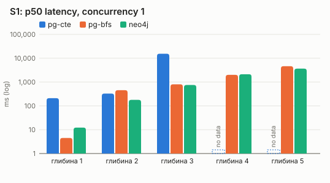
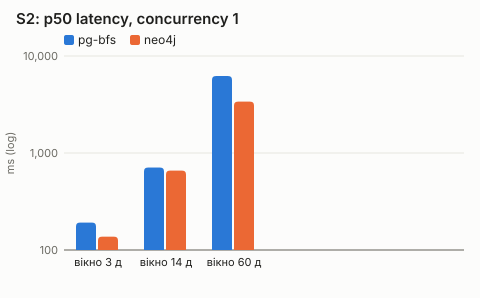

# Benchmark 2026-11-16T12-16-22-426Z (x5)

- Запуск: 2026-11-16T12:16:22.426Z → 2026-11-16T12:54:42.827Z
- Коміт: `a09d696796e6ec60c755b9b4de2996f52628956a` (є незакомічені зміни)
- Параметри: `—`, SHA-256 `44136fa355b3678a1146ad16f7e8649e94fb4fc21fe77e8310c060f61caaff8a`

<details><summary>Середовище (клієнт, ліміти контейнерів, налаштування рушіїв)</summary>

```json
{
  "client": {
    "node": "v22.23.4",
    "platform": "linux 6.18.44-fc-v470",
    "arch": "x64",
    "cpuModel": "Intel(R) Xeon(R) Processor @ 2.10GHz",
    "cpuCount": 4,
    "totalMemBytes": 16869146624
  },
  "containers": {
    "note": "docker not available; engines run without container limits"
  },
  "postgres": {
    "version": "PostgreSQL 16.15 (Ubuntu 16.15-0ubuntu0.24.04.1) on x86_64-pc-linux-gnu, compiled by gcc (Ubuntu 13.3.0-6ubuntu2~24.04.1) 13.3.0, 64-bit",
    "database": "clinic_bench_x5",
    "databaseSize": "792 MB",
    "settings": {
      "effective_cache_size": "262144 8kB",
      "jit": "off",
      "maintenance_work_mem": "65536 kB",
      "max_connections": "200",
      "max_parallel_workers_per_gather": "2",
      "random_page_cost": "1.1",
      "server_version": "16.15 (Ubuntu 16.15-0ubuntu0.24.04.1)",
      "shared_buffers": "131072 8kB",
      "statement_timeout": "30000 ms",
      "TimeZone": "Europe/Kyiv",
      "work_mem": "32768 kB"
    }
  },
  "neo4j": {
    "components": [
      {
        "name": "Neo4j Kernel",
        "versions": [
          "5.26.33"
        ],
        "edition": "community"
      }
    ],
    "settings": {
      "db.transaction.timeout": "1m",
      "dbms.cypher.planner": "DEFAULT",
      "server.cypher.parallel.worker_limit": "0",
      "server.memory.heap.initial_size": "1.00GiB",
      "server.memory.heap.max_size": "1.00GiB",
      "server.memory.pagecache.size": "1.46GiB"
    },
    "counts": {
      "nodes": 323430,
      "rels": 3109418
    }
  }
}
```

</details>

## S1 — Відстеження контактів, глибина 1–5 (вікно 14 днів)

- **Чому:** Головне питання роботи: чи дає графова модель виграш на багатокрокових обходах. Глибина — єдиний параметр, від якого вартість SQL росте як розмір фронту в степені кроку; 200 індексних пацієнтів, активних у вікні, — ті самі, що в гейті щільності, тож розмір кроків відомий (d1 p50 ≈ 50, d2 ≈ 500 на ×1). Рекурсивний CTE міряється лише до глибини 3: на глибині 3 він уже виходить за таймаут 30 с, далі були б самі таймаути.
- **Очікування:** d1 — паритет або перемога PG (один GiST-пошук); з глибиною Neo4j виграє в pg-cte на порядки (CTE не дедуплікує осіб між кроками), а відносно pg-bfs (дедуплікація фронту) — у рази або паритет; з масштабом ×5/×10 перевага Neo4j не зменшується.
- **Спростовано, якщо:** pg-bfs не повільніший за Neo4j на глибині ≥ 3 на всіх масштабах — тоді винесення в граф не виправдане для цього навантаження.
- Методика: прогрів 100 ітерацій / 10 с; вимір 500 ітерацій / 30 с (мінімум 3); 3 повтори з чергуванням рушіїв; таймаут 30 с.



### S1 · глибина 1

Параметри: `{"depth":1,"window":"14 d","indexes":200}`

| c | engine | p50, ms | p50 spread | p95, ms | p99, ms | max, ms | ops/s | n | timeouts |
|---|---|---|---|---|---|---|---|---|---|
| 1 | pg-cte | 210 | 178–218 | 276 | 280 | 285 | 4.6 | 432 | 0 |
| 1 | pg-bfs | 4.50 | 4.29–5.14 | 6.45 | 7.54 | 29.8 | 206.3 | 1500 | 0 |
| 1 | neo4j | 12.3 | 11.1–12.7 | 18.4 | 22.7 | 39.7 | 79.7 | 1500 | 0 |

p50 ratio — c=1: pg-cte / neo4j = 17.14×; c=1: pg-bfs / neo4j = 0.37×

<details><summary>План: pg-cte</summary>

```
Function Scan on fn_trace_contacts_cte  (cost=0.25..10.25 rows=1000 width=40) (actual time=203.440..203.445 rows=52 loops=1)
  Buffers: shared hit=11978
Planning Time: 0.013 ms
Execution Time: 203.461 ms
```

</details>

<details><summary>План: pg-bfs</summary>

```
Function Scan on fn_trace_contacts  (cost=0.25..10.25 rows=1000 width=40) (actual time=6.525..6.530 rows=52 loops=1)
  Buffers: shared hit=405, local hit=109 read=1 dirtied=3 written=2
Planning Time: 0.064 ms
Execution Time: 6.558 ms
```

</details>

<details><summary>План: neo4j</summary>

```
total dbHits=19154, records=52
ProduceResults@neo4j  rows=52  dbHits=0
  Projection@neo4j  rows=52  dbHits=725
    Projection@neo4j  rows=52  dbHits=0
      Unwind@neo4j  rows=52  dbHits=0
        Projection@neo4j  rows=1  dbHits=0
          Apply@neo4j  rows=1  dbHits=0
            Projection@neo4j  rows=1  dbHits=0
              NodeUniqueIndexSeek@neo4j  rows=1  dbHits=2
            EagerAggregation@neo4j  rows=1  dbHits=0
              Projection@neo4j  rows=52  dbHits=0
                EagerAggregation@neo4j  rows=52  dbHits=0
                  Sort@neo4j  rows=77  dbHits=0
                    Projection@neo4j  rows=77  dbHits=151
                      Filter@neo4j  rows=77  dbHits=0
                        Projection@neo4j  rows=302  dbHits=604
                          Filter@neo4j  rows=302  dbHits=10777
                            Expand(All)@neo4j  rows=6873  dbHits=6879
                              EagerAggregation@neo4j  rows=2  dbHits=0
                                Filter@neo4j  rows=2  dbHits=8
                                  Expand(All)@neo4j  rows=3  dbHits=8
                                    Unwind@neo4j  rows=1  dbHits=0
                                      Argument@neo4j  rows=1  dbHits=0
```

</details>

### S1 · глибина 2

Параметри: `{"depth":2,"window":"14 d","indexes":200}`

| c | engine | p50, ms | p50 spread | p95, ms | p99, ms | max, ms | ops/s | n | timeouts |
|---|---|---|---|---|---|---|---|---|---|
| 1 | pg-cte | 328 | 288–378 | 598 | 736 | 801 | 2.9 | 263 | 0 |
| 1 | pg-bfs | 455 | 444–458 | 642 | 689 | 693 | 2.1 | 187 | 0 |
| 1 | neo4j | 179 | 173–180 | 340 | 487 | 514 | 5.2 | 471 | 0 |

p50 ratio — c=1: pg-cte / neo4j = 1.83×; c=1: pg-bfs / neo4j = 2.54×

<details><summary>План: pg-cte</summary>

```
Function Scan on fn_trace_contacts_cte  (cost=0.25..10.25 rows=1000 width=40) (actual time=320.056..320.093 rows=670 loops=1)
  Buffers: shared hit=12017
Planning Time: 0.022 ms
Execution Time: 320.139 ms
```

</details>

<details><summary>План: pg-bfs</summary>

```
Function Scan on fn_trace_contacts  (cost=0.25..10.25 rows=1000 width=40) (actual time=399.122..399.169 rows=670 loops=1)
  Buffers: shared hit=13296, local hit=436577 read=675 dirtied=1278 written=2520
Planning Time: 0.044 ms
Execution Time: 399.218 ms
```

</details>

<details><summary>План: neo4j</summary>

```
total dbHits=307788, records=670
ProduceResults@neo4j  rows=670  dbHits=0
  Projection@neo4j  rows=670  dbHits=9350
    Projection@neo4j  rows=670  dbHits=0
      Unwind@neo4j  rows=670  dbHits=0
        Projection@neo4j  rows=1  dbHits=0
          Apply@neo4j  rows=1  dbHits=0
            Projection@neo4j  rows=1  dbHits=0
              Apply@neo4j  rows=1  dbHits=0
                Projection@neo4j  rows=1  dbHits=0
                  NodeUniqueIndexSeek@neo4j  rows=1  dbHits=2
                EagerAggregation@neo4j  rows=1  dbHits=0
                  Projection@neo4j  rows=52  dbHits=0
                    EagerAggregation@neo4j  rows=52  dbHits=0
                      Sort@neo4j  rows=77  dbHits=0
                        Projection@neo4j  rows=77  dbHits=151
                          Filter@neo4j  rows=77  dbHits=0
                            Projection@neo4j  rows=302  dbHits=604
                              Filter@neo4j  rows=302  dbHits=10742
                                Expand(All)@neo4j  rows=6873  dbHits=6879
                                  EagerAggregation@neo4j  rows=2  dbHits=0
                                    Filter@neo4j  rows=2  dbHits=8
                                      Expand(All)@neo4j  rows=3  dbHits=8
                                        Unwind@neo4j  rows=1  dbHits=0
                                          Argument@neo4j  rows=1  dbHits=0
            EagerAggregation@neo4j  rows=1  dbHits=0
              Projection@neo4j  rows=618  dbHits=0
                EagerAggregation@neo4j  rows=618  dbHits=0
                  Sort@neo4j  rows=724  dbHits=0
                    Projection@neo4j  rows=724  dbHits=1421
                      Filter@neo4j  rows=724  dbHits=0
                        Projection@neo4j  rows=2765  dbHits=64854
                          Filter@neo4j  rows=2765  dbHits=103640
                            Expand(All)@neo4j  rows=78540  dbHits=78593
                              EagerAggregation@neo4j  rows=19  dbHits=0
                                Filter@neo4j  rows=525  dbHits=19036
                                  Expand(All)@neo4j  rows=12207  dbHits=12500
                                    Unwind@neo4j  rows=52  dbHits=0
                                      Argument@neo4j  rows=1  dbHits=0
```

</details>

### S1 · глибина 3

Параметри: `{"depth":3,"window":"14 d","indexes":200}`

| c | engine | p50, ms | p50 spread | p95, ms | p99, ms | max, ms | ops/s | n | timeouts |
|---|---|---|---|---|---|---|---|---|---|
| 1 | pg-cte | 15410 | 15129–19023 | 16287 | 16287 | 19991 | 0.1 | 9 | 0 |
| 1 | pg-bfs | 802 | 771–822 | 1147 | 1176 | 1284 | 1.2 | 112 | 0 |
| 1 | neo4j | 751 | 658–766 | 1125 | 1285 | 1328 | 1.3 | 124 | 0 |

p50 ratio — c=1: pg-cte / neo4j = 20.52×; c=1: pg-bfs / neo4j = 1.07×

<details><summary>План: pg-cte</summary>

```
Function Scan on fn_trace_contacts_cte  (cost=0.25..10.25 rows=1000 width=40) (actual time=13020.982..13021.164 rows=3468 loops=1)
  Buffers: shared hit=13558, temp read=82621 written=165605
Planning Time: 0.019 ms
Execution Time: 13021.332 ms
```

</details>

<details><summary>План: pg-bfs</summary>

```
Function Scan on fn_trace_contacts  (cost=0.25..10.25 rows=1000 width=40) (actual time=625.182..625.472 rows=3468 loops=1)
  Buffers: shared hit=13289, local hit=677970 read=767 dirtied=1321 written=2564
Planning Time: 0.031 ms
Execution Time: 625.657 ms
```

</details>

<details><summary>План: neo4j</summary>

```
total dbHits=1807939, records=3468
ProduceResults@neo4j  rows=3468  dbHits=0
  Projection@neo4j  rows=3468  dbHits=48221
    Projection@neo4j  rows=3468  dbHits=0
      Unwind@neo4j  rows=3468  dbHits=0
        Projection@neo4j  rows=1  dbHits=0
          Apply@neo4j  rows=1  dbHits=0
            Projection@neo4j  rows=1  dbHits=0
              Apply@neo4j  rows=1  dbHits=0
                Projection@neo4j  rows=1  dbHits=0
                  Apply@neo4j  rows=1  dbHits=0
                    Projection@neo4j  rows=1  dbHits=0
                      NodeUniqueIndexSeek@neo4j  rows=1  dbHits=2
                    EagerAggregation@neo4j  rows=1  dbHits=0
                      Projection@neo4j  rows=52  dbHits=0
                        EagerAggregation@neo4j  rows=52  dbHits=0
                          Sort@neo4j  rows=77  dbHits=0
                            Projection@neo4j  rows=77  dbHits=151
                              Filter@neo4j  rows=77  dbHits=0
                                Projection@neo4j  rows=302  dbHits=604
                                  Filter@neo4j  rows=302  dbHits=10777
                                    Expand(All)@neo4j  rows=6873  dbHits=6879
                                      EagerAggregation@neo4j  rows=2  dbHits=0
                                        Filter@neo4j  rows=2  dbHits=8
                                          Expand(All)@neo4j  rows=3  dbHits=8
                                            Unwind@neo4j  rows=1  dbHits=0
                                              Argument@neo4j  rows=1  dbHits=0
                EagerAggregation@neo4j  rows=1  dbHits=0
                  Projection@neo4j  rows=618  dbHits=0
                    EagerAggregation@neo4j  rows=618  dbHits=0
                      Sort@neo4j  rows=724  dbHits=0
                        Projection@neo4j  rows=724  dbHits=1421
                          Filter@neo4j  rows=724  dbHits=0
                            Projection@neo4j  rows=2765  dbHits=64854
                              Filter@neo4j  rows=2765  dbHits=103640
                                Expand(All)@neo4j  rows=78540  dbHits=78593
                                  EagerAggregation@neo4j  rows=19  dbHits=0
                                    Filter@neo4j  rows=525  dbHits=19036
                                      Expand(All)@neo4j  rows=12207  dbHits=12500
                                        Unwind@neo4j  rows=52  dbHits=0
                                          Argument@neo4j  rows=1  dbHits=0
            EagerAggregation@neo4j  rows=1  dbHits=0
              Projection@neo4j  rows=2798  dbHits=0
                EagerAggregation@neo4j  rows=2798  dbHits=0
                  Sort@neo4j  rows=4494  dbHits=0
                    Projection@neo4j  rows=4494  dbHits=8685
                      Filter@neo4j  rows=4494  dbHits=0
                        Projection@neo4j  rows=11045  dbHits=451849
                          Filter@neo4j  rows=11045  dbHits=455905
                            Expand(All)@neo4j  rows=370620  dbHits=370990
                              EagerAggregation@neo4j  rows=140  dbHits=0
                                Filter@neo4j  rows=3368  dbHits=103986
                                  Expand(All)@neo4j  rows=66178  dbHits=69830
                                    Unwind@neo4j  rows=618  dbHits=0
                                      Argument@neo4j  rows=1  dbHits=0
```

</details>

### S1 · глибина 4

Параметри: `{"depth":4,"window":"14 d","indexes":200}`

| c | engine | p50, ms | p50 spread | p95, ms | p99, ms | max, ms | ops/s | n | timeouts |
|---|---|---|---|---|---|---|---|---|---|
| 1 | pg-bfs | 2003 | 1954–2170 | 2510 | 2510 | 2604 | 0.5 | 47 | 0 |
| 1 | neo4j | 2123 | 2109–2150 | 2607 | 2607 | 2634 | 0.5 | 47 | 0 |

p50 ratio — c=1: pg-bfs / neo4j = 0.94×

<details><summary>План: pg-bfs</summary>

```
Function Scan on fn_trace_contacts  (cost=0.25..10.25 rows=1000 width=40) (actual time=1967.273..1968.035 rows=12722 loops=1)
  Buffers: shared hit=17312 dirtied=36 written=1, local hit=1513725 read=1400 dirtied=1476 written=2637
Planning Time: 0.061 ms
Execution Time: 1969.094 ms
```

</details>

<details><summary>План: neo4j</summary>

```
total dbHits=6700945, records=12722
ProduceResults@neo4j  rows=12722  dbHits=0
  Projection@neo4j  rows=12722  dbHits=177303
    Projection@neo4j  rows=12722  dbHits=0
      Unwind@neo4j  rows=12722  dbHits=0
        Projection@neo4j  rows=1  dbHits=0
          Apply@neo4j  rows=1  dbHits=0
            Projection@neo4j  rows=1  dbHits=0
              Apply@neo4j  rows=1  dbHits=0
                Projection@neo4j  rows=1  dbHits=0
                  Apply@neo4j  rows=1  dbHits=0
                    Projection@neo4j  rows=1  dbHits=0
                      Apply@neo4j  rows=1  dbHits=0
                        Projection@neo4j  rows=1  dbHits=0
                          NodeUniqueIndexSeek@neo4j  rows=1  dbHits=2
                        EagerAggregation@neo4j  rows=1  dbHits=0
                          Projection@neo4j  rows=52  dbHits=0
                            EagerAggregation@neo4j  rows=52  dbHits=0
                              Sort@neo4j  rows=77  dbHits=0
                                Projection@neo4j  rows=77  dbHits=151
                                  Filter@neo4j  rows=77  dbHits=0
                                    Projection@neo4j  rows=302  dbHits=604
                                      Filter@neo4j  rows=302  dbHits=10777
                                        Expand(All)@neo4j  rows=6873  dbHits=6879
                                          EagerAggregation@neo4j  rows=2  dbHits=0
                                            Filter@neo4j  rows=2  dbHits=7
                                              Expand(All)@neo4j  rows=3  dbHits=8
                                                Unwind@neo4j  rows=1  dbHits=0
                                                  Argument@neo4j  rows=1  dbHits=0
                    EagerAggregation@neo4j  rows=1  dbHits=0
                      Projection@neo4j  rows=618  dbHits=0
                        EagerAggregation@neo4j  rows=618  dbHits=0
                          Sort@neo4j  rows=724  dbHits=0
                            Projection@neo4j  rows=724  dbHits=1421
                              Filter@neo4j  rows=724  dbHits=0
                                Projection@neo4j  rows=2765  dbHits=64854
                                  Filter@neo4j  rows=2765  dbHits=104095
                                    Expand(All)@neo4j  rows=78540  dbHits=78593
                                      EagerAggregation@neo4j  rows=19  dbHits=0
                                        Filter@neo4j  rows=525  dbHits=19160
                                          Expand(All)@neo4j  rows=12207  dbHits=12500
                                            Unwind@neo4j  rows=52  dbHits=0
                                              Argument@neo4j  rows=1  dbHits=0
                EagerAggregation@neo4j  rows=1  dbHits=0
                  Projection@neo4j  rows=2798  dbHits=0
                    EagerAggregation@neo4j  rows=2798  dbHits=0
                      Sort@neo4j  rows=4494  dbHits=0
                        Projection@neo4j  rows=4494  dbHits=8685
                          Filter@neo4j  rows=4494  dbHits=0
                            Projection@neo4j  rows=11045  dbHits=451849
                              Filter@neo4j  rows=11045  dbHits=455963
                                Expand(All)@neo4j  rows=370620  dbHits=370990
                                  EagerAggregation@neo4j  rows=140  dbHits=0
                                    Filter@neo4j  rows=3368  dbHits=104652
                                      Expand(All)@neo4j  rows=66178  dbHits=69830
                                        Unwind@neo4j  rows=618  dbHits=0
                                          Argument@neo4j  rows=1  dbHits=0
            EagerAggregation@neo4j  rows=1  dbHits=0
              Projection@neo4j  rows=9254  dbHits=0
                EagerAggregation@neo4j  rows=9254  dbHits=0
                  Sort@neo4j  rows=13925  dbHits=0
                    Projection@neo4j  rows=13925  dbHits=27374
                      Filter@neo4j  rows=13925  dbHits=0
                        Projection@neo4j  rows=38653  dbHits=1110330
                          Filter@neo4j  rows=38653  dbHits=1623220
                            Expand(All)@neo4j  rows=1355632  dbHits=1356738
                              EagerAggregation@neo4j  rows=431  dbHits=0
                                Filter@neo4j  rows=12637  dbHits=384863
                                  Expand(All)@neo4j  rows=244633  dbHits=260097
                                    Unwind@neo4j  rows=2798  dbHits=0
                                      Argument@neo4j  rows=1  dbHits=0
```

</details>

### S1 · глибина 5

Параметри: `{"depth":5,"window":"14 d","indexes":200}`

| c | engine | p50, ms | p50 spread | p95, ms | p99, ms | max, ms | ops/s | n | timeouts |
|---|---|---|---|---|---|---|---|---|---|
| 1 | pg-bfs | 4620 | 4549–4638 | 4861 | 4861 | 5146 | 0.2 | 21 | 0 |
| 1 | neo4j | 3653 | 3615–3714 | 4142 | 4142 | 4435 | 0.3 | 26 | 0 |

p50 ratio — c=1: pg-bfs / neo4j = 1.26×

<details><summary>План: pg-bfs</summary>

```
Function Scan on fn_trace_contacts  (cost=0.25..10.25 rows=1000 width=40) (actual time=4237.248..4238.964 rows=28882 loops=1)
  Buffers: shared hit=17346 dirtied=45 written=2, local hit=4277101 read=3029 dirtied=1789 written=3148
Planning Time: 0.070 ms
Execution Time: 4240.913 ms
```

</details>

<details><summary>План: neo4j</summary>

```
total dbHits=14708417, records=28882
ProduceResults@neo4j  rows=28882  dbHits=0
  Projection@neo4j  rows=28882  dbHits=402624
    Projection@neo4j  rows=28882  dbHits=0
      Unwind@neo4j  rows=28882  dbHits=0
        Projection@neo4j  rows=1  dbHits=0
          Apply@neo4j  rows=1  dbHits=0
            Projection@neo4j  rows=1  dbHits=0
              Apply@neo4j  rows=1  dbHits=0
                Projection@neo4j  rows=1  dbHits=0
                  Apply@neo4j  rows=1  dbHits=0
                    Projection@neo4j  rows=1  dbHits=0
                      Apply@neo4j  rows=1  dbHits=0
                        Projection@neo4j  rows=1  dbHits=0
                          Apply@neo4j  rows=1  dbHits=0
                            Projection@neo4j  rows=1  dbHits=0
                              NodeUniqueIndexSeek@neo4j  rows=1  dbHits=2
                            EagerAggregation@neo4j  rows=1  dbHits=0
                              Projection@neo4j  rows=52  dbHits=0
                                EagerAggregation@neo4j  rows=52  dbHits=0
                                  Sort@neo4j  rows=77  dbHits=0
                                    Projection@neo4j  rows=77  dbHits=151
                                      Filter@neo4j  rows=77  dbHits=0
                                        Projection@neo4j  rows=302  dbHits=604
                                          Filter@neo4j  rows=302  dbHits=10777
                                            Expand(All)@neo4j  rows=6873  dbHits=6879
                                              EagerAggregation@neo4j  rows=2  dbHits=0
                                                Filter@neo4j  rows=2  dbHits=7
                                                  Expand(All)@neo4j  rows=3  dbHits=8
                                                    Unwind@neo4j  rows=1  dbHits=0
                                                      Argument@neo4j  rows=1  dbHits=0
                        EagerAggregation@neo4j  rows=1  dbHits=0
                          Projection@neo4j  rows=618  dbHits=0
                            EagerAggregation@neo4j  rows=618  dbHits=0
                              Sort@neo4j  rows=724  dbHits=0
                                Projection@neo4j  rows=724  dbHits=1421
                                  Filter@neo4j  rows=724  dbHits=0
                                    Projection@neo4j  rows=2765  dbHits=64854
                                      Filter@neo4j  rows=2765  dbHits=104095
                                        Expand(All)@neo4j  rows=78540  dbHits=78593
                                          EagerAggregation@neo4j  rows=19  dbHits=0
                                            Filter@neo4j  rows=525  dbHits=19160
                                              Expand(All)@neo4j  rows=12207  dbHits=12500
                                                Unwind@neo4j  rows=52  dbHits=0
                                                  Argument@neo4j  rows=1  dbHits=0
                    EagerAggregation@neo4j  rows=1  dbHits=0
                      Projection@neo4j  rows=2798  dbHits=0
                        EagerAggregation@neo4j  rows=2798  dbHits=0
                          Sort@neo4j  rows=4494  dbHits=0
                            Projection@neo4j  rows=4494  dbHits=8685
                              Filter@neo4j  rows=4494  dbHits=0
                                Projection@neo4j  rows=11045  dbHits=451849
                                  Filter@neo4j  rows=11045  dbHits=455905
                                    Expand(All)@neo4j  rows=370620  dbHits=370990
                                      EagerAggregation@neo4j  rows=140  dbHits=0
                                        Filter@neo4j  rows=3368  dbHits=103986
                                          Expand(All)@neo4j  rows=66178  dbHits=69830
                                            Unwind@neo4j  rows=618  dbHits=0
                                              Argument@neo4j  rows=1  dbHits=0
                EagerAggregation@neo4j  rows=1  dbHits=0
                  Projection@neo4j  rows=9254  dbHits=0
                    EagerAggregation@neo4j  rows=9254  dbHits=0
                      Sort@neo4j  rows=13925  dbHits=0
                        Projection@neo4j  rows=13925  dbHits=27374
                          Filter@neo4j  rows=13925  dbHits=0
                            Projection@neo4j  rows=38653  dbHits=1110330
                              Filter@neo4j  rows=38653  dbHits=1623702
                                Expand(All)@neo4j  rows=1355632  dbHits=1356738
                                  EagerAggregation@neo4j  rows=431  dbHits=0
                                    Filter@neo4j  rows=12637  dbHits=384863
                                      Expand(All)@neo4j  rows=244633  dbHits=260097
                                        Unwind@neo4j  rows=2798  dbHits=0
                                          Argument@neo4j  rows=1  dbHits=0
            EagerAggregation@neo4j  rows=1  dbHits=0
              Projection@neo4j  rows=16160  dbHits=0
                EagerAggregation@neo4j  rows=16160  dbHits=0
                  Sort@neo4j  rows=20828  dbHits=0
                    Projection@neo4j  rows=20828  dbHits=40731
                      Filter@neo4j  rows=20828  dbHits=0
                        Projection@neo4j  rows=25159  dbHits=2680133
                          Filter@neo4j  rows=25159  dbHits=1376904
                            Expand(All)@neo4j  rows=1815946  dbHits=1818011
                              EagerAggregation@neo4j  rows=779  dbHits=0
                                Filter@neo4j  rows=37975  dbHits=1111504
                                  Expand(All)@neo4j  rows=703202  dbHits=755110
                                    Unwind@neo4j  rows=9254  dbHits=0
                                      Argument@neo4j  rows=1  dbHits=0
```

</details>

## S2 — Відстеження контактів глибини 3: вікно 3 / 14 / 60 днів

- **Чому:** Вікно — другий множник вартості: кількість присутностей, що перетинають вікно, росте лінійно з його довжиною, а розмір кроку — надлінійно. Особи однакові для всіх вікон (активні в 3-денному ⊂ 14 ⊂ 60), тож різниця — лише від вікна. PG фільтрує вікно GiST-індексом, Neo4j — після розгортання ребер (індексу на час у ребрі обходу не використати).
- **Очікування:** Обидва рушії сповільнюються з вікном; відносна перевага Neo4j зменшується на 60 днях, бо зростає частка ребер, що відкидаються фільтром часу після обходу.
- **Спростовано, якщо:** Час Neo4j не залежить від вікна (тоді вартість визначає не фільтр, а щось інше) або PG сповільнюється сильніше за Neo4j.
- Методика: прогрів 100 ітерацій / 10 с; вимір 500 ітерацій / 30 с (мінімум 3); 3 повтори з чергуванням рушіїв; таймаут 30 с.



### S2 · вікно 3 д

Параметри: `{"depth":3,"window":{"from":"2026-04-30T21:00:00.000Z","to":"2026-05-03T21:00:00.000Z"}}`

| c | engine | p50, ms | p50 spread | p95, ms | p99, ms | max, ms | ops/s | n | timeouts |
|---|---|---|---|---|---|---|---|---|---|
| 1 | pg-bfs | 192 | 190–195 | 330 | 394 | 480 | 4.8 | 429 | 0 |
| 1 | neo4j | 137 | 136–140 | 206 | 234 | 298 | 6.9 | 630 | 0 |

p50 ratio — c=1: pg-bfs / neo4j = 1.40×

<details><summary>План: pg-bfs</summary>

```
Function Scan on fn_trace_contacts  (cost=0.25..10.25 rows=1000 width=40) (actual time=254.288..254.297 rows=138 loops=1)
  Buffers: shared hit=15117 dirtied=2, local hit=83179 read=3 dirtied=252 written=253
Planning Time: 0.058 ms
Execution Time: 254.918 ms
```

</details>

<details><summary>План: neo4j</summary>

```
total dbHits=176106, records=138
ProduceResults@neo4j  rows=138  dbHits=0
  Projection@neo4j  rows=138  dbHits=1915
    Projection@neo4j  rows=138  dbHits=0
      Unwind@neo4j  rows=138  dbHits=0
        Projection@neo4j  rows=1  dbHits=0
          Apply@neo4j  rows=1  dbHits=0
            Projection@neo4j  rows=1  dbHits=0
              Apply@neo4j  rows=1  dbHits=0
                Projection@neo4j  rows=1  dbHits=0
                  Apply@neo4j  rows=1  dbHits=0
                    Projection@neo4j  rows=1  dbHits=0
                      NodeUniqueIndexSeek@neo4j  rows=1  dbHits=2
                    EagerAggregation@neo4j  rows=1  dbHits=0
                      Projection@neo4j  rows=39  dbHits=0
                        EagerAggregation@neo4j  rows=39  dbHits=0
                          Sort@neo4j  rows=50  dbHits=0
                            Projection@neo4j  rows=50  dbHits=97
                              Filter@neo4j  rows=50  dbHits=0
                                Projection@neo4j  rows=76  dbHits=126
                                  Filter@neo4j  rows=76  dbHits=10935
                                    Expand(All)@neo4j  rows=7189  dbHits=7195
                                      EagerAggregation@neo4j  rows=2  dbHits=0
                                        Filter@neo4j  rows=2  dbHits=8
                                          Expand(All)@neo4j  rows=4  dbHits=8
                                            Unwind@neo4j  rows=1  dbHits=0
                                              Argument@neo4j  rows=1  dbHits=0
                EagerAggregation@neo4j  rows=1  dbHits=0
                  Projection@neo4j  rows=46  dbHits=0
                    EagerAggregation@neo4j  rows=46  dbHits=0
                      Sort@neo4j  rows=54  dbHits=0
                        Projection@neo4j  rows=54  dbHits=103
                          Filter@neo4j  rows=54  dbHits=0
                            Projection@neo4j  rows=105  dbHits=1448
                              Filter@neo4j  rows=105  dbHits=20805
                                Expand(All)@neo4j  rows=19443  dbHits=19469
                                  EagerAggregation@neo4j  rows=9  dbHits=0
                                    Filter@neo4j  rows=94  dbHits=8801
                                      Expand(All)@neo4j  rows=5772  dbHits=5960
                                        Unwind@neo4j  rows=39  dbHits=0
                                          Argument@neo4j  rows=1  dbHits=0
            EagerAggregation@neo4j  rows=1  dbHits=0
              Projection@neo4j  rows=53  dbHits=0
                EagerAggregation@neo4j  rows=53  dbHits=0
                  Sort@neo4j  rows=80  dbHits=0
                    Projection@neo4j  rows=80  dbHits=151
                      Filter@neo4j  rows=80  dbHits=0
                        Projection@neo4j  rows=102  dbHits=2931
                          Filter@neo4j  rows=102  dbHits=34050
                            Expand(All)@neo4j  rows=37525  dbHits=37571
                              EagerAggregation@neo4j  rows=17  dbHits=0
                                Filter@neo4j  rows=109  dbHits=14654
                                  Expand(All)@neo4j  rows=9647  dbHits=9877
                                    Unwind@neo4j  rows=46  dbHits=0
                                      Argument@neo4j  rows=1  dbHits=0
```

</details>

### S2 · вікно 14 д

Параметри: `{"depth":3,"window":{"from":"2026-04-30T21:00:00.000Z","to":"2026-05-14T21:00:00.000Z"}}`

| c | engine | p50, ms | p50 spread | p95, ms | p99, ms | max, ms | ops/s | n | timeouts |
|---|---|---|---|---|---|---|---|---|---|
| 1 | pg-bfs | 708 | 695–724 | 991 | 1143 | 1179 | 1.4 | 128 | 0 |
| 1 | neo4j | 659 | 619–662 | 1021 | 1223 | 1270 | 1.6 | 146 | 0 |

p50 ratio — c=1: pg-bfs / neo4j = 1.08×

<details><summary>План: pg-bfs</summary>

```
Function Scan on fn_trace_contacts  (cost=0.25..10.25 rows=1000 width=40) (actual time=853.471..853.805 rows=5159 loops=1)
  Buffers: shared hit=17418 dirtied=5 written=1, local hit=747460 read=841 dirtied=1357 written=2330
Planning Time: 0.073 ms
Execution Time: 854.805 ms
```

</details>

<details><summary>План: neo4j</summary>

```
total dbHits=2515798, records=5159
ProduceResults@neo4j  rows=5159  dbHits=0
  Projection@neo4j  rows=5159  dbHits=71823
    Projection@neo4j  rows=5159  dbHits=0
      Unwind@neo4j  rows=5159  dbHits=0
        Projection@neo4j  rows=1  dbHits=0
          Apply@neo4j  rows=1  dbHits=0
            Projection@neo4j  rows=1  dbHits=0
              Apply@neo4j  rows=1  dbHits=0
                Projection@neo4j  rows=1  dbHits=0
                  Apply@neo4j  rows=1  dbHits=0
                    Projection@neo4j  rows=1  dbHits=0
                      NodeUniqueIndexSeek@neo4j  rows=1  dbHits=2
                    EagerAggregation@neo4j  rows=1  dbHits=0
                      Projection@neo4j  rows=76  dbHits=0
                        EagerAggregation@neo4j  rows=76  dbHits=0
                          Sort@neo4j  rows=190  dbHits=0
                            Projection@neo4j  rows=190  dbHits=374
                              Filter@neo4j  rows=190  dbHits=0
                                Projection@neo4j  rows=290  dbHits=554
                                  Filter@neo4j  rows=290  dbHits=11276
                                    Expand(All)@neo4j  rows=7189  dbHits=7195
                                      EagerAggregation@neo4j  rows=2  dbHits=0
                                        Filter@neo4j  rows=2  dbHits=8
                                          Expand(All)@neo4j  rows=4  dbHits=8
                                            Unwind@neo4j  rows=1  dbHits=0
                                              Argument@neo4j  rows=1  dbHits=0
                EagerAggregation@neo4j  rows=1  dbHits=0
                  Projection@neo4j  rows=761  dbHits=0
                    EagerAggregation@neo4j  rows=761  dbHits=0
                      Sort@neo4j  rows=913  dbHits=0
                        Projection@neo4j  rows=913  dbHits=1809
                          Filter@neo4j  rows=913  dbHits=0
                            Projection@neo4j  rows=4306  dbHits=66209
                              Filter@neo4j  rows=4306  dbHits=168659
                                Expand(All)@neo4j  rows=122571  dbHits=122643
                                  EagerAggregation@neo4j  rows=27  dbHits=0
                                    Filter@neo4j  rows=685  dbHits=23642
                                      Expand(All)@neo4j  rows=15117  dbHits=15483
                                        Unwind@neo4j  rows=76  dbHits=0
                                          Argument@neo4j  rows=1  dbHits=0
            EagerAggregation@neo4j  rows=1  dbHits=0
              Projection@neo4j  rows=4322  dbHits=0
                EagerAggregation@neo4j  rows=4322  dbHits=0
                  Sort@neo4j  rows=7140  dbHits=0
                    Projection@neo4j  rows=7140  dbHits=13898
                      Filter@neo4j  rows=7140  dbHits=0
                        Projection@neo4j  rows=15499  dbHits=611096
                          Filter@neo4j  rows=15499  dbHits=637592
                            Expand(All)@neo4j  rows=516748  dbHits=517244
                              EagerAggregation@neo4j  rows=187  dbHits=0
                                Filter@neo4j  rows=4654  dbHits=147947
                                  Expand(All)@neo4j  rows=93965  dbHits=98336
                                    Unwind@neo4j  rows=761  dbHits=0
                                      Argument@neo4j  rows=1  dbHits=0
```

</details>

### S2 · вікно 60 д

Параметри: `{"depth":3,"window":{"from":"2026-04-30T21:00:00.000Z","to":"2026-06-29T21:00:00.000Z"}}`

| c | engine | p50, ms | p50 spread | p95, ms | p99, ms | max, ms | ops/s | n | timeouts |
|---|---|---|---|---|---|---|---|---|---|
| 1 | pg-bfs | 6216 | 6170–6700 | 11849 | 11849 | 12538 | 0.1 | 15 | 0 |
| 1 | neo4j | 3385 | 3332–3698 | 8028 | 8028 | 8376 | 0.2 | 21 | 0 |

p50 ratio — c=1: pg-bfs / neo4j = 1.84×

<details><summary>План: pg-bfs</summary>

```
Function Scan on fn_trace_contacts  (cost=0.25..10.25 rows=1000 width=40) (actual time=11506.688..11509.508 rows=42625 loops=1)
  Buffers: shared hit=61952 dirtied=4, local hit=3470386 read=14308 dirtied=6411 written=11466, temp read=2914 written=2915
Planning Time: 0.064 ms
Execution Time: 11512.080 ms
```

</details>

<details><summary>План: neo4j</summary>

```
total dbHits=33788901, records=42625
ProduceResults@neo4j  rows=42625  dbHits=0
  Projection@neo4j  rows=42625  dbHits=593833
    Projection@neo4j  rows=42625  dbHits=0
      Unwind@neo4j  rows=42625  dbHits=0
        Projection@neo4j  rows=1  dbHits=0
          Apply@neo4j  rows=1  dbHits=0
            Projection@neo4j  rows=1  dbHits=0
              Apply@neo4j  rows=1  dbHits=0
                Projection@neo4j  rows=1  dbHits=0
                  Apply@neo4j  rows=1  dbHits=0
                    Projection@neo4j  rows=1  dbHits=0
                      NodeUniqueIndexSeek@neo4j  rows=1  dbHits=2
                    EagerAggregation@neo4j  rows=1  dbHits=0
                      Projection@neo4j  rows=76  dbHits=0
                        EagerAggregation@neo4j  rows=76  dbHits=0
                          Sort@neo4j  rows=190  dbHits=0
                            Projection@neo4j  rows=190  dbHits=374
                              Filter@neo4j  rows=190  dbHits=0
                                Projection@neo4j  rows=1175  dbHits=2324
                                  Filter@neo4j  rows=1175  dbHits=12356
                                    Expand(All)@neo4j  rows=7189  dbHits=7195
                                      EagerAggregation@neo4j  rows=2  dbHits=0
                                        Filter@neo4j  rows=2  dbHits=8
                                          Expand(All)@neo4j  rows=4  dbHits=8
                                            Unwind@neo4j  rows=1  dbHits=0
                                              Argument@neo4j  rows=1  dbHits=0
                EagerAggregation@neo4j  rows=1  dbHits=0
                  Projection@neo4j  rows=3242  dbHits=0
                    EagerAggregation@neo4j  rows=3242  dbHits=0
                      Sort@neo4j  rows=4673  dbHits=0
                        Projection@neo4j  rows=4673  dbHits=9283
                          Filter@neo4j  rows=4673  dbHits=0
                            Projection@neo4j  rows=37508  dbHits=1294585
                              Filter@neo4j  rows=37508  dbHits=383434
                                Expand(All)@neo4j  rows=241788  dbHits=241942
                                  EagerAggregation@neo4j  rows=57  dbHits=0
                                    Filter@neo4j  rows=2570  dbHits=25687
                                      Expand(All)@neo4j  rows=15117  dbHits=15483
                                        Unwind@neo4j  rows=76  dbHits=0
                                          Argument@neo4j  rows=1  dbHits=0
            EagerAggregation@neo4j  rows=1  dbHits=0
              Projection@neo4j  rows=39307  dbHits=0
                EagerAggregation@neo4j  rows=39307  dbHits=0
                  Sort@neo4j  rows=67496  dbHits=0
                    Projection@neo4j  rows=67496  dbHits=132080
                      Filter@neo4j  rows=67496  dbHits=0
                        Projection@neo4j  rows=213100  dbHits=26316521
                          Filter@neo4j  rows=213100  dbHits=2297439
                            Expand(All)@neo4j  rows=1630336  dbHits=1631899
                              EagerAggregation@neo4j  rows=597  dbHits=0
                                Filter@neo4j  rows=51361  dbHits=514377
                                  Expand(All)@neo4j  rows=290912  dbHits=310071
                                    Unwind@neo4j  rows=3242  dbHits=0
                                      Argument@neo4j  rows=1  dbHits=0
```

</details>

